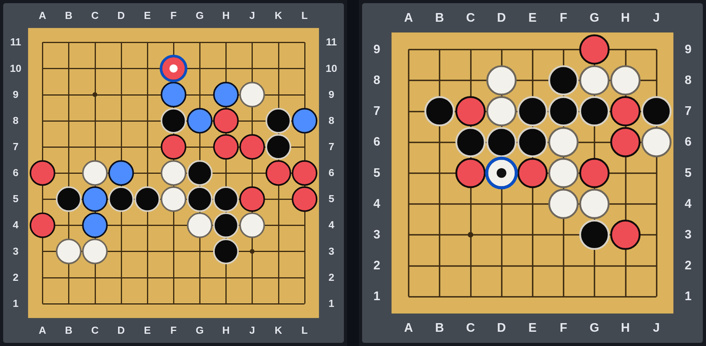
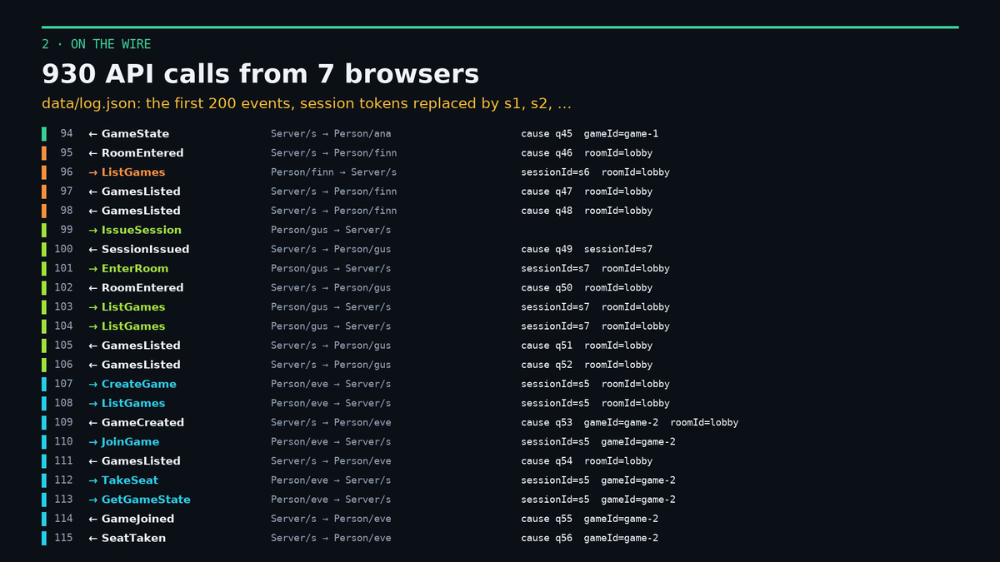
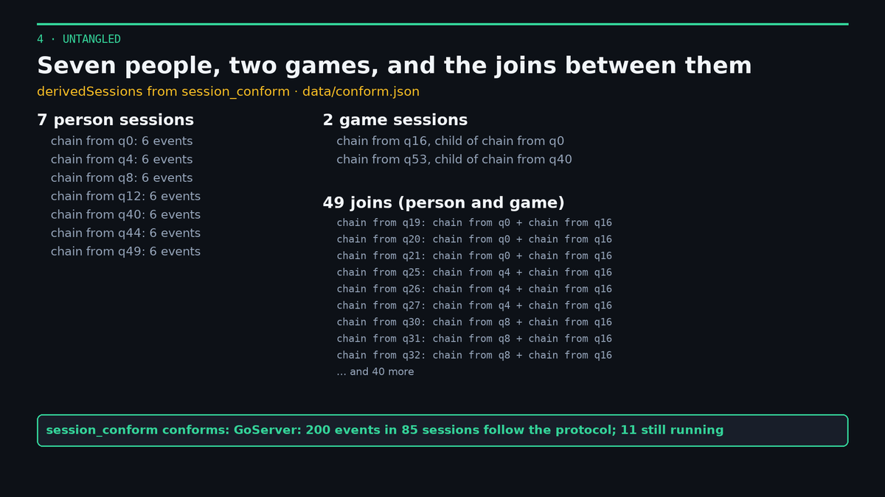
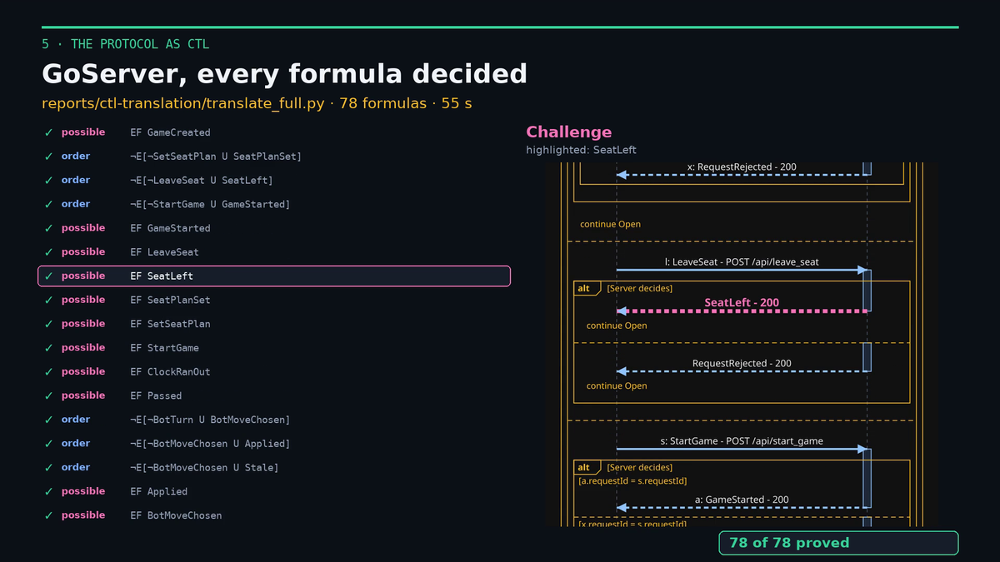
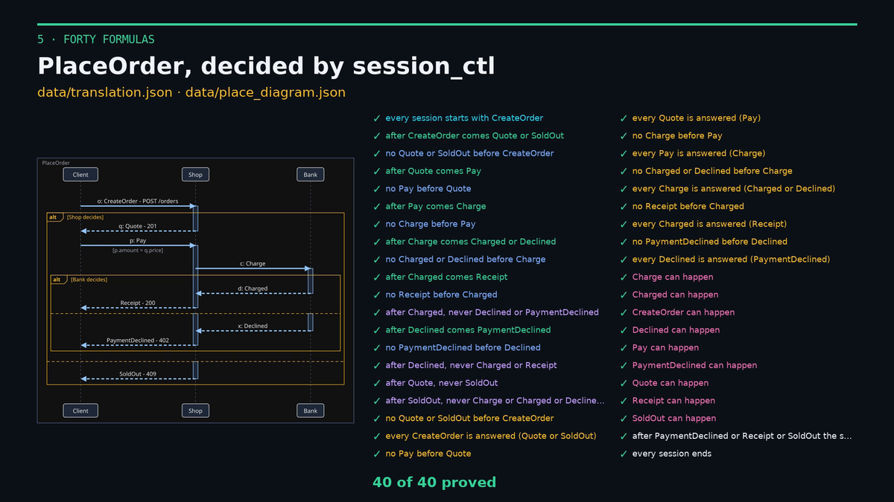
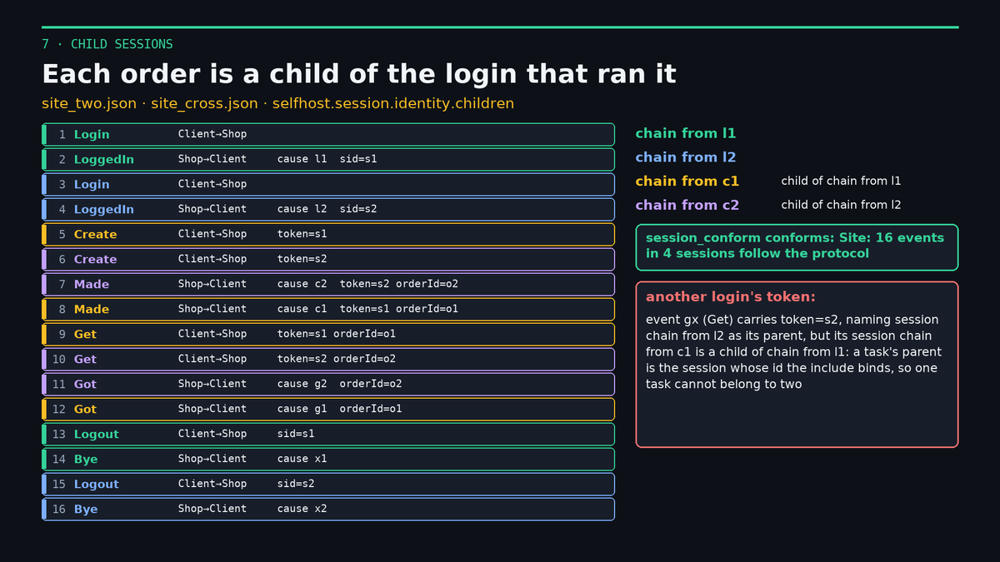
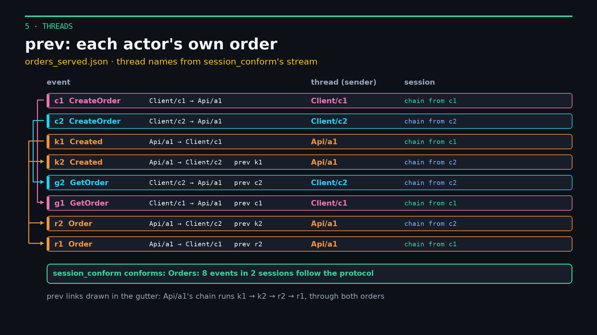

[](https://github.com/rfielding/leanFM/actions/workflows/lean_action_ci.yml)

# LeanFM

**A programming language whose programs are protocols.**

[Read the book (PDF)](book/main.pdf) · [Dark PDF](book/main-dark.pdf) ·
[Videos](#watch-it-work) · [Use it from Claude Desktop](#leanfm-in-claude-desktop)

A protocol names the roles in a conversation, the messages between them and their order, who
decides at each choice, what is assumed about decisions nobody else can see, and what the system
promises. Everything else in a LeanFM project is generated from the protocol or checked against
it: the diagrams people read, the requirements and implementation mapping reviewed in git, the
interfaces, the code each role is written on, and the verdicts on what the running system logs.

Most LeanFM is written by an LLM. You say in ordinary words what the software must do; the model
writes the protocol; LeanFM checks it and shows what it means, as diagrams, obligations, witnesses
and counterexamples. You push back, the protocol changes, the pictures change with it, and only
then is code written. The model learns the language from LeanFM itself: its server speaks the
Model Context Protocol and hands any agent that connects the language reference and the tools.



*Two games of N-player Go running on one server: four people on an 11×11 board, three on a
9×9, each a real browser. LeanFM reads the traffic they make, untangles it into sessions using
nothing but the protocol, and proves what the protocol promises
([video](video/goserver/leanfm-goserver-live.mp4)).*

---

## LeanFM in Claude Desktop

LeanFM's MCP server runs as a child process of Claude Desktop, over standard input and output. It
needs no API key, no port and no account: none of its tools calls a model, and Claude's own turns
belong to your Claude subscription. Every tool is read-only: none changes a file, and none runs
submitted text as code (protocol text is read by a parser for its grammar alone).

### Set it up

```sh
git clone https://github.com/rfielding/leanFM.git && cd leanFM
lake build leanfm-mcp                       # needs elan (https://github.com/leanprover/elan)
python3 scripts/claude_desktop_config.py --root "$PWD" --install
```

Then quit and reopen Claude Desktop. The script adds one `leanfm` entry to
`claude_desktop_config.json` (keeping your other servers and writing a backup first): Claude
Desktop runs `leanfm-mcp --stdio --root <this checkout>`. Rerun `lake build leanfm-mcp` after a
`git pull`, and restart Claude Desktop so it starts the new binary.

- **LeanFM on another machine?** Build it there and install with `--ssh HOST`: Claude Desktop then
  runs the server over ssh (`scripts/claude_desktop_config.py --help`).
- **claude.ai or the mobile apps?** The same executable serves MCP over HTTP behind TLS as a custom
  connector: see [`deploy/mcp/README.md`](deploy/mcp/README.md).

### Things to ask

- *"Use LeanFM to design a library-lending service as a session type, check it, and animate a
  stream of 20 borrowers."*
- *"Browse the GoServer specification (`example: goserver`) and show me how a move is answered."*
- *"Here is a log from my server. Check it against the protocol with `session_conform` and tell me
  which sessions break it."*
- *"Is it possible that a payment is charged twice? Ask `session_ctl` and show me the path."*

Start from the `design_with_session_types` prompt: it walks from the roles to a checked protocol,
each role's typestate, code that logs its messages, and `session_conform` on those logs.

### The explorer

The session tools declare an MCP Apps view, so Claude Desktop draws their answers inline, and the
view is an explorer as well as a picture:


*A real `session_conform` answer as the view draws it: one lifeline per actor (each browser
instance its own), each thread in its own colour with a legend, the sessions LeanFM derived from
the log (two logins and two orders, each order a child of its login), the event log, and the
selected event as JSON.*

- **The protocol in an editor** that LeanFM rechecks after each pause, with a sketch where clicking
  two lifelines adds a message.
- **Generated sequence diagrams**: frames fold and open, an included protocol opens on its own
  diagram, and clicking an actor shows its state machine.
- **Each role's view**: its typestate API, the steps it takes part in, the OpenAPI document it serves
  and its payloads.
- **The event stream, animated**: per-actor lifelines; threads (each actor's own order, its `prev`
  chain) in colour; a highlight that lights one session or thread in the whole mashed-together
  diagram; clicking an event focuses on its thread and frames the sessions it formed, a child inside
  its parent.
- **A walk-through** of one session, one allowed step at a time (`session_next`); **CTL** with
  suggested properties built from the protocol, each decided with its path; **datasets** of up to
  10,000 sessions charted by path, message, role load, length and duration.

### The tools

| Group | Tools |
|---|---|
| Design and check | `session_check`, `session_review`, `session_diagram`, `session_explore`, `session_actor`, `session_types`, `session_openapi`, `session_skeleton`, `session_compat` |
| Behaviour | `session_simulate`, `session_next`, `session_dataset`, `session_mdp`, `session_sla`, `session_instances` |
| Real runs | `session_conform` (a log against the protocol, sessions derived when the log names none), `session_spans` |
| Questions | `session_ctl` (temporal properties, with witnesses and counterexamples), `check_ctl`, `explain_formula`, `knows` (what an actor can derive) |
| Security | `check_protocol` (attacks on a security protocol), `check_reassembly` (stream-reassembly evasions) |
| Projects | `project_view`, `requirements_interrogation`, `code_generation_prompt`, `validate_generated_artifacts`, `classify_requirement`, `server_logs` |

The full list, with every argument, is generated into the book's appendix *The MCP Tools* from the
server's own tool list.

---

## Watch it work

Every frame in these videos is drawn from LeanFM's own answers, saved beside each video, never a
hand-drawn substitute.

### GoServer, live ([video](video/goserver/leanfm-goserver-live.mp4))

Two real games, the traffic from seven browsers, what LeanFM found when the specification first met
that traffic, and the protocol turned into CTL.



*On the wire: 930 calls from seven browsers in one interleaved stream, each person's colour. This
is the flat diagram, the union of every actor and every message.*

On first contact, 7 of 58 sessions broke the protocol: every browser asks for the game list while
its previous request is still unanswered. The browser polls; the protocol said one request at a
time. The protocol was wrong, so it changed, and the same log now conforms.



*Untangled with no session ids in the log: seven person sessions, two game sessions (each a child
of its creator), and 49 joins, each seat, move and game-state request belonging to its person and
its game at once.*



*GoServer's session type as 78 CTL formulas, every one proved over its 10,969-state graph, each
shown beside the diagram it comes from with its messages in the formula's colour.*

### Diagrams as CTL ([video](video/ctl/leanfm-diagrams-as-ctl.mp4))

What does an interaction diagram mean, exactly? Turn every diagram into CTL and let a model checker
decide it. A full diagram is one session (follow TCP stream); a flat log is many full diagrams
drawn over one another, and only `cause` and `prev` untangle it.



*PlaceOrder's structure gives forty formulas, all proved; every deliberately broken variant fails a
named formula ([`reports/ctl-translation`](reports/ctl-translation)).*

### Session separation ([video](video/sessions/leanfm-session-separation.mp4))

A log rarely says which event belongs to which conversation. LeanFM separates them using only what
the protocol declares: a cause ties an answer to its request, `Fresh` mints a session id, `Link`
names it again, and `given`/`with` hand an included task its parent's id.





*Children (each order a child session of its login) and threads (one server thread serving two
orders in turn: a thread runs through many sessions, and a session through many threads).*

---

## The book in brief

The [book](book/main.pdf) (128 pages; [dark](book/main-dark.pdf)) is the record of what LeanFM is.
Every listing, diagram and verdict in Part I comes from LeanFM, through the same functions its tools
call.

**Part I, the language.**
- *The Protocol Is the Program*: who writes it (mostly an LLM, checked by LeanFM), a protocol, its
  message types and statements, and the rule that only what crosses a boundary is specified. The
  language starts from multiparty session types and adds stated assumptions, time and value,
  promises, temporal questions and attackers.
- *What a Protocol Means*: the two rules every protocol keeps; projection, what each role owes;
  calls.
- *Assumptions and Promises*: probabilities on choices nobody else can see, time, amounts and
  rates, and promises judged over observation periods.
- *Questions You Ask a Protocol*: CTL operators read as necessarily and possibly, answered with
  paths; what an answer costs; properties in the Lean file; who can know what; whether two versions
  work together.
- *An Execution Is an Event Stream*: events and their envelope, conformance, actors, links
  (`prev`, `cause`) and clocks, instances, versions, state in the stream, promises on a stream.

**Part II, what a protocol generates.** Diagrams, the code each role is written on, interfaces
(protobuf, OpenAPI), requirements and an implementation mapping reviewed in git, and building
software from a protocol; then *feature completion as positive and negative proof*: each feature as
an always property and its forbidden behaviours, stability before security, and the completion
ledger.

**Part III, worked examples.**
- *The Bakery*: declared and measured rates.
- *TFTP and the Sorcerer's Apprentice*: declared channel physics, and why liveness needs fairness.
- *Signing In over HTTP*: OAuth, a forged callback, and what it generates.
- *A Legal Example*: lawful, right, known, required.
- *Protocol Exercises*: roles, attackers and knowledge, ending with Needham–Schroeder, checked.

**Appendices.** The MCP tools and how a consultation travels; LeanFM's own web-server protocol;
and the bootstrap contract every new project follows (one exclusive project root, three layers
reviewed in git).

## Sessions, threads and CTL

The newest work, in [`LeanFM/LLMGenerated/SelfHosting.lean`](LeanFM/LLMGenerated/SelfHosting.lean)
(`selfhost.session.identity.*`, `selfhost.session.correlation`, `selfhost.session.ctl-translation`):

- **Identity is declared in the protocol text.** `Fresh` mints a session id and `Link` names it,
  placed in a header, path, query or body; ids are unique among open sessions and freed when their
  session ends, like file descriptors. Marks can come from a `.proto` as trailing comments
  (`string session_id = 1; // fresh`), so the file stays plain proto3.
- **Nested protocols get their ids explicitly.** `protocol Order (Client, Shop) given token` and
  `include Order Client Shop with token = sid`. A task run in a `sessions` block is a child of the
  session that ran it; a task given two ids minted by two sessions is a join (a move belongs to its
  player and its game).
- **Threads and sessions are two cuts of one log.** A thread is one actor's own order (its `prev`
  chain); a session is one protocol instance across actors.
- **Where clauses implement the chain on the wire** (`p.requestId = m.requestId`), and channel
  behaviour is which implicit constraints hold: a lossy or reordering channel is the same diagram
  with fewer constraints.

## Projects in this repository

Each is a complete LeanFM project with its own book, requirements, implementation mapping and source:

- [`projects/GoServer`](projects/GoServer): N-player Go with rooms, challenges, bots, teams, claimed
  names and a ranking, a Go server and a React browser app. LeanFM's main example.
- [`projects/Maqam`](projects/Maqam): a live-coding sequencer for just-intonation maqam,
  reverse-engineered from Rust into a specification and implemented again in Zig against it.
- [`projects/PaxosKV`](projects/PaxosKV): a three-replica Paxos key/value database
  (`make paxos-check`).
- [`projects/IslandUploads`](projects/IslandUploads): file uploads across islands that may be
  partitioned for a day.

## Working on LeanFM

LeanFM is developed with the LeanFM method: a change starts in its own requirements
(`LeanFM/LLMGenerated/SelfHosting.lean`), then the implementation mapping
(`SessionImplementation.lean`, `McpLogicImplementation.lean`), then the source, each checked before
the next. Review and acceptance happen in git. See [`AGENTS.md`](AGENTS.md) and
[`SKILL.md`](SKILL.md).

```sh
make check        # build everything and run every check (needs bubblewrap; see below)
make serve        # the web server and MCP over HTTP on 127.0.0.1:8080
make book         # the LaTeX book and its dark copy
make go-toolchain # the checksum-pinned Go toolchain under .toolchains/
make http-check   # check the live server's routes after make serve
```

- **Claude Code**: `make claude` starts Claude with the project's history, memory and configuration
  under `.cache/claude/`; [`.mcp.json`](.mcp.json) connects it to `make serve`'s endpoint.
- **Cursor**: [`.cursor/mcp.json`](.cursor/mcp.json) points Cursor Agent at the same endpoint
  ([`CURSOR.md`](CURSOR.md)).
- **The chat UI sandbox**: `make check` includes `make chatui-check`, which needs Linux `bwrap`
  (the `bubblewrap` package) with working user, PID and network namespaces. A missing or denied
  sandbox is an environment failure, never a reason to skip isolation tests.

What LeanFM does not yet do is listed in [`CRITIQUE.md`](CRITIQUE.md).
