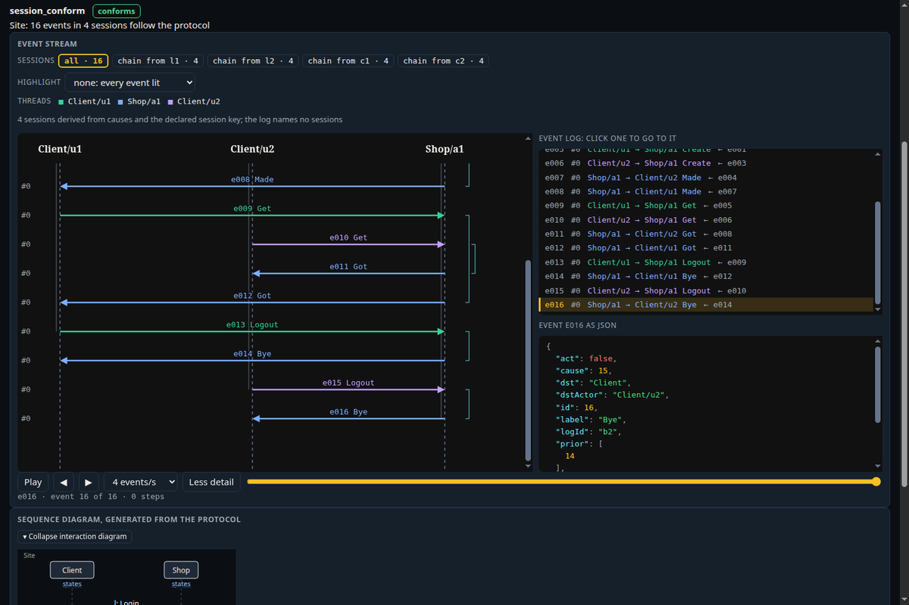

[](https://github.com/rfielding/leanFM/actions/workflows/lean_action_ci.yml)

# LeanFM

**A programming language whose programs are protocols.**

[Read the book (PDF)](book/main.pdf) · [Dark PDF](book/main-dark.pdf) ·
[The book in brief](#the-book-in-brief) · [Install](#install) · [Run](#run-it) ·
[Claude Desktop](#leanfm-in-claude-desktop) · [Videos](#videos)

A protocol names the roles in a conversation, the messages between them and their order, who
decides at each choice, what is assumed about decisions nobody else can see, and what the system
promises. Everything else in a LeanFM project is generated from the protocol or checked against
it: the diagrams people read, the requirements and implementation mapping reviewed in git, the
interfaces, the code each role is written on, and the verdicts on what the running system logs.

Most LeanFM is written by an LLM. You say in ordinary words what the software must do; the model
writes the protocol; LeanFM checks it and shows what it means, as diagrams, obligations, witnesses
and counterexamples. You push back, the protocol changes, the pictures change with it, and only
then is code written. The model learns the language from LeanFM itself: its server speaks the
Model Context Protocol and hands any agent that connects the language reference and the tools.

> **Features need strong implication. Security guarantees need weak implication.**
>
> A feature is required with `(stronglyImplies a b)`, which is `(and (possibly a) (always (implies a b)))`,
> or its usual shape `(leadsTo a b)`, which is `(stronglyImplies a (eventually b))`. The trigger `a` must
> be able to happen, so a system that never lets anyone make the request fails, instead of passing for free.
>
> A security guarantee is required with `(weaklyImplies a b)`, which is `(always (ifEver a b))`. A system
> where `a` can never happen passes, as it should: a door that never opens lets no one in.
>
> The difference is `possibly`: some future reaches `a`. LTL speaks only of every path and cannot say
> that, so requirements need CTL.


*Two games of N-player Go running on one server: four people on an 11×11 board, three on a
9×9, each a real browser. LeanFM reads the traffic they make, untangles it into sessions using
nothing but the protocol, and proves what the protocol promises
([video](video/goserver/leanfm-goserver-live.mp4)).*

---

## The book in brief


The [book](book/main.pdf) ([dark copy](book/main-dark.pdf)), *Requirements Logic*, is
the reference for what LeanFM is and does. Requirements Logic is a Temporal Lean: protocols (session
types: who sends what to whom) together with claims about what may and must happen next (CTL). Its
central result: a protocol is exactly a set of CTL formulas, one per state the conversation can be in, and a system satisfies those
formulas if and only if it behaves like the protocol. Every listing, graph, table, verdict and MCP
answer in it is generated by LeanFM itself (`CtlBookExample.lean`, `RequirementListsExample.lean`
and the other `*Example.lean` files) through the functions its tools call, so the book cannot drift
from the code.

**Part I, the protocol language.**
- *Global Types*: roles, messages, causes, choices, loops, bounded loops, `parallel`, `sessions` and
  `include`, on a request with two answers (`GET /images`: 200 or 404) and a three-party purchase.
- *Projection and Well-Formedness*: each role's local type, and the two ways a protocol cannot be
  played (a race, and a role that cannot tell which branch was taken).
- *Where Clauses, Identity and Logs*: conditions on data; sessions derived from causes and marks
  (`Fresh`, `Link`); GoServer's games and seats as sessions that fork and join; `prev` and `cause`
  on the wire.

**Part II, from session types to CTL.**
- *CTL over a Conversation*: CTL as two steps and four recursive rules (`allUntil`, `someUntil`,
  `allUnless`, `someUnless`), everything else defined from them in one line; the states a session
  type implies, with the atoms `on M` and `stop`; and bisimulation.
- *Faithful CTL*: typestates as bisimulation classes, a characteristic formula for each, and the
  theorem that the faithful rules hold exactly when the system is bisimilar to the protocol, which
  no CTL can improve on.
- *Construct by Construct*: what each construct costs in typestates and lookahead, hidden counters,
  `parallel` as a product, and the linear walk with its proof. Formulas appear both as indented
  s-expressions and read out as indented English.
- *Deciding It*: faithfulness as one bisimulation check; CTL evaluated over a hash-consed DAG in
  O(distinct subformulas × model); the functions that name the shapes specifications repeat
  (`outcomes`, `follows`, `leadsTo`, `precedes`, `stronglyImplies`), written infix as `a EU b`.

**Part III, requirements and implementations.** One small shop (`examples/orders`) from a list of
requirements, each converting to CTL or marked `sorry` and counted, to an implementation that
gives evidence per requirement. *Where it runs* places the roles in a `deployment` (islands,
machines, interfaces) and derives which links cross a hostile network or a partition. Status is
computed, never typed in, and LeanFM's own lists are checked the same way.

**Part IV, the LeanFM MCP server.**
- *Asking LeanFM*: connecting a client, the tools, and real request/answer pairs for
  `session_check`, `session_ctl` (formulas, suggestions, faithful rules), `session_next`,
  `check_ctl`, `session_conform` and `session_openapi`, and how to raise a limit for one call.
- *Case Studies*: GoServer, IslandUploads (where hidden state lives, and how `prev` removes it), and
  LeanFM's own protocol.

The appendix is a reference for the protocol text, the formula syntax and the tool arguments.

---

## Install

LeanFM is developed on Linux (x86-64) and runs on macOS. From a fresh checkout:

```sh
git clone https://github.com/rfielding/leanFM.git
cd leanFM
./setup.sh        # installs only what is missing (asks for sudo for system packages)
make build
make serve
```

`./setup.sh book` adds what `make book` needs, `./setup.sh check` what `make check` needs, and
`./setup.sh tla` what `make tla-check` needs, `./setup.sh all` everything; `--check` only reports what is missing. Every make target checks
its programs first and stops naming what is missing. When `./setup.sh` cannot install something on
your machine, `make setup-help` writes a prompt for whatever assistant you use (`AGENT=claude` or
`AGENT=codex` runs one with it). The script is generated from
one list, `LeanFM/Deps.lean`, and the MCP tool `setup_script` answers the same script:

<!-- deps: generated from LeanFM/Deps.lean by SetupScript.lean -->
| Program | For | Needed by |
|---|---|---|
| git | the repository | build |
| make | the make targets | build |
| flock | one make at a time in a checkout | build |
| curl | downloads (elan, Go) | build |
| Python 3 with pip | the scripts and checks | build |
| Node.js 18 or later and npm | the viewer's bundle (ui/) | build |
| elan (Lean and Lake) | builds LeanFM; installs the Lean in lean-toolchain by itself | build |
| TeX Live | the book's PDFs | book |
| Graphviz | the book's graphs | book |
| Poppler utilities | the book's pages in the viewer and the PDF checks | book |
| Playwright with Chromium | SVG to PDF for the book, and the viewer checks | book |
| Pillow and CairoSVG | the chat UI's image checks | check |
| bubblewrap | the sandbox the checks run generated code in | check |
| ripgrep | the checks' searches | check |
| ss | finding a running server's port | check |
| Google Chrome | the headless viewer in make run-log-check and the videos | check, videos |
| Go (checksum-pinned, in .toolchains/) | the Go example's checks | check |
| FFmpeg | the videos | videos |
| the video environment (video/.conda: Python with Manim and Piper) | rendering and narrating the videos | videos |
| Java | TLC, for the TLA+ comparison (make tla-check) | tla |
| TLA+ tools (checksum-pinned, in .toolchains/) | the TLA+ comparison | tla |
<!-- deps: end -->

The videos also need the project-local conda environment `video/.conda` with Manim and Piper; see
`video/README.md`.

## Run it

```sh
make build        # the UI bundle, leanfm-server and leanfm-mcp
make serve        # web server and MCP over HTTP on http://127.0.0.1:8080 (make stop ends it)
make http-check   # check the running server's routes
make check        # build everything and run every check
make book         # regenerate the book's figures and listings, then book/main.pdf and main-dark.pdf
make claude       # Claude Code with this project's MCP endpoint and its state under .cache/claude/
```

The first build downloads the Lean toolchain and compiles Lean's dependencies, which takes a while;
later builds are incremental. To use LeanFM from Claude Desktop without a server, see the next
section. Agents connected to the server can ask `server_info` which commit it was started from and
whether it is stale (rebuilt since it started).

---

## Renamed words

LeanFM's words were renamed to say what they mean. The old words are refused, each with an error
naming its replacement, so a formula or protocol written in them fails rather than meaning
something else.

| old | new | meaning |
|---|---|---|
| `par { ... } and { ... }` | `parallel { ... } and { ... }` | branches that run interleaved |
| `rec L { ... continue L; }` | `loop L { ... continue L; }` | a named loop (bounded: `loop L at most N { ... } otherwise { ... }`) |
| JSON steps `"par"`, `"rec"` | `"parallel"`, `"loop"` | the same, in the JSON protocol form |
| `(after M)`, `{"after": "M"}` | `(on M)`, `{"on": "M"}` | on delivery of M: true in the state that delivery reaches, until the next message |
| `terminal`, `"terminal"` | `stop`, `"stop"` | the conversation may stop here |
| diagram tabs `alt`, `par`, `ref` | `choice`, `parallel`, `include` | the language's own keywords |

Words that read as English stand for the CTL operators; each says whether it means some path or
every path: `possibly` (EF), `inevitably` (AF), `always` (AG), `never` (AG not), `someAlways` (EG),
`allNext`/`someNext` (AX/EX), and, infix, `allUntil`/`someUntil` (AU/EU) and `allUnless`/`someUnless`
(AW/EW). `explain_formula` answers any formula `unfolded` into the primitives.

## LeanFM in Claude Desktop

LeanFM's MCP server runs as a child process of Claude Desktop, over standard input and output. It
needs no API key, no port and no account: none of its tools calls a model, and Claude's own turns
belong to your Claude subscription. Every tool is read-only: none changes a file, and none runs
submitted text as code (protocol text is read by a parser for its grammar alone).

### Set it up

```sh
git clone https://github.com/rfielding/leanFM.git && cd leanFM
make build                                  # needs elan (https://github.com/leanprover/elan)
make serve                                  # the LeanFM server; leave it running
python3 scripts/claude_desktop_config.py --root "$PWD" --forward http://127.0.0.1:8080/mcp --install
```

Then quit and reopen Claude Desktop, once. The script adds one `leanfm` entry to
`claude_desktop_config.json` (keeping your other servers and writing a backup first): Claude
Desktop runs `leanfm-mcp --stdio --forward http://127.0.0.1:8080/mcp`, a relay to the server
`make serve` runs. After a `git pull` and a rebuild, restart only `make serve`; Claude Desktop
keeps running. The two may start in either order: a request that arrives before the server
listens waits for it (up to `LEANFM_FORWARD_WAIT_SECONDS`, 30 by default).

Without `--forward`, Claude Desktop starts its own `leanfm-mcp --stdio --root <this checkout>`
instead; then restart Claude Desktop after each rebuild.

- **LeanFM on another machine?** Build it there and install with `--ssh HOST`: Claude Desktop then
  runs the server over ssh (`scripts/claude_desktop_config.py --help`).
- **claude.ai or the mobile apps?** The same executable serves MCP over HTTP behind TLS as a custom
  connector: see [`deploy/mcp/README.md`](deploy/mcp/README.md).

### Things to ask

- *"Use LeanFM to design a library-lending service as a session type, check it, and animate a
  stream of 20 borrowers."*
- *"Browse the GoServer specification (`example: goserver`) and show me how a move is answered."*
- *"Here is a log from my server. Check it against the protocol with `session_conform` and tell me
  which sessions break it."*
- *"Is it possible that a payment is charged twice? Ask `session_ctl` and show me the path."*

Start from the `design_with_session_types` prompt: it walks from the roles to a checked protocol,
each role's typestate, code that logs its messages, and `session_conform` on those logs.

### The explorer

The session tools declare an MCP Apps view, so Claude Desktop draws their answers inline, and the
view is an explorer as well as a picture:



*A real `session_conform` answer as the view draws it: one lifeline per actor (each browser
instance its own), each thread in its own colour with a legend, the sessions LeanFM derived from
the log (two logins and two orders, each order a child of its login), the event log, and the
selected event as JSON.*

- **The protocol in an editor** that LeanFM rechecks after each pause, with a sketch where clicking
  two lifelines adds a message.
- **Generated sequence diagrams**: frames fold and open, an included protocol opens on its own
  diagram, and clicking an actor shows its state machine.
- **Each role's view**: its typestate API, the steps it takes part in, the OpenAPI document it serves
  and its payloads.
- **The event stream, animated**: per-actor lifelines; threads (each actor's own order, its `prev`
  chain) in colour; a highlight that lights one session or thread in the whole mashed-together
  diagram; clicking an event focuses on its thread and frames the sessions it formed, a child inside
  its parent.
- **A walk-through** of one session, one allowed step at a time (`session_next`); **CTL** with
  suggested properties built from the protocol, each decided with its path; **datasets** of up to
  10,000 sessions charted by path, message, role load, length and duration.

### The tools

| Group | Tools |
|---|---|
| Design and check | `session_check`, `session_review`, `session_diagram`, `session_explore`, `session_actor`, `session_types`, `session_openapi`, `session_skeleton`, `session_compat`, `session_deployment`, `session_realizable` |
| Behaviour | `session_simulate`, `session_next`, `session_dataset`, `session_mdp`, `session_sla`, `session_instances` |
| Real runs | `session_conform` (a log against the protocol, sessions derived when the log names none), `session_spans` |
| Questions | `session_ctl` (temporal properties, with witnesses and counterexamples), `check_ctl`, `explain_formula`, `knows` (what an actor can derive) |
| Security | `check_protocol` (attacks on a security protocol), `check_reassembly` (stream-reassembly evasions) |
| Projects | `project_view`, `requirements_interrogation`, `code_generation_prompt`, `validate_generated_artifacts`, `classify_requirement`, `server_logs`, `server_info` |

The full list, with every argument, is generated into the book's chapter *Asking LeanFM* from the
server's own tool list.

---

## Videos

Every frame is drawn from LeanFM's own answers, saved beside each video.

- [GoServer, live](video/goserver/leanfm-goserver-live.mp4): 930 calls from seven browsers in two
  games, untangled into sessions with no session ids in the log; on first contact 7 of 58 sessions
  broke the protocol (the browsers poll), so the protocol was corrected; then 78 CTL formulas,
  all proved over a 10,969-state graph.
- [Diagrams as CTL](video/ctl/leanfm-diagrams-as-ctl.mp4): every interaction diagram as CTL, decided
  by a model checker; PlaceOrder gives forty formulas, and each broken variant fails a named one.
- [Session separation](video/sessions/leanfm-session-separation.mp4): `cause`, `Fresh`, `Link` and
  `given`/`with` separate interleaved conversations into sessions, children and threads.
- [A Lean tutorial](video/lean-tutorial/leanfm-lean-tutorial.mp4): Lean as the programming language
  LeanFM is written in, then the LeanFM language, every snippet compiled
  ([`video/lean-tutorial`](video/lean-tutorial)).


## Projects in this repository

Each is a complete LeanFM project with its own book, requirements, implementation mapping and source:

- [`projects/GoServer`](projects/GoServer): N-player Go with rooms, challenges, bots, teams, claimed
  names and a ranking, a Go server and a React browser app. LeanFM's main example.
- [`projects/Maqam`](projects/Maqam): a live-coding sequencer for just-intonation maqam,
  reverse-engineered from Rust into a specification and implemented again in Zig against it.
- [`projects/PaxosKV`](projects/PaxosKV): a three-replica Paxos key/value database
  (`make paxos-check`).
- [`projects/IslandUploads`](projects/IslandUploads): file uploads across islands that may be
  partitioned for a day.

## A project in its own repository

A project does not have to live under `projects/`. Name its root with `--project` (repeat it for
several). From an MCP client, start `leanfm-mcp` from the project's own `.mcp.json`; a relative
`--project` is taken from where the client starts it, which is the project:

```json
{
  "mcpServers": {
    "leanfm": {
      "command": "/path/to/leanFM/.lake/build/bin/leanfm-mcp",
      "args": ["--stdio", "--root", "/path/to/leanFM", "--project", "."]
    }
  }
}
```

Or run the shared server with it: `make serve PROJECTS="$HOME/code/maqam"`.

The project is then listed by `project_view`, its protocol files work with the session tools'
`project` and `file` arguments, and its `logs/events.log` appears in `server_logs` as
`<Name>/events`, exactly as for a project here. The name is the `display_name` in the project's
`manifest.json`. The server only reads the project. It refuses to start if a root is missing, has
no `manifest.json`, is inside this checkout, overlaps another root, or has a name another project
already uses.

The project runs its own checks from its own root against this checkout, writing only below its
root:

```sh
python3 /path/to/leanFM/scripts/chatui_specification.py . \
  Project.Requirements.requirements Project.Implementation.implementation
```

`make external-project-check` tests all of this.

## Working on LeanFM

LeanFM is developed with the LeanFM method: a change starts in its own requirements
(`LeanFM/LLMGenerated/SelfHosting.lean`), then the implementation mapping
(`SessionImplementation.lean`, `McpLogicImplementation.lean`), then the source, each checked before
the next. Review and acceptance happen in git. See [`AGENTS.md`](AGENTS.md) and
[`SKILL.md`](SKILL.md).

- **Claude Code**: `make claude` starts Claude with the project's history, memory and configuration
  under `.cache/claude/`; [`.mcp.json`](.mcp.json) connects it to `make serve`'s endpoint.
- **Cursor**: [`.cursor/mcp.json`](.cursor/mcp.json) points Cursor Agent at the same endpoint
  ([`CURSOR.md`](CURSOR.md)).
- **The chat UI sandbox**: `make check` includes `make chatui-check`, which needs Linux `bwrap`
  (the `bubblewrap` package) with working user, PID and network namespaces. A missing or denied
  sandbox is an environment failure, never a reason to skip isolation tests.

What LeanFM does not yet do is listed in [`CRITIQUE.md`](CRITIQUE.md).
