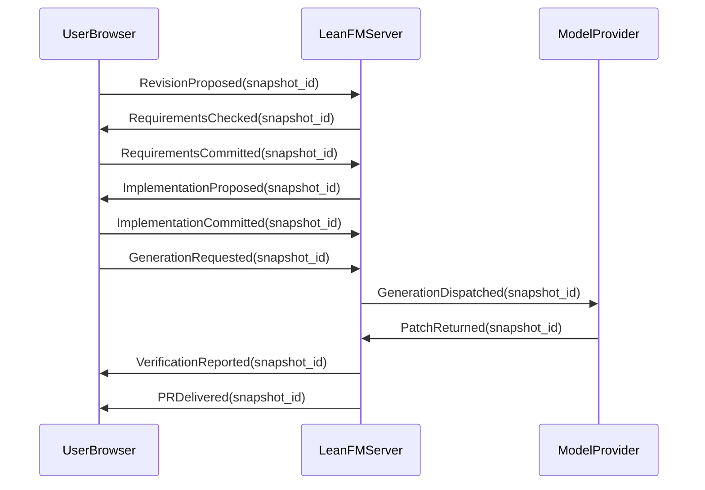
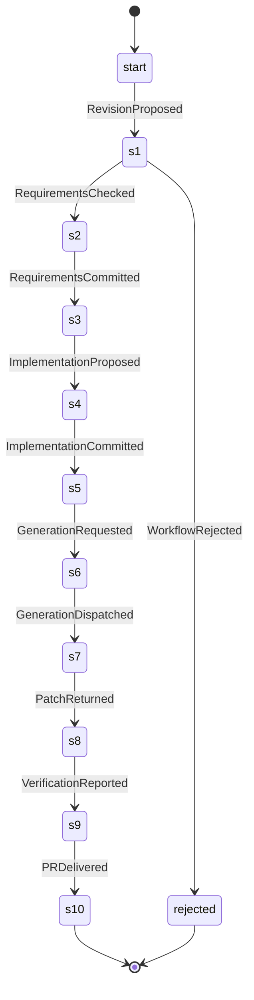
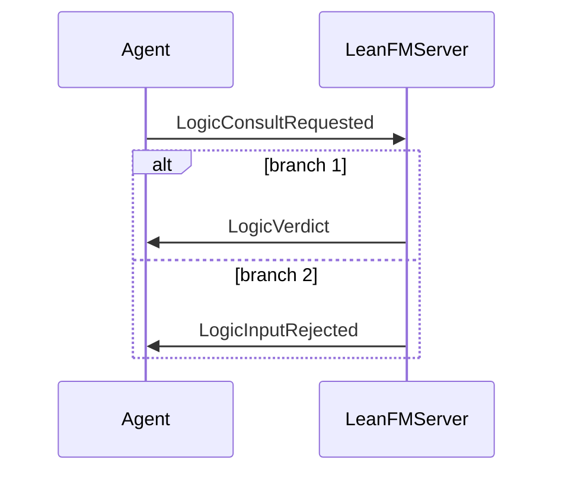

# Self-hosting requirements review

Status: proposal. Review and acceptance happen in git.

Product composition: ChatUI requirements plus revision-bound requirements-to-PR workflow.
Worker example: retained separately, not the specification of the whole product.

## Component registry

- leanfm.chatui: LeanFM/ChatUI/Requirements.lean; LeanFM/ChatUI/Requirements.proto; LeanFM/ChatUI/Implementation.lean — existing product component; conformance must be audited
- leanfm.selfhost: LeanFM/LLMGenerated/SelfHosting.lean; LeanFM/LLMGenerated/SelfHosting.proto; LeanFM/LLMGenerated/Implementation.lean — proposed workflow and clauses; MCP read-only context adapter implemented; remaining mappings pending
- worker.example: LeanFM/LLMGenerated/Requirements.lean; LeanFM/LLMGenerated/Requirements.proto; LeanFM/LLMGenerated/Implementation.lean — preserved example, not whole-product implementation

## Generated interaction: successful proposed workflow

## Generated state machine

## Generated interaction: MCP logic consultation

## Proposed clauses (not semantic proofs)

- selfhost.revision [proposed]: A snapshot is identified by exact book, requirements, protobuf, implementation, and repository revisions. Changes invalidate affected checks and derived artifacts; stale requests fail without overwriting current state.
- selfhost.gates [implemented]: Review and acceptance are git commits made by the user; LeanFM records no approvals and never blocks an edit, source write or launch on one. Code generation requires the current snapshot's requirements and implementation mapping to pass their canonical checks. Project status reports whether each is checked and committed.
- selfhost.pr [proposed]: PR delivery requires an actual patch, requirement-to-code/test mappings, reproducible check results, base revision, and remaining limitations. The PR may be delivered as a local reviewable bundle; remote publication requires explicit authority. Failed checks cannot be labeled completed.
- selfhost.checker [proposed]: Check results distinguish proved, disproved, unknown, unsupported, and resource-limit reached. Identify model revision, formula, assumptions, bounds, terminal-path convention, fairness, and witness or counterexample. Schema validation is not a semantic proof.
- selfhost.formulas [proposed]: Requirements must support typed nested CTL state formulas and separately typed path conditions. AF AG p is eventual permanent safety; AG AF p is universal recurrence. Preserve existential counterexample duals without claiming CTL covers all LTL.
- selfhost.modal [proposed]: Knowledge quantifies over legal histories with identical declared actor observations. Obligation and permission quantify over all and some nonempty named ideal policy futures. Never conflate legal, observable, ideal, and probabilistic alternatives. Belief and morality are outside this extension.
- selfhost.lazy [proposed]: Retain modality-specific indexes only while current formulas reference the corresponding actor or policy relation. Rebuild them from retained source evidence; release unreferenced indexes. Index lifetimes must not alter truth. Isolate caches by project and model revision.
- selfhost.probability [proposed]: Probabilities are optional and distinct from existence. Identify declared model probability versus observed frequency versus unknown. Specify normalization, conditioning, scheduler or min/max policy, horizon, threshold comparison, and sample boundary. Do not infer independence or treat unknown as zero.
- selfhost.history [proposed]: Immutable events carry predecessor links; derived successor indexes preserve event identity and partial order. State whether a past monitor uses causal ancestry or a declared linearization. Strictly prior facts exclude the current event.
- selfhost.coverage [proposed]: Every normative book claim is linked to an accepted requirement, an explicitly pending proposal, or a deferred/illustrative classification. Every accepted requirement maps to implementation decisions and evidence; unmapped claims prevent a claim of complete one-shot readiness.
- selfhost.handoff [proposed]: A new session starts from book/main.pdf, book/main-dark.pdf, canonical requirements/protobuf/implementation, component registry, current repository, and generated review report. Application goals also retain spec/ProjectMemory.md, spec/runtime.json, revision-bound actual-launch evidence, failure remedies and PR/base-revision context. Conversation history is not required input.
- selfhost.bounds [proposed]: Declare finite exploration and resource bounds. Exhaustion yields resource-limit or unknown, never proved. Compaction must preserve the declared observation and monitor semantics.
- selfhost.session.syntax [implemented]: A protocol is written in Lean with the protocol notation of LeanFM.Session and elaborates to a value of Global R for any role type R, so it can be instantiated with another protocol's roles. Statements: a message (optional name, label, sender, receiver, optional cause naming an earlier message, optional route naming the operation a request invokes such as POST /orders, optional status a response carries such as 402, optional where clause); an event at one role; choice with or-branches; par with and-branches; join k of branches; rec with continue in tail position; sessions; include of another protocol. Always: a label is a Lean type, so a misspelt label is a compile error, and a where clause is a Lean Bool over the payloads of the messages named so far, type-checked when the protocol is written and evaluated over decoded payloads when a trace is checked. Never: repetition other than continue at the end of a branch (the state space stays finite); a route or status changing any check's verdict (they are for people and generated views).
- selfhost.session.choice [implemented]: A choice names no decider. Always: the decider is the one role that starts every branch, by sending its first message or by an event at that role alone; an empty branch is that role choosing to do nothing. Never: a choice whose branches are started by different roles accepted (it is reported as a race naming who starts what); two branches that start with the same event; a choice none of whose branches does anything.
- selfhost.session.causes [implemented]: A message's cause names an earlier message it answers. Never: a cause that its sender has neither sent nor received (a role decides only from its own history); it is reported.
- selfhost.session.projection [implemented]: Projection gives each role its local type: the protocol with every message the role neither sends nor receives erased, its own choices as select and other roles' choices as offer; a role that takes part only in nested sessions blocks is a service (a text-message gateway, a mailer) whose local type serves those sessions, sessions { ... }, without being projected through the enclosing session's choices, and a service of several kinds of session tells them apart by their first messages (as an offer) or is reported; a join k of as join k of over the role's own branches (par when it takes part in no more than k of them), resolved by what arrives. Always: a role that does not decide a choice can tell its branches apart when the first messages it can receive in them differ, looking inside par; a role whose part of the session has not started (its first message has not reached it) may be absent from a branch that never contacts it, and the body of sessions is projected as not started. Never: a role that has already taken part left out of a branch, or unable to tell branches apart; projection fails with the reason (Role cannot tell which branch Decider chose).
- selfhost.session.composition [implemented]: Protocols compose. Always: include runs another protocol with the given roles and the rest continues where it finishes, each protocol written as if it were the whole; par runs branches interleaved, each keeping its order; join k of continues after any k branches, recording which ones; sessions runs any number of independent copies of its body. Never: an unselected join branch canceled implicitly (cancellation is an explicit message).
- selfhost.session.http [implemented]: The HTTP call discipline is optional and applies to channels declared HTTP (session_check: every channel once mayCall is given, except those between the roles of a notHttp pair). Always: every message on an HTTP channel is a request to a role the sender may call, or the response to the nearest pending request in its cause chain, sent back to the role that asked; a streaming response may answer more than once; every request gets a response before a run reaches the end of the protocol (a run that goes round a loop again has not ended). Never: a response sent to a role other than the caller, a request to a role the sender may not call, or a request left without any response accepted; each is reported as a cut naming the message.
- selfhost.session.physics [implemented]: Channel physics is declared beside the protocol. Always: a channel has a capacity, a full policy (block, reject, drop newest or drop oldest), sequencing, sharding, loss and duplication; presets (reliable, udp, stream, http, kafka) name common channels and a declaration states only what differs; every channel defaults to reliable; a spec states which surfaced conditions each channel's protocol handles, its properties and its assumptions. Never: a condition a used channel surfaces (timeout, duplicate, reject, loss, reorder, per-key order, partition, hostile, readable, close) left unhandled without being reported.
- selfhost.session.topology [implemented]: A deployment tree places actors in islands, datacenters, machines and replicated or sharded groups, and gives them interfaces with a scope and a kind. Always: an interface is named by its path (island, actor, scope, interface); ingress is reachable from anyone, peering from any island, internal from the same island, local from the same machine; placement adds conditions to a channel (partition across islands, hostile from outside, reject into a replicated group, per-key order into a shard); a library adds an interface kind by refining an existing one. Never: a channel to an internal or local interface reported reachable from outside its scope.
- selfhost.session.diagram [implemented]: Interaction diagrams are generated from the global type, in standard sequence-diagram notation, never drawn separately. Always: Global.diagram draws one lifeline per listed role and one arrow per message, labelled with its id, label, route and status, with its where clause under it; a message whose cause chain reaches a call (a message that was not itself a reply) from its receiver to its sender is a dashed reply, so a response that follows other calls is drawn as the answer to the call that asked for it and a new call made after a reply is not; an event is an action box on its role; choice is an alt frame captioned with the role that decides (the one that sends the first message of every branch); par is a par frame; join k of n is a par frame captioned any k of n; rec is a loop frame and continue is drawn inside it; sessions is a loop frame around one instance; include is a ref frame named after the included protocol; a choice with no single decider is drawn and captioned as a race; every request that is answered is an activation bar on the callee from the request to its response, inset when the callee is still busy with another call, and a response in another branch of a choice gets its own bar from where that branch begins, so no bar runs through a branch its call is not in; the diagram is a list of shapes (rect, line, path, text) with colours named by role (fg, arrow, frame, muted, line, bg, actFill), written as SVG text in a theme or handed to a view as data. Lifelines are spaced so the widest message label fits between neighbours (180 to 420 pixels); Messages are drawn thicker than frames, dividers and lifelines, with arrowheads of a fixed size, a frame or divider opens below the arrow before it, and text outside a box has a halo in the background colour so no line runs through its letters. Repeated replies to one request within a branch extend its existing activation bar. Never: an activation bar starting before its request or overlapping an actor header; a construct of the protocol omitted from its diagram; an arrow that is not a message of the protocol; a frame's edge or a divider drawn along an arrow; protocol text (labels, ids, guards, role names) placed in the drawing unescaped.
- selfhost.session.calls [implemented]: cause packages interactions into calls, and LeanFM derives the calls and each role's typestate API from the global type. Always: a message whose cause chain reaches a request from its receiver to its sender is a response to that request, and every other message is a request; a call is a request with its responses (with their statuses) and its detail, which is every message the request causes directly or through others except its responses and what they cause; Global.calls lists calls as a tree, a request in another call's detail nested under the nearest such call, a request with no response listed as having no reply; Local.typestate reads a role's projection as states: the role starts in S0, a send, an event or a continue is a method that consumes its state and returns the next, a select is several methods on one state, an offer is one receive returning a sum of label and next state, a loop's continue returns to the loop's state, a par the role takes part in on one side only is that side followed by what comes after, and End has no methods. Never: a response listed as a call of its own; a message placed in the detail of a call one of whose responses caused it; a typestate method for a message the role neither sends nor receives.
- selfhost.session.events [implemented]: LeanFM generates event streams from a global type, so animations, traces and test data are views of the protocol rather than hand-made. Always: Global.simulate runs the protocol with a seed: each sessions block starts the requested number of instances at staggered times, each with a session number in the order its first event happened; each par or join branch is a thread; at each step one runnable thread, chosen by the seeded generator, takes its next step, and a choice takes a random branch; each event records its id, session, step, sender, receiver, label, message id, route, status, prior (the previous event of each role it involves in its session, plus, for the first event after a par or join, the last event of every branch it waited for), cause (the event of the message its cause names, in its session) and answers (the request it responds to, by the rule of selfhost.session.calls); the same seed gives the same stream; eventsJson writes the stream as a JSON array with every string escaped. Never: a prior, cause or answers link to a later event or to another session; a session whose messages are not those of one run of its protocol; two par branches on different actors linked through prior; the event after a join not following every branch it joined; a loop unrolled more than its fuel.
- selfhost.session.conform [implemented]: A log of a running implementation can be checked against its protocol, so code built from a session type is held to it. Always: a session whose events do not fit the protocol's top-level body is checked against a sessions block nested in it (a service's own session); Global.next gives, after the events of one session, every step some state explaining them allows next (its cause resolved to the event the protocol names) and whether the session may end there; Global.conforms takes logged events (id, session, sender and receiver or the role of an event, label, the id of the causing event) and checks each session in order of first appearance, against the body of a top-level sessions block or else the whole protocol; an event is accepted when some protocol state reached so far allows it next (par branches interleave, a choice is settled by the first event only one branch allows, rec repeats, include is inlined, after join k the continuation runs beside the unfinished branches), and when the protocol names cause y the event's cause must be the event that was y in the same session; a session is complete when the protocol can end where its events stop; every stream Global.simulate generates conforms. Never: an event the protocol does not allow at that point, a wrong label, sender, receiver or cause, a repeated event id, or a cause that is not an earlier event of the same session accepted (each is reported with the event and what the protocol allowed instead, and whether only the cause was wrong); a session that stops early accepted unless incomplete sessions were asked for; a run accepted when more than 512 protocol states explain it (the check stops and says so).
- selfhost.session.skeleton [implemented]: Code built from a session type starts from that type: each role's typestate becomes code whose methods are exactly what the protocol allows. Always: Global.pythonSkeleton writes one self-contained Python module, and Global.typescriptSkeleton the same states as one TypeScript module in which a step a state does not allow is a missing method and so does not type-check, receive returns a union tagged by label that narrows the next state, and each state class carries a literal state field so states with the same methods are distinct types (the example type-checks the module, and @ts-expect-error lines prove the forbidden steps, the lending bug among them, do not compile) (a small runtime, then a class per typestate state of every role and a start function per role; a role that only serves sessions starts each session in the body's first state); a send method sends and logs the message in session_conform's format, fills in the cause the protocol names from the events of the same session, and returns the next state; receive accepts only a message the state allows (label, sender and receiver) of its own session and returns it with the next state; act, fork (par and join), serve, continue, stop and an empty branch (skip) follow the typestate; the module for the worked example is checked in and kept equal to what is generated. Never: a method for a step the state does not allow; a state usable twice (the second use raises); a refused message consuming the state; a guessed cause where the same sender, receiver and label appear with different ids or causes (the method takes the cause instead); protocol text other than role and label names in the code, or a name placed other than as a sanitized identifier or an escaped string literal; two methods of one state, or two roles, with the same Python name (an error); a language other than Python or TypeScript accepted. A join's count reaches the code: the role's local type keeps join k of over its own branches (all of them when it takes part in fewer than k, since it cannot see the others end; session_conform holds the run to the count), its typestate forks any k of them, and the generated Fork joins only on k distinct ends.
- selfhost.session.evolution [implemented]: When a protocol changes, LeanFM says which roles can be deployed on their own schedule. Always: for each role in both versions, Global.compat decides whether its new version can upgrade first (running with the old version of every role of the old protocol) and whether its old version can stay behind (running with the new version of every role of the new protocol), by exploring the composed system to every reachable state: a message is taken when its sender may send it and its receiver may receive it, an event when its role may perform it, and a role with several choices of its own may commit to one; roles only in one version are named. Never: a mixed system that can get stuck (nothing can happen and some role cannot stop) reported as compatible, which includes a message nobody will accept, a deadlock and a role left waiting, each reported with the steps that reach it and what each role still expects; a role-by-role subtyping refusal where the multiparty system works (a Desk that answers Refused at once is accepted when the old Member accepts Refused there); a yes when more than 5000 states would be needed (the check stops and says so).
- selfhost.session.properties [implemented]: Rules a protocol must keep that its structure does not show are checked as temporal properties of the protocol itself. Always: Global.stateGraph gives one session of a protocol as a state graph (the residual global types with their bindings that conformance explores, nested sessions played once in place, one transition per step labelled with its message or event and its roles, terminal states where the session may end, at most 2000 states), and session_ctl decides a CTL formula over it with the logic tools' checker, atoms after(label) and terminal, answering proved or disproved with a witness or counterexample path. A counterexample for AG g or never g continues past the state where g fails with g's own evidence from there, so a nested property's path ends at the step that breaks it. Never: a formula naming a label the protocol does not have accepted (it is rejected naming the label); a property reported proved when the graph would exceed its bound (the check stops and says so).
- selfhost.session.openapi [implemented]: A role's HTTP interface is generated from the protocol. Always: Global.openApi writes the requests a role receives (calls at any depth whose receiver is the role) as an OpenAPI 3.1 document: one operation per route (route "POST /orders" is method post on path /orders), the request's label as operationId and summary with its sender, a request body naming the label for post, put and patch, and each response the protocol allows under its status (default when it has none) naming the response's label; every label is an open object schema to be filled in. Never: a request without a route guessed into the document (it is listed as unrouted); two different requests on one method and path, a method that is not an HTTP method, or a path not starting with / accepted (each is an error naming the route); a role the protocol does not have accepted.
- selfhost.session.review [implemented]: LeanFM reviews a protocol design in one answer, with an edit to try for each finding. Always: Global.review reports the core rules' issues, each with its usual fix (a message in each branch or the service idiom, a cause the sender saw, one decider); the HTTP discipline wherever a message has a route (its channel is HTTP and its sender may call its receiver, so no flags are needed), with the response line to add for a request never answered (or an id first when it has none) and every response to a routed request without a status; a state of the session graph from which the session can never end, with the steps that reach it; and roles that take no part. The text content carries the numbered findings and suggestions. Never: a finding for a protocol that has none (the examples review clean); a channel without routes treated as HTTP; a graph beyond its bound reviewed as clean (it says so).
- selfhost.mcp.session.tools [implemented]: MCP clients design protocols with the session-type library through ten read-only tools that take a protocol as LeanFM protocol text (the lean argument: one or more protocol Name (Roles) { statements } definitions, the last one checked, earlier ones available to include), or alternatively in a closed JSON form ({name?, roles, steps}), both documented by the resource leanfm://language/session-reference and named in the server instructions. Always: the text is read by a parser for the protocol grammar alone and builds the same global type the protocol command builds for the same text (the same diagram, issues and projections), with include renaming the included protocol's roles in order; the JSON form builds the same global type as the equivalent text (steps after a choice or rec continue every branch); errors in text give the line and column; session_check answers ok or the issues of Global.issues, each role's local type and typestate API or its projection error, the calls with routes and statuses, the calls text and the diagram shapes, and with mayCall the HTTP cuts; session_diagram answers SVG text in a dark or light theme and the shapes; session_simulate answers a seeded event stream (concurrent copies of the protocol when it has no sessions block) with the diagram; session_conform checks logged events ({id, session, from, to, label, cause}, {id, session, at, label, act: true} for an event, or session_simulate's events as they are) with Global.conforms and answers conforms or violates with each session's first problem; session_review answers Global.review with a numbered report in the text content; session_openapi answers Global.openApi for a role, the document also in the text content; session_ctl answers a CTL formula over Global.stateGraph checked by the logic tools' checker; session_compat answers Global.compat for a new version (lean) and its previous one (old): per role whether it can upgrade first and whether it can stay behind, each no with its path, and which order works; session_next answers Global.next for one session after the events so far: every step the protocol allows next with the event each must name as its cause, and whether the session may end (running, finished, stuck, or violates with the first problem of a walk the protocol does not allow; at most 200 events); session_skeleton answers Global.pythonSkeleton's module, in the text content as well as structuredContent because the code is the answer; the prompt design_with_session_types walks a client from the roles to a checked protocol (with mayCall and notHttp for HTTP), its typestate and a walk-through, session_skeleton in Python or TypeScript, an implementation on the generated module that logs its messages, session_conform on the logs, and session_compat when a running protocol changes; every answer echoes the protocol as protocol text (lean): the text sent, or the JSON form written as text that reads back to the same diagram; each answer has a one-line summary with the tool, verdict and reading, and the whole answer once as structuredContent; the same arguments give the same answer. Never: submitted text elaborated or run as Lean (it is read only by the protocol parser, so a Lean command is a syntax error) or a field run as code (a where text is shown, never evaluated); a statement after continue, an undefined, misnamed or self-including include, a protocol defined twice, an unclosed brace, string or comment accepted; an unknown role, step kind or key, a continue outside its rec or before the end of its branch, a join out of range, an empty, over-long or control-character string, or a protocol over the limits (200 steps, 12 roles, 16 branches, depth 24, 200-character strings, 64 KiB of arguments; simulations of 200 instances, 600 events, 8 loop iterations) accepted rather than rejected with the step path named; a result over 90,000 characters returned whole (the SVG, then the shapes, then later events are left out, and the answer says which).
- selfhost.mcp.session.view [implemented]: session_check, session_diagram, session_simulate, session_conform, session_ctl and session_compat declare the MCP Apps view ui://leanfm/session-view, offered by resources/list and resources/read as one static HTML document with mimeType text/html;profile=mcp-app and no CSP domains. Always: from the tool result alone, a host that renders the view shows the verdict and reading, the issues, the generated sequence diagram built from the result's shapes, the calls text, each role's typestate and local type, for session_conform where the run breaks the protocol, for session_ctl the witness or counterexample path as messages, for session_compat which roles can upgrade first and which can stay behind, and for session_simulate the event stream animated on a canvas with play, pause, step, speed and a scrubber, simple by default (only the newest four arrows labelled, older ones faded, no session tags, routes or prior links until an event is selected) with a control for full detail, and a walk-through of one session that calls only session_next, one call at a time with at most 200 events, showing a button per allowed step grouped by the role that takes it (a role with several shown as choosing, and the roles with none as waiting), the steps so far with their causes, undo and start again; a sketch under the editor showing only the roles' lifelines, where clicking a sender's then a receiver's lifeline (or one twice, for an event) and giving a label (an identifier), an optional route (a method and a path) and, for a reply to the latest request the other way, an optional status (three digits) adds one statement to the protocol text at the cursor or before the closing brace, and a role can be added by name, after which LeanFM rechecks the text, so every diagram shown is still generated; the view's script must parse (node --check in the MCP tests) and run (driven in Node against a stub DOM and host with real results of every session tool, the walk-through and the animation, failing on any exception), where selecting an event shows its prior links, its cause and the request it answers; it follows the host's light or dark theme; it is an editor: the protocol text each tool echoes back (lean) is shown as editable LeanFM protocol text with buttons that insert statement templates, and after a pause in typing (or on Check now) the view calls session_check through the host's tools/call with the edited text and redraws everything below the editor from LeanFM's answer, keeping the text as typed, and Animate calls session_simulate the same way; empty text is not sent; a host that refuses tools/call is reported, and the person can still ask the model to rerun the tool. Never: a call to any tool but session_check and session_simulate from the view; two calls in flight at once (an edit made during a call is checked after it, the latest text winning); text over 64 KiB sent; tool data inserted as HTML or script (text nodes, SVG elements made with createElementNS from numbers, a fixed set of colour names and checked path data, and canvas drawing only); a network request or an external script, style, font or image; an unbounded drawing (at most 4000 shapes and 600 events are drawn, and the rest are counted); a ui:// URI other than the declared ones answered.
- selfhost.mcp.context [implemented]: A stateless MCP endpoint exposes the project book, canonical requirements, protobuf, implementation specification, and live language references through fixed resource URIs. Initialization states that the book is durable agent context comparable to maintained system-prompt material.
- selfhost.mcp.readonly [implemented]: The MCP endpoint is read-only: its tools return deterministic interrogation, generation, and validation material, cannot read arbitrary paths, and cannot mutate project state.
- selfhost.mcp.transport [implemented]: POST /mcp accepts JSON-RPC initialization, ping, resource, prompt, and tool methods using MCP protocol version 2025-06-18. The loopback service requires deployment authentication before remote exposure; remote exposure uses the MCP-only host of selfhost.mcp.hosting, never the full service.
- selfhost.mcp.hosting [implemented]: A separate executable leanfm-mcp serves only the MCP endpoint so it can be exposed to remote clients (Claude.ai, Claude Desktop, Claude Code and browser-based MCP clients) over the Streamable HTTP transport. Always: POST /mcp answers JSON-RPC with application/json, a notification or a response sent by the client is acknowledged with 202 and no body, OPTIONS /mcp answers a CORS preflight, GET /healthz answers ok, and every other path is 404; a request whose Origin is in the configured allowlist (default https://claude.ai and https://claude.com) gets Access-Control-Allow-Origin naming that origin, Vary: Origin, the allowed methods POST and OPTIONS, the allowed headers Content-Type, Accept, Authorization, Mcp-Session-Id, Mcp-Protocol-Version and Last-Event-ID, and Mcp-Session-Id exposed; a request with no Origin (a server-side client) is served; the listen address, port, origins, optional bearer token, rate, burst and concurrency are configuration read from the environment, with a loopback default address. Never: a route of the full service (the chat UI, /api/llm, sessions, project files, renders) reachable through leanfm-mcp; a request with an Origin outside the allowlist served (403, no CORS headers) or Access-Control-Allow-Origin set to *; credentials allowed across origins; a POST whose Content-Type is not JSON (415), whose Accept admits neither JSON nor anything (406), whose Mcp-Protocol-Version is unsupported (400), or whose body exceeds 256 KiB (413) dispatched; when a bearer token is configured, a request without exactly that token served (401 with WWW-Authenticate); a client exceeding its request rate served (429 with Retry-After); more tool calls running at once than the configured limit (503 with Retry-After); a tool result larger than 100,000 characters (the directory's 25,000-token limit) returned whole: it is compacted by omitting per-step knowledge and then early path steps, saying so, or replaced by an error; a request body, tool argument, token or client address written to the log.
- selfhost.mcp.logic.reference [implemented]: Resource leanfm://language/logic-reference states the JSON formula grammar, the operators and their English readings, the five verdicts, the witness/counterexample conventions, the terminal-state convention and the bounds, so an agent never guesses logic syntax.
- selfhost.mcp.logic.explain [implemented]: Tool explain_formula takes one JSON formula and returns its English reading, its negation with existential/universal duals, the requirement mode it fits (always, never, eventually or possibly), typing errors (a path condition used as a state formula and the reverse), unknown atoms, and lints: an implication whose antecedent may be unreachable is reported with the stronglyImplies alternative; AF/EF, AG/EG and AF AG/AG AF readings are distinguished.
- selfhost.mcp.logic.ctl [implemented]: Tool check_ctl takes a task, either a canonical task id or an inline draft with states, initial state and message-labelled transitions, plus one JSON CTL formula over that task's observable atoms (at state, after message, terminal, claimed(claim) for a claim some transition of a draft makes, holding once a transition on the path has made it, and knows(actor, term) for an actor whose knowledge the draft declares: initial terms, and whether it sees every channel, with transitions carrying terms). knows(actor, term) holds at a state when the actor can derive the term, by the rules of the knows tool, from the terms it sent, received or (seeing every channel) observed on the path to that state; two paths that reach one state with different knowledge are different states of the model. It returns one of proved, disproved, unknown, unsupported or resource-limit, the reading, the declared bounds and terminal convention, and evidence: a witness path for an existential or possibly claim that holds, a counterexample path for a universal or never claim that fails, each as states and messages.
- selfhost.mcp.logic.trace [implemented]: Tool check_trace takes event envelopes (id, prevIds, causeIds, task, src, dst, message). It reports duplicate or dangling ids, cycles, causes that do not precede their effects, src/dst that contradict a message schema, which events are concurrent, and for each task whether its events are accepted by that task's grammar or the first event that is not. It returns the interaction diagram and causal graph derived from the events, so agents design sequence diagrams by writing events rather than drawing them.
- selfhost.mcp.logic.observability [implemented]: Tool classify_requirement takes a formula or a predicate text and classifies every atom as observable (a message, a field of a message, a task state reachable from messages), derived (knowledge from the causal past, a policy permission or obligation, a where_ predicate over message fields) or implementation-only (internal state with no observable consequence). For derived atoms it names the declaration that must exist; for implementation-only atoms it says the claim belongs in Implementation.lean or must be restated through observable events, and proposes the events that would make it testable. It never reports a hidden predicate as observable.
- selfhost.mcp.logic.knows [implemented]: Tool knows takes event envelopes {id, prevIds, causeIds, src, dst, term}, an actor, an event id at, the actor's initial terms and optionally a query term. Terms are JSON data built from atom, key, pk, sk, pair, tuple, enc {key, body} and hash. Always: knows considers only the events in the causal past of at (at itself, and every event reachable backwards from it through prevIds and causeIds) that the actor sent or received, or every event in that past for an actor declared to see all channels; it takes them apart by the declared rules (both parts of a pair; the body of a ciphertext whose opening key the actor can build: the private key for a public-key ciphertext, the public key for a signature, the key itself otherwise) until nothing new appears, and returns every piece the actor then holds with the event that first gave it. For a query it answers proved, with the derivation (which held pieces, combined by pairing, encryption or hashing), or disproved. Never: an event outside the causal past contributes; a value is reported derivable without a derivation; a rule recovers an atom, a key or a hash input the actor does not hold. Inputs are bounded and handled as data like every logic tool; an unknown or duplicate event id, a dangling reference or a malformed term is rejected.
- selfhost.logic.overlay [implemented]: Branch probabilities and delivery delays live in overlays separate from the task core; a declared and a measured overlay share one shape and every answer names its overlay. An overlay annotates every transition and nothing else, and the probabilities leaving each state sum to exactly 1 as exact fractions; it is never normalized silently and never changes a CTL verdict. From the core and an overlay LeanFM generates complete runs with exact probability and duration, the most likely witness or counterexample run, P(F target), P(F<=deadline target), the completion-time distribution and the expected duration; a task that revisits a state is reported rather than truncated.
- selfhost.mcp.logic.protocol [implemented]: Tool check_protocol takes honest roles as scripts of steps over message patterns (choose a variable from values; make a value fresh to this session; send a pattern to an intended recipient; receive a pattern, binding its unbound variables; make a claim with arguments), an attacker with a name and initial terms, finite domains for received variables, an optional number of concurrent sessions for each role, an optional defender in front of named roles (its keys, drop patterns and rewrite rules), and one formula. Always: a message delivered to a role the defender protects passes the defender first, which drops it when a drop pattern matches any part it can see, rewrites it when a rewrite rule matches, and otherwise forwards it; the defender sees inside a ciphertext only when it can build the opening key from its own knowledge; every session is a separate run of its role with its own bindings, named so the evidence tells sessions apart, and a fresh value differs between sessions and is unknown to the attacker until a message reveals it; every channel belongs to the attacker: each honest send adds its message to the attacker's knowledge, and an honest receive happens for exactly the messages matching its pattern that the attacker can build; the state space is generated from the declaration and decided by check_ctl, with claimed and knows atoms available, and the answer carries check_ctl's verdict and evidence plus the messages that crossed the wire on the returned path, each named as its evidence event names it: an honest send with its sender, its addressee and the attacker it went through; a delivery with the attacker and the receiving role. Never: a wire entry whose sender or addressee differs from the evidence event it reports. Never: a verdict of proved over a model cut off at the state bound (that is resource-limit); a send or claim using a variable that no earlier choose or receive of its role binds (that is an input error); an attacker that is also an honest role; two sessions sharing a fresh value; more sessions than the declared bound; a defender matching inside a ciphertext it cannot open, or protecting a role that is not declared; the defender's link to a protected role counted as the attacker's; any input run as code. The model is bounded: each session runs once, with the declared number of sessions, and variables bind values from the declared domains, never whole ciphertexts; the answer says so.
- selfhost.mcp.logic.reassembly [implemented]: Tool check_reassembly takes a signature of 1 to 4 characters, the overlap policy of a defender scanning the stream and of the host behind it (first: old bytes win an overlap; last: new bytes win), whether the defender blocks (resets the stream on a match) or only alerts, and optionally a formula over the claims alerted(signature) and delivered(signature). Always: the attacker may send any segment of the stream, at any offset and length, with each byte the signature's or another, any number of times; the defender and the host each apply every segment with their own policy, except that nothing reaches the host after a blocking defender has matched; the search covers every such segmentation, and an evasion is answered with the segments that make it, in order. Never: proved over a model cut off at the state bound; an evasion reported for a defender and host with the same policy; a segment the defender did not see reaching the host; any input run as code.
- selfhost.mcp.logic.view [implemented]: The logic tools check_protocol, check_ctl, check_reassembly and knows declare an MCP Apps view (extension io.modelcontextprotocol/ui, protocol 2026-01-26): each tool definition carries _meta.ui.resourceUri ui://leanfm/logic-view, and resources/list and resources/read offer that resource as one static HTML document with mimeType text/html;profile=mcp-app. Always: a host that renders the view shows, from the tool result alone, the verdict, the reading, the evidence path one step at a time, and for check_protocol a sequence diagram of the messages on the wire with the attacker's knowledge and the claims made at each step; a host without the extension receives exactly the text and structuredContent results it received before. Never: tool data inserted into the document as HTML or script (it is placed only as text and as SVG geometry); a network request or an external script, style, font or image (the resource declares no CSP domains); a project path, credential or session value in the resource; an unbounded drawing (at most 64 path steps and 256 knowledge items are drawn, and the rest are counted); a ui:// URI other than the declared one answered.
- selfhost.mcp.logic.safety [implemented]: Logic tools treat formulas, tasks and traces strictly as JSON data: never compiled, evaluated or executed as Lean, shell or any other code. Inputs are bounded (formula nodes, task states and transitions, trace events, string lengths); exceeding a bound yields resource-limit or an input error, never proved. Tools are deterministic, stateless and read no paths.

Implementation mapping: pending for workflow and checker extensions. Existing ChatUI mappings remain in LeanFM/ChatUI/Implementation.lean.
