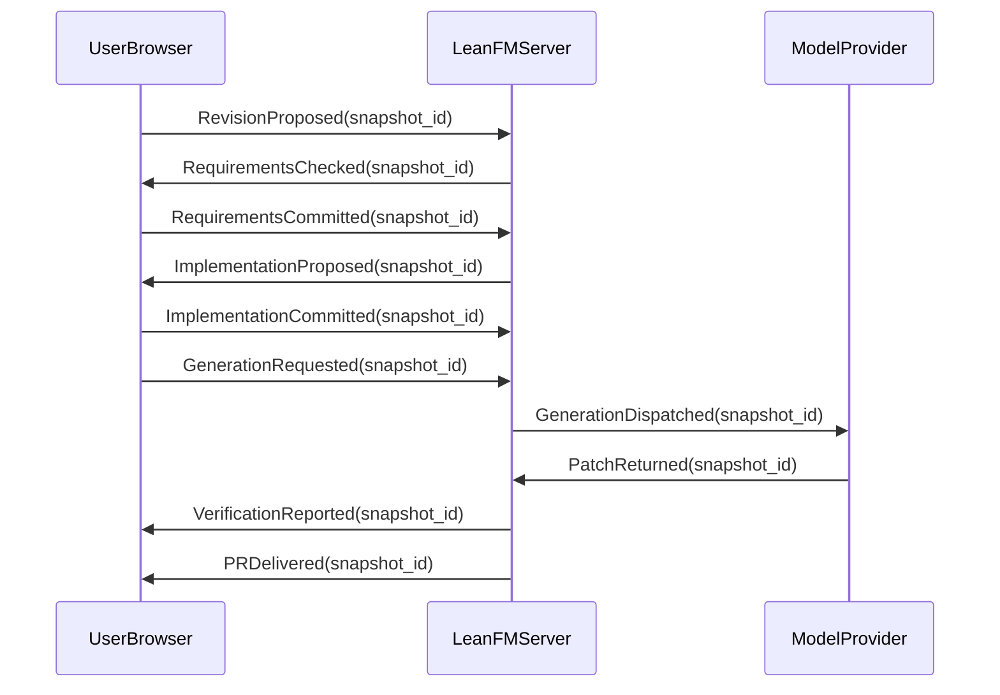
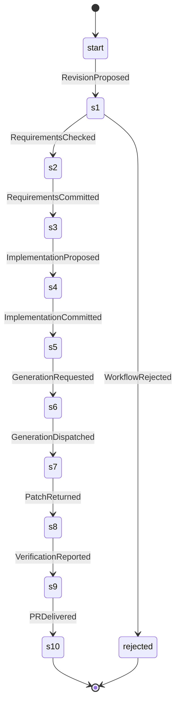
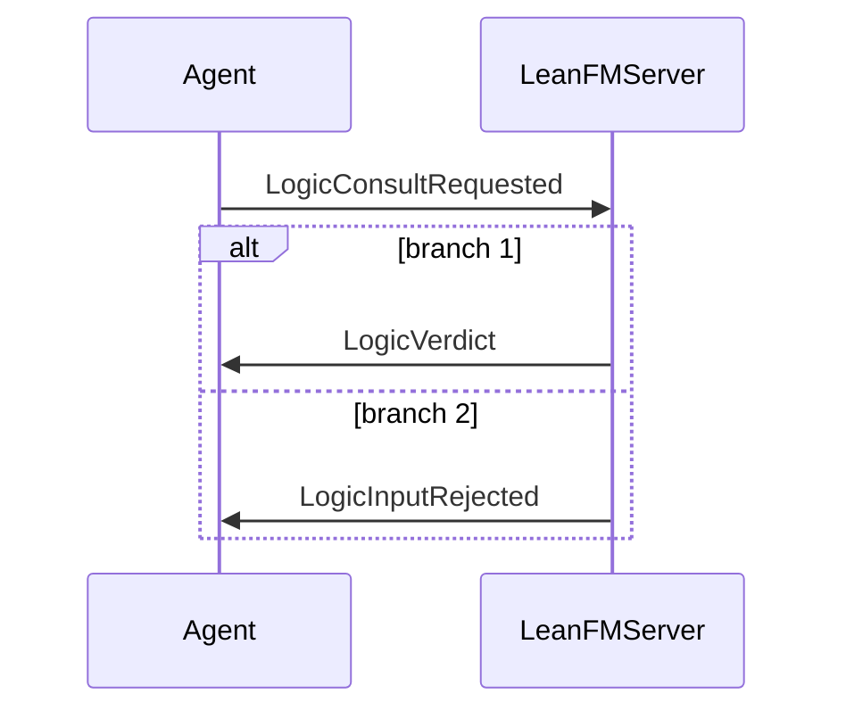

# Self-hosting requirements review

Status: proposal. Review and acceptance happen in git.

Product composition: ChatUI requirements plus revision-bound requirements-to-PR workflow.
Worker example: retained separately, not the specification of the whole product.

## Component registry

- leanfm.chatui: LeanFM/ChatUI/Requirements.lean; LeanFM/ChatUI/Requirements.proto; LeanFM/ChatUI/Implementation.lean - existing product component; conformance must be audited
- leanfm.selfhost: LeanFM/LLMGenerated/SelfHosting.lean; LeanFM/LLMGenerated/SelfHosting.proto; LeanFM/LLMGenerated/Implementation.lean - proposed workflow and clauses; MCP read-only context adapter implemented; remaining mappings pending
- worker.example: LeanFM/LLMGenerated/Requirements.lean; LeanFM/LLMGenerated/Requirements.proto; LeanFM/LLMGenerated/Implementation.lean - preserved example, not whole-product implementation

## Generated interaction: successful proposed workflow

## Generated state machine

## Generated interaction: MCP logic consultation

## Proposed clauses (not semantic proofs)

- selfhost.revision [proposed]: A snapshot is identified by exact book, requirements, protobuf, implementation, and repository revisions. Changes invalidate affected checks and derived artifacts; stale requests fail without overwriting current state.
- selfhost.gates [implemented]: Review and acceptance are git commits made by the user; LeanFM records no approvals and never blocks an edit, source write or launch on one. Code generation requires the current snapshot's requirements and implementation mapping to pass their canonical checks. Project status reports whether each is checked and committed.
- selfhost.project.implementations [implemented]: A project may carry several implementations of one specification, so the same requirements can be implemented in different languages and the implementations compared. manifest.json lists them as implementations: [{name, implementation, source}] with default_implementation naming one of them; a project without that list has one implementation, default, in spec/Implementation.lean with the manifest's source directory, exactly as before. Always: the specification check (scripts/chatui_specification.py, make spec-check in a project) validates the requirements once and derives spec/tasks.json from them alone, then compiles each implementation in the same sandbox and validates it against the same RequirementSpec in a driver of its own (so implementations may share a namespace), the default first; each listed implementation's outputDirectory must be its manifest source; reports/specification-check/validation.json records default_implementation and, per implementation, its file, source, module, target, status (validated, invalid or does_not_compile) and errors, and the digests of every implementation file; the default implementation failing fails the check and promotes nothing, while another implementation failing is recorded and the check still succeeds, so a port in progress never blocks the specification or its views. Never: a name that is not [a-z][a-z0-9_]* (at most 32 characters), more than 8 implementations, two implementations sharing a name or a file, an implementation path or source outside the project root, through a symlink, or whose path components are not Lean identifiers; a default_implementation that is not listed; an implementation compiled outside the sandbox the requirements use; an implementation's text changing spec/tasks.json.
- selfhost.pr [proposed]: PR delivery requires an actual patch, requirement-to-code/test mappings, reproducible check results, base revision, and remaining limitations. The PR may be delivered as a local reviewable bundle; remote publication requires explicit authority. Failed checks cannot be labeled completed.
- selfhost.checker [proposed]: Check results distinguish proved, disproved, unknown, unsupported, and resource-limit reached. Identify model revision, formula, assumptions, bounds, terminal-path convention, fairness, and witness or counterexample. Schema validation is not a semantic proof.
- selfhost.formulas [proposed]: Requirements must support typed nested CTL state formulas and separately typed path conditions. AF AG p is eventual permanent safety; AG AF p is universal recurrence. Preserve existential counterexample duals without claiming CTL covers all LTL.
- selfhost.modal [proposed]: Knowledge quantifies over legal histories with identical declared actor observations. Obligation and permission quantify over all and some nonempty named ideal policy futures. Never conflate legal, observable, ideal, and probabilistic alternatives. Belief and morality are outside this extension.
- selfhost.lazy [proposed]: Retain modality-specific indexes only while current formulas reference the corresponding actor or policy relation. Rebuild them from retained source evidence; release unreferenced indexes. Index lifetimes must not alter truth. Isolate caches by project and model revision.
- selfhost.probability [proposed]: Probabilities are optional and distinct from existence. Identify declared model probability versus observed frequency versus unknown. Specify normalization, conditioning, scheduler or min/max policy, horizon, threshold comparison, and sample boundary. Do not infer independence or treat unknown as zero.
- selfhost.history [proposed]: Immutable events carry predecessor links; derived successor indexes preserve event identity and partial order. State whether a past monitor uses causal ancestry or a declared linearization. Strictly prior facts exclude the current event.
- selfhost.coverage [proposed]: Every normative book claim is linked to an accepted requirement, an explicitly pending proposal, or a deferred/illustrative classification. Every accepted requirement maps to implementation decisions and evidence; unmapped claims prevent a claim of complete one-shot readiness.
- selfhost.handoff [proposed]: A new session starts from book/main.pdf, book/main-dark.pdf, canonical requirements/protobuf/implementation, component registry, current repository, and generated review report. Application goals also retain spec/ProjectMemory.md, spec/runtime.json, revision-bound actual-launch evidence, failure remedies and PR/base-revision context. Conversation history is not required input.
- selfhost.bounds [proposed]: Declare finite exploration and resource bounds. Exhaustion yields resource-limit or unknown, never proved. Compaction must preserve the declared observation and monitor semantics.
- selfhost.session.syntax [implemented]: A protocol is written in Lean with the protocol notation of LeanFM.Session and elaborates to a value of Global R for any role type R, so it can be instantiated with another protocol's roles. Statements: a message (optional name, label, sender, receiver, optional cause naming an earlier message, optional route naming the operation a request invokes such as POST /orders, optional status a response carries such as 402, optional where clause); an event at one role; choice with or-branches; parallel with and-branches; join k of branches; loop with continue in tail position; sessions; include of another protocol. Always: a label is a Lean type (one no structure declares is a structure that carries nothing, as the text reading treats it, so a misspelt label shows as a message of its own in every view, and a condition reading its fields is an error), and a where clause is a condition over the payloads of the messages named so far, type-checked as a Lean proposition when the protocol is written and run over the logged fields by LeanFM's interpreter when a trace is checked (selfhost.session.lean-syntax). Never: repetition other than continue at the end of a branch (the state space stays finite); a route or status changing any check's verdict (they are for people and generated views).
- selfhost.session.choice [implemented]: A choice names no decider. Always: the decider is the one role that starts every branch, by sending its first message or by an event at that role alone; an empty branch is that role choosing to do nothing. Never: a choice whose branches are started by different roles accepted (it is reported as a race naming who starts what); two branches that start with the same event; a choice none of whose branches does anything.
- selfhost.session.causes [implemented]: A message's cause names an earlier message it answers. Never: a cause that its sender has neither sent nor received (a role decides only from its own history); it is reported.
- selfhost.session.projection [implemented]: Projection gives each role its local type: the protocol with every message the role neither sends nor receives erased, its own choices as select and other roles' choices as offer; a role that takes part only in nested sessions blocks is a service (a text-message gateway, a mailer) whose local type serves those sessions, sessions { ... }, without being projected through the enclosing session's choices, and a service of several kinds of session tells them apart by their first messages (as an offer) or is reported; a join k of as join k of over the role's own branches (parallel when it takes part in no more than k of them), resolved by what arrives. Always: a role that does not decide a choice can tell its branches apart when the first messages it can receive in them differ, looking inside parallel; a role whose part of the session has not started (its first message has not reached it) may be absent from a branch that never contacts it, and the body of sessions is projected as not started. Never: a role that has already taken part left out of a branch, or unable to tell branches apart; projection fails with the reason (Role cannot tell which branch Decider chose).
- selfhost.session.composition [implemented]: Protocols compose. Always: include runs another protocol with the given roles and the rest continues where it finishes, each protocol written as if it were the whole; parallel runs branches interleaved, each keeping its order; join k of continues after any k branches, recording which ones; sessions runs any number of independent copies of its body. Never: an unselected join branch canceled implicitly (cancellation is an explicit message).
- selfhost.session.http [implemented]: The HTTP call discipline is optional and applies to channels declared HTTP (session_check: every channel once mayCall is given, except those between the roles of a notHttp pair). Always: every message on an HTTP channel is a request to a role the sender may call, or the response to the nearest pending request in its cause chain, sent back to the role that asked; a streaming response may answer more than once; every request gets a response before a run reaches the end of the protocol (a run that goes round a loop again has not ended). Never: a response sent to a role other than the caller, a request to a role the sender may not call, or a request left without any response accepted; each is reported as a cut naming the message.
- selfhost.session.physics [implemented]: Channel physics is declared beside the protocol. Always: a channel has a capacity, a full policy (block, reject, drop newest or drop oldest), sequencing, sharding, loss and duplication; presets (reliable, udp, stream, http, kafka) name common channels and a declaration states only what differs; every channel defaults to reliable; a spec states which surfaced conditions each channel's protocol handles, its properties and its assumptions. Never: a condition a used channel surfaces (timeout, duplicate, reject, loss, reorder, per-key order, partition, hostile, readable, close) left unhandled without being reported.
- selfhost.session.topology [implemented]: A deployment tree places actors in islands, datacenters, machines and replicated or sharded groups, and gives them interfaces with a scope and a kind. Always: an interface is named by its path (island, actor, scope, interface); ingress is reachable from anyone, peering from any island, internal from the same island, local from the same machine; placement adds conditions to a channel (partition across islands, hostile from outside, reject into a replicated group, per-key order into a shard); a library adds an interface kind by refining an existing one. Never: a channel to an internal or local interface reported reachable from outside its scope.
- selfhost.session.deployment [implemented]: The deployment tree of selfhost.session.topology is written as text, after the protocol it places: deployment Name of P { ... } holds outside and island groups, which hold datacenter, machine, replicated and sharded groups and roles; a role is written Role; or Role { scope name : kind; ... } with scope ingress, peering, internal or local and kind call, queue, stream, http, api, ingressHttp, ingressHttps, datagram or one declared earlier in the block by kind Name refines Kind [adds "condition", ...] [removes "condition", ...];. Neither deployment nor kind is a reserved word in a Lean module that imports the library. In a Lean file the block is a Lean command that checks it against P and defines nothing; session_deployment reads the same block with the same grammar and answers placed or refused, each role's place and interfaces, each link (a distinct sender and receiver of P's messages, includes inlined) with its labels, the interface it uses, whether that interface is reachable from the sender and the conditions the interface and placement add, and an SVG view of the tree with the links. A deployment adds no step to P: P's messages, their order and its nesting (choice, parallel, include, sessions) are unchanged, a replicated group does not replace the messages of a replication protocol, and the conditions are reported for the implementation to handle. Always: every role of P is placed exactly once; a link whose messages are all replies (each one's cause chain, at most 64 links, reaches a message its receiver sent to its sender, as the diagram dots replies) travels back over the interface of the link it answers, with its conditions and its verdict; any other link to a role with interfaces uses the first of them, in the block's order, that the sender can reach; any other link to a role with no interfaces is unrestricted, as in the topology; the view draws every placed role inside its groups and every link, a refused link dashed, and its answer carries the question, event source, reducer, unit and boundary. Never: a deployment accepted (elaborated without error, or answered placed) with a role of P unplaced or placed twice, a placed name that is not a role of P, a group inside a role or an outside or island group below the top, an unknown kind or a kind declared twice, two interfaces of one role with one name, or a link whose receiver has interfaces of which the sender can reach none; each is a Lean error at the offending role or declaration, and session_deployment answers refused with every such issue. Never: a deployment of more than 256 groups, roles and interfaces in all read.
- selfhost.session.diagram [implemented]: Interaction diagrams are generated from the global type, in standard sequence-diagram notation, never drawn separately. Always: Global.diagram draws one lifeline per listed role and one arrow per message, labelled with its id, label, route and status, with its where clause under it; a message whose cause chain reaches a call (a message that was not itself a reply) from its receiver to its sender is a reply, drawn dotted (round dots) while every other message, a request, is drawn solid, and the dividers of choice and parallel frames stay dashed, so a reply is never mistaken for a frame's line; so a response that follows other calls is drawn as the answer to the call that asked for it and a new call made after a reply is not; an event is an action box on its role; choice is an alt frame captioned with the role that decides (the one that sends the first message of every branch); parallel is a parallel frame; join k of n is a parallel frame captioned any k of n; loop is a loop frame and continue is drawn inside it; sessions is a loop frame around one instance; include is a ref frame named after the included protocol; a choice with no single decider is drawn and captioned as a race; every request that is answered is an activation bar on the callee from the request to its response, inset when the callee is still busy with another call, and a response in another branch of a choice gets its own bar from where that branch begins, so no bar runs through a branch its call is not in; the diagram is a list of shapes (rect, line, path, text) with colours named by role (fg, arrow, frame, muted, line, bg, actFill), written as SVG text in a theme or handed to a view as data. Lifelines are spaced so the widest message label fits between neighbours (180 to 420 pixels); Messages are drawn thicker than frames, dividers and lifelines, with arrowheads of a fixed size, a frame or divider opens below the arrow before it, and text outside a box has a halo in the background colour so no line runs through its letters. Repeated replies to one request within a branch extend its existing activation bar. Never: an activation bar starting before its request or overlapping an actor header; a construct of the protocol omitted from its diagram; an arrow that is not a message of the protocol; a frame's edge or a divider drawn along an arrow; protocol text (labels, ids, guards, role names) placed in the drawing unescaped.
- selfhost.session.calls [implemented]: cause packages interactions into calls, and LeanFM derives the calls and each role's typestate API from the global type. Always: a message whose cause chain reaches a request from its receiver to its sender is a response to that request, and every other message is a request; a call is a request with its responses (with their statuses) and its detail, which is every message the request causes directly or through others except its responses and what they cause; Global.calls lists calls as a tree, a request in another call's detail nested under the nearest such call, a request with no response listed as having no reply; Local.typestate reads a role's projection as states: the role starts in S0, a send, an event or a continue is a method that consumes its state and returns the next, a select is several methods on one state, an offer is one receive returning a sum of label and next state, a loop's continue returns to the loop's state, a parallel the role takes part in on one side only is that side followed by what comes after, and End has no methods. Never: a response listed as a call of its own; a message placed in the detail of a call one of whose responses caused it; a typestate method for a message the role neither sends nor receives.
- selfhost.session.generative [implemented]: Inline generative annotations in MCP protocol text elaborate to metadata beside an unchanged Global grammar: clock c = time(id) or max(time(id), time(id)); obligation Name on Role { trigger clock; require Label or Label within N days; on breach record Label; }; choice at Role using declared(name) with probability n/d per branch; and message at clock or time(id), optionally plus a duration or finite sample of duration:probability entries. Fixed units ms, seconds, minutes, hours and days convert to milliseconds. Always: erasure preserves all branches including zero-probability and late paths and the same CTL/projection/conformance semantics. session_check and session_diagram return a resolved generative layer. An external overlay with named choice weights and message timing expressions may supply or explicitly replace those annotations without changing the core text; the effective layer and provenance are returned. Never: malformed, negative, zero-denominator, greater-than-one, non-normalized, partial or duplicate distributions; unknown or forward clock/message references; mismatched deciders; duplicate clocks, obligation names or ambiguous event ids in one path accepted; metadata executed as Lean or host code; annotated concurrency, recursion, includes or nested sessions silently assigned timed scheduling semantics. Structural tools retain the grammar; generative execution reports unsupported constructs. Input and enumeration bounds fail explicitly rather than truncate.
- selfhost.session.generative.execution [implemented]: For finite sequential protocols with choices, session_simulate uses the resolved probability/time layer to produce deterministic seeded timed event envelopes and per-session deadline reports. Always: event time is monotonic milliseconds within each session; a missing explicit time uses the preceding event time (initially zero); a requested absolute time before its causal prefix is an error, never clamped. Unweighted multiway choices require weights in generative mode, never silently uniform. Finite path enumeration is bounded; unsupported or inconsistent paths, including zero-mass paths, are validated. Samples carry conditional weights and an explicit declared or external overlay origin; generated events conform to the erased grammar and preserve event causes, predecessors and answers. Obligations start at their declared clock, fulfill on a matching message sent by the named actor from trigger through the inclusive deadline, and are pending until the observation horizon passes the deadline if unmet. A late fulfillment remains violated. Breach records are monitor output, never fabricated sends. Never: a late or zero-probability trace removed from protocol conformance; a complete protocol treated as evidence that an unmet deadline already passed; probability claims inferred from a seed; one session's clocks, message ids, causes or obligations reused in another; incomplete generation returned as complete after an event limit.
- selfhost.session.generative.monitor [implemented]: session_conform keeps structural verdicts independent of normative deadline reports. For annotated sequential protocols, timestamped observed traces are replayed against the erased paths with actual event times; report obligations as fulfilled, pending, violated or not-triggered. Observations outside a generation distribution remain structurally admissible. Optional observation horizon is per-session-relative milliseconds, at least the last event time; otherwise use the last event. A protocol whose layer only the chain can run (loop, accrue, after on an event, a periodic gate) has no finite paths to replay: session_conform gives its structural verdict with no deadline reports, and the layer's executionUnsupported note says that generation and expectations run on the chain (session_simulate, session_dataset, session_mdp) while deadline monitoring does not; for any other unsupported construct the note is the generator's own reason. Never: a conformance check that fails because deadline monitoring cannot run; a note saying a protocol cannot be generated when the chain generates it; missing or decreasing timestamps silently accepted for timed monitoring; a label from the wrong actor fulfilling an obligation; a future delivery inferred from a prefix; a sidecar overlay silently discarded or partial distributions silently renormalized.
- selfhost.session.mdp [implemented]: session_mdp renders a finite sequential session with its resolved inline or external probability layer as a decision tree: protocol states, explicit action selections with policy weights, probabilistic timing outcomes and deterministic transitions. Always: generated shapes and escaped SVG describe the same checked graph, with exact terminal masses summing to one, including zero-mass terminals. Return terminal message/time/obligation outcomes and the exact probability of at least one violation, counting each terminal once. Pending obligations are not violations or fulfillment. Terminal probability is reaching that complete path, not probability on an outgoing terminal edge. Preserve prefix history, clock times and branch identity; never merge states merely because labels match. The view is an unfolded process under the supplied policy, not an optimal-policy solver. Unknown weights, invalid protocols, unsupported scheduling, path/node/output limits and non-unit terminal mass fail explicitly; never normalize or truncate a complete-looking graph. No evaluation, external IO, HTML injection or secret access from model input. Return prompt, question, source, reducer, units and finite-session boundary with each view. The MCP Apps view displays the graph and terminal distribution directly and retains overlays when redrawing.
- selfhost.session.amounts [implemented]: A message may carry an amount, moving a quantity of one named unit from its sender to its receiver: amount 1000 USD, or amount sample { 1000 USD : 9/10; 700 USD : 1/10; } for an uncertain quantity. An obligation may name a penalty its actor pays when it is violated: on breach record Label pays 2000 USD to Role. Always: quantities are whole numbers of at most 12 digits; erasure leaves the Global grammar, projection, conformance and CTL unchanged; session_mdp shows each amount on its message state and an amount sample as transition outcomes whose exact probabilities multiply into the terminal masses; each terminal reports every role's net balance per unit (received minus sent, plus penalties received minus penalties paid), and the result reports each role's exact expected net balance per unit (the sum of terminal probability times balance, signed) together with the expected penalty paid; for every terminal and unit the roles' balances sum to zero, since value is moved, not created. Never: an amount on an event or outside a message; a negative, fractional or oversized quantity; an amount sample with mixed units, duplicate quantities, more than 16 entries or probabilities that do not sum to 1; a penalty payee that is not a role or is the payer; a pending or fulfilled obligation's penalty counted; an expected balance rounded, normalized or computed from a seed.
- selfhost.session.mdp.loops [implemented]: session_mdp also analyses a sequential session with loops (loop and continue) as an absorbing Markov chain under the supplied policy, and does so for any session when asked for view chain. One state per protocol point; one edge per message, event, choice action or loop entry, each with its exact probability and the mean of its amount. Always: expected visits per state solve v = start + vQ over the transient states with exact rationals; an edge's expected traversals are its source's expected visits times its probability; each role's expected net balance per unit is the sum over edges of traversals times the edge's mean amount, minus for the sender and plus for the receiver; the expected number of messages is the sum of message-edge traversals; amounts are drawn on edges, in this view and in the tree view, and every state shows its expected visits (in the tree, its probability of being reached); on a loop-free session without obligations the chain's expected balances equal the tree's; the result carries prompt, question, source, reducer, units and boundary. Never: a session that some reachable state can never leave reported with finite expectations (the linear system is singular, and the tool says the session can loop forever); obligations evaluated in a looped session (deadlines depend on history, and the tool points to the tree view); message times silently used (the view says it does not use them); parallel, join, sessions, include or an unweighted choice accepted; more than 96 states; a probability or expectation rounded.
- selfhost.session.mdp.rewards [implemented]: The chain view of session_mdp is a multi-reward process: amounts per traversal on edges, time per edge, and amounts that accrue per unit of time while a rate is in force. A message or event may come after a delay relative to the step before it (on 1 week, or after sample { 1 days : 1/2; 3 days : 1/2; }); weeks join the time units. A statement accrue N UNIT per PERIOD from A to B sets the rate at which A pays B from that point until the next accrue for the same payer, payee and unit (accrue 0 ends it, as a grace period). Always: an edge's expected time is its traversals times its mean delay; a state's expected residence is the sum of the expected times of the edges that leave it; the session's expected duration is the sum over edges; each accrual adds, for every edge, traversals times mean delay times the rate in force at the edge's source; the session ends in one end state per distinct last step, each with its exact probability (their sum is 1) and the expected balances and duration given that outcome (joint expectation divided by the outcome's probability, using absorption probabilities from every state); a rate period is exact milliseconds and rates are exact rationals per millisecond; the drawing's legend and the result's breakdown give, per role and unit, the expected balance with each source's share (a message's label, or the rate that accrued) and, when a role trades exactly two units against each other, the effective price of one in the other; the legend's decimals are rounded to the nearest hundredth and the exact values stay in the result. Never: a state whose rate in force differs between paths that reach it accepted (the tool names the state and asks for the rate to be declared after the paths meet); an absolute time (at clock or at time(id)) used as a delay in the chain or mixed with accruals; an accrual in the tree view silently ignored (the tool points to the chain view); a conditional expectation for an outcome of probability 0 reported as a number; a negative rate, a zero or oversized period, or a rate between a role and itself.
- selfhost.session.mdp.walk [implemented]: session_mdp with walk computes the rewards of one specific walk through the chain instead of their expectations: the same weights (trade vectors on edges, rates in force times time) applied to the walk's actual traversal counts and times. A walk comes from an event stream: events in session_conform's format (label, from, to, session, and timeMs or time in session-relative milliseconds), grouped by session in order of first appearance, each step's delay being the time since the previous event of its session (the first since zero); a hand-written walk is a list of steps (label, optional from, to and afterMs), a step without a time taking its edge's mean delay. With several sessions the result gives each session's walk and their totals. Always: from the current state the walk follows choice, loop and rate edges to the one message or event edge that matches the step, multiplying the probabilities of the choices it takes; the result gives each edge's count, each state's visits and time, the walk's duration, each role's balance per unit as a map keyed by unit, the walk's probability under the policy, and whether it reached an end. Never: a step that no edge reachable from the current state matches, or that two do, accepted (the tool names the step and what could come next); a time that goes backwards within a session, or a stream mixing timed and untimed events; more than 512 steps in one session or 5000 events in a stream; a walk's result presented as an expectation.
- selfhost.session.mdp.horizon [implemented]: A step may wait for a periodic gate: at next 1 week (on a message, or on an event after its role) happens at the next whole period since the session began. session_mdp with horizon (such as 52 weeks) analyses a session with exactly one gate over that many whole periods, whether or not it ever ends: the gate splits time into periods, each ending with one passage of the gate, so the graph is the same for every horizon and only the count of periods changes. Always: the tree view times a gated step at the next multiple of its period after the previous step; with a horizon of N periods, the initial segment (start to the gate) and the cycle (gate back to the gate) are solved as absorbing chains, q0 and q being the probabilities that each reaches the gate; the gate passes q0 (1 + q + ... + q^(N-1)) times in expectation and the cycle runs q0 (1 + ... + q^(N-2)) times; the expected wait at the gate is the period times its passages minus the expected work time on the paths that reach it; every reward is then traversals times trade vectors plus rates in force times time, so a weekly trade that always continues passes exactly N times and a rate in force throughout accrues for exactly N periods; the result gives the number of periods, the probability that the session is still running at the horizon, totals per role and unit as maps keyed by unit, and the same drawing with horizon totals; a partial period after the last whole one is not counted, and the result says so. Never: a horizon without exactly one gate, or a gate without a horizon in the chain view (the tool says which is missing); a loop that does not pass the gate; work before a gate that can take longer than its period (the longest path, with each delay at its largest, is checked); a horizon shorter than one period or over 10000 periods.
- selfhost.session.generate.chain [implemented]: session_simulate generates event streams from the chain for sessions the timed generator cannot run (loop, accrue, after on an event, a periodic gate): each session walks from the start, drawing each choice's branch, each delay and each amount by their exact probabilities with the seeded integer-ticket sampler, a gate waiting for the next whole period. Events carry session, id, label, src, dst, prior, session-relative time in milliseconds, the amounts actually moved, the message's own id, and the cause the protocol names for it: the latest event in the session with that id (a loop rebinds an id on every pass), so a generated stream conforms. Always: the same seed gives the same stream; every generated session is a walk of the chain, so session_mdp with the stream as events accepts it and computes each session's realized rewards from the amounts actually drawn (a walk step may carry amounts, which must match the edge's sender, receiver and unit); a session that reaches an end is marked ended; over many sessions the mean realized balance approaches the expected one. Never: more than the instance limit of sessions or 512 events in one session (a longer session is cut and marked not ended, never extended); an amount on an event that its edge cannot move accepted by a walk; a generated time that goes backwards; a generated event without the cause its message names.
- selfhost.session.diagram.annotations [implemented]: The sequence diagram (session_diagram and every tool's diagram panel) shows a protocol's generative annotations under each arrow and event: its branch's probability on the branch's first step (p 4/5), its amounts (15 USD, or each outcome with its probability), its time (on 10 seconds, at next week) and, when the session's chain can be solved without a horizon, its expected count per session (x5/4); a legend under the lifelines gives each role's expected balance per unit with its sources and the expected duration. Always: each copy of a step that the global type repeats in several branches carries that step's own annotation, because annotations are matched by the step's position in the protocol, not by its label; a protocol without annotations draws exactly as before. Never: the position tag used for matching appears in the drawing, its text or the legend; an annotation drawn under a step it does not belong to.
- selfhost.session.diagram.folds [implemented]: Every request/response pair of an interaction diagram is a fold, in every view that draws a protocol's interaction diagram (the session view, session_explore's tree and the protocols the navigator opens through project_view). Always: a call is a request and its responses, the messages Global.diagram draws as replies to that request (their cause chain reaches the request from the request's receiver to its sender), together with everything drawn between them (nested calls, events and frames); its span runs from the top of the request's row to the bottom of its last response's row, or, for a response drawn inside a frame that opens below the request (a choice of responses, a loop), to the bottom of the outermost such frame, so a fold never cuts a frame; Global.diagramModel lists each call with its caller, callee, request label, response labels and statuses, its span, its depth (one more than the number of calls whose span contains it) and the roles of the messages and events inside its span, and lists each lifeline's role and x and each message's and event's row and roles; folded, a call is drawn as one double-headed arrow from caller to callee labelled Request -> Response status (several responses, as in a choice, joined by |) with a marker that opens it, and what lies below moves up; unfolded, it is the request, the nested messages and the response as before; each call folds and opens on its own, and a call inside a folded one keeps its own setting; calls at depth 2 and below start folded, so the top level reads as calls. After folding, a role that has messages or events, all of them inside folded calls or folded frames, is elided: no lifeline, no head and no column, and the lifelines to its right move left; opening a call brings back the roles it uses; the elided roles are listed in a note hidden: Db, Cache above the diagram, and clicking a name opens every folded call and frame that holds one of its messages; when every role would be elided, none is. Never: folding or eliding hides a message from checks, conformance, the event log, the session type or any tool's answer (they change only the drawing: the shapes and calls LeanFM sends are the same whatever is folded, and only the view decides what to draw); a fold whose span holds part of a frame, or a call whose responses are drawn only in a branch the request is not in; an elided role missing from the hidden note; a fold arrow drawn between any roles but its call's caller and callee.
- selfhost.session.derived-sessions [implemented]: A session in an event stream is derived from the protocol, not read from the events. Always: session_simulate answers derivedSessions, which groups the stream's events by union-find over two kinds of join: an equation in a where clause between fields of two messages (a.roomId = q.roomId, at the top of the condition or under and) joins the events of those messages that carry the same value in the equated fields, transitively across equations, and an event's cause and prior links join it to the events they name; each group is listed with its key (the equated field and value that joined it, such as roomId=r7, or, for a group joined only by links, the first event of its chain), its event count, its events oldest first, and the simulated session numbers its events carry, which are only a cross-check: the answer counts the groups that match one simulated session exactly and never groups by them; an event that matches no equation and no link is listed as unattributed, never placed in a session; the session view's event stream shows the derived sessions as buttons (key and count) with all and unattributed, the session buttons in a list of their own at most about four rows tall that scrolls vertically when there are more (all and unattributed staying outside it, always visible), so a log with many sessions never pushes the stream's drawing down, and picking one filters the stream's drawing and its event log to those events, the roles with no event left elided and listed as hidden as in selfhost.session.diagram.folds; the simulated session number stays in the log as a cross-check, not a filter. Never: the filter changes a check, a verdict, or the events and log LeanFM sent (it only selects which events are drawn and listed); an event in two derived sessions (the groups partition the attributed events); two groups merged by anything but an equation or a link, and when equations over different fields join groups the key names every field and value that joined them and the answer says which event joined them; an equation under or or not used as a join (only equations that must hold join); an answer over its bounds (the 600 events the view draws, 64 equations, 200 sessions listed, the rest counted).
- selfhost.session.log-sessions [implemented]: A log does not have to name its sessions. Concurrent sessions interleave in one log, as many TCP streams interleave in one capture, and session_conform tells them apart by identity the protocol declares, as Wireshark follows a stream by its addresses and ports, never by an id an implementation might log wrongly or not at all. Always: when no event of a log names a session, session_conform derives them: two events are in one session when one names the other as its cause (an answer belongs to its request's session), when they carry the same value of the protocol's declared session key (sessions by a.caller: that message's field), or when one carries a Link value the other minted as a Fresh value while that session is live (selfhost.session.identity.marks); a Fresh value starts a session, and a Fresh value seen again after its session terminated starts a new one, because the value was freed; an event no such link reaches starts a session when the protocol lets a session start with its message, and is otherwise unattributed: a problem saying the log cannot place it and how to make it placeable (name its cause in the protocol, declare a session key, or log session ids), because sessions are parallel copies of the protocol whose events interleave in any order, so B -> A: resp twice after A -> B: msg twice fits either pairing unless each resp names the msg it answers; each derived session is checked as a logged session is, named by its key value or, without one, by its first event; when every event names a session, the log's sessions are checked as before and the derived sessions are a cross-check: two events that a cause or a key value puts in one session while the log puts them in two are a problem naming both events, their log sessions and the link, and the log does not conform; every answer gives derivedSessions in session_simulate's shape (each session's key, its events as positions in the stream, and the log sessions its events name) and the log as an event stream (events numbered from 1 in log order, each with its label, roles, act flag, its cause and prev as links to those numbers, and its log session), so the session view draws a log as it draws a simulated stream: a button per derived session plays only that session, as Wireshark's Follow Stream does, and clicking an event focuses on the thread its prev links reach. Never: a where-clause equation joining sessions in a log (equal values are a condition the protocol checks, not an identity: two unrelated payments of 10 are not one session); prev joining sessions (an actor that takes part in several sessions orders its own events across them: B's second resp names its first as prev); an event the log cannot place guessed into a session; an event in two derived sessions; a log in which some events name a session and others do not accepted (it is refused, saying to name a session on every event or on none); the view's session filter changing a verdict, an event or the log LeanFM sent; more than 200 derived sessions listed (the rest are counted).
- selfhost.session.identity.marks [implemented]: A message's fields say whether it starts a session or continues one. A field typed Fresh T is minted by the message that carries it: POST /orders answers Created with orderId : Fresh String, and that value names a new session. A field typed Link T names a session minted earlier: GetOrder carries orderId : Link String, and belongs to the session that minted that orderId. A Link field links to the Fresh field of the same name and type in the protocol; a message may carry several Link fields and one or more Fresh fields. A field says where it travels, header, path, query or body, because the state an event carries may sit in any of them and the choice is not principled beyond this: a header is visible to every process that handles the message without reading its body (a proxy, a router, a log shipper), so identity a process must route by belongs in a header or the path; a field without a placement is in the body. The marks are the identity: sessions are parallel copies whose events interleave in any order, and only marked fields (and causes) say which events belong together. sessions by a.caller is the special case of one Fresh field that never forks. Always: the marks and placements are the Lean types Fresh T, Link T, Header T, PathParam T and QueryParam T (each the value itself), so a session-type file still compiles, and a placement may wrap a mark, Header (Link String); session_types writes each as plain T in the .proto, the Lean module and the JSON schemas, the .proto and the Lean module noting the mark and placement in a comment, so implementations carry plain values; session_openapi writes each field where it travels (header, path or query parameter, or body schema); conformance reads a logged event's fields from its headers, path, query and body objects alike, each typed as its message declares; the marks are part of the protocol text, typed when it is read. Never: a Link field with no Fresh field of its name and type in the protocol (it could never be satisfied; refused naming the field); a Fresh or Link mark on a List, an Option or a structure; a where equation treated as identity (it stays a condition); a field marked both Fresh and Link.
- selfhost.session.identity.graph [proposed]: Sessions fork and join as messages do, so the sessions of a run form a graph, not a partition, and each session thread is a state machine of protocol states, not actor states: the session type says which states and steps exist, and CTL states the fine detail the structure does not. The graph's shape is read from the protocol text (selfhost.session.identity.scopes), never inferred from a log: a login session is the parent of the tasks it runs because the text includes each task with the login's token, not because the task's events happen to carry it. Child sessions from given and with in logs without session ids are selfhost.session.identity.children, and a session belonging to two sessions is selfhost.session.identity.joins; this clause adds per-session residuals and the interleaved view. Always: each session's current protocol state is the residual of its own session type (the block or included protocol that scopes it) after its events, carried by the fields of the events that name it; a session's parent is the session whose id the text binds into the block that mints it, a fork (an order session creating one shipment session per parcel; a login running any number of order tasks); a message that carries its own session's id together with its parent's (an order message carrying the token and the orderId) belongs to its own session, and the parent id is checked to be the parent's value, not treated as a join; a message carrying Link fields of two sessions that are not parent and descendant is a join (checkout links a cart session and a customer session), it belongs to each, and its answers belong to the same sessions; a join is accepted only where the text writes it (a block whose include binds both ids), and otherwise is a problem naming both sessions; a cause keeps an answer in its request's session. session_conform and session_simulate answer the session graph: each session with the block or protocol that scopes it, the Fresh field and value that named it, its events, its parent session and the message that forked it, and each join with its message; the session view draws the graph beside the stream and shows the sessions' state machines interleaved in the one big log: each row of the log is one event, with the protocol state every live session is in after it (the session it advanced moved, the others unchanged), so many concurrent machines read as one log; following a session plays its events with its children's folded under the fork that started each. Never: two sessions merged because a message links them (each stays a session; a join is an edge); a parent inferred from which ids an event carries rather than from the text's bindings; an event placed in a session no cause or Link names; a fork or join inferred from prev, timing or log order.
- selfhost.session.identity.scopes [implemented]: The protocol text says how session ids pass into the tasks it runs, so how many sessions a run has and which belongs to which is never left to a reader of its diagrams. Protocols nest (include), and each composition operator has one identity rule. Always: a protocol declares the ids it is given, protocol Order (Client, Shop) given token, each a field whose Fresh field is minted by whoever includes it, so the protocol checks on its own (refining selfhost.session.identity.marks: a given field's Link needs no Fresh field of its own name, because the include names the field that mints it); include binds every given field to a field in scope, include Order Client Shop with token, or under another name, with token = sid, the types equal, where a field in scope is a field of a message earlier in the including protocol (in its sequence, or before the block that holds the include): a Fresh or Link field, or a plain field read as a reference, such as the gameId a person picks from a listing, which names a session without making the message that carried it part of that session; or a field that protocol is itself given; inside the included protocol a message carrying a given field carries the includer's value: session_conform reads a renamed Link (token bound to sid) as naming the session that minted sid, through every level of include, so a task message carrying another login's token links two live sessions and is reported, never accepted as its own; sequence and choice continue one session (a choice branch may mint a field another branch does not); parallel and join k of run their branches inside one session, told apart by their messages, so they need no id; sessions { } runs any number of copies at once, so copies must be told apart: a message a copy can begin with starts a copy, and every other message of the body names a cause or carries a Link to a Fresh field some message of the body mints (Get carries the orderId Created minted; a Link to a given field names the parent, not the copy), or the body is sessions by a.caller, or the body has at most one message (an included protocol's messages count as the body's); a body whose copies cannot be told apart is reported by session_check under identity, naming the message that cannot be placed and the fix (mint an id and carry it as a Link, name the cause, or write sessions by), without changing its verdict, because such a protocol is still valid for logs that name their sessions, and session_conform without session ids already reports its later messages as unattributed; sessions by a.caller is read as an id minted by the body's first message and freed when its session terminates, as a Fresh value is, so in a log without session ids, after that session ends the same caller starts a new one (a log that names its sessions names each by its key value, selfhost.session.envelope, so it says itself which Hello begins a session); session_check writes each include's bindings on its box in the interaction diagram (ref Order with token), and the outline still opens the box as protocol Order. Never: an include whose with names a field not in scope, binds a field the included protocol is not given, binds a different type, binds a given field twice, or leaves a given field unbound (refused naming the field and the include); a given field marked Fresh on a message of the protocol that is given it; a sessions body whose copies cannot be told apart passing session_check without its identity note; a binding or a scope taken from a log, a diagram or chat rather than the text; a protocol with no given fields, no with and no marks read, checked or drawn differently than before (its only change is the identity note).
- selfhost.session.identity.children [implemented]: In a log without session ids, a task the protocol text runs with its parent's id is a session of its own, a child of the session that minted that id, because the text binds the id into the task (selfhost.session.identity.scopes), never because its events happen to carry it. Always: a Link field a message carries because its protocol is given it by an include that lies inside a sessions body entered after the field's value was minted (Create's token, bound by include Order Client Shop with token = sid inside sessions { }, under its own name or another) names the parent, while an include in sequence, a choice or a loop continues its includer's session, so there a given Link is an ordinary Link that joins (a challenge's TakeSeat belongs to its person's session): it is checked to name a live session, as every Link is, and records that session as the parent of the session its event belongs to, never joining the event to that session; the event's own session is set by its cause, its other Link fields and the Fresh fields it mints, as before, and an event that names no cause and links no other session starts a session, so each copy of a sessions body is one child session and the parent session keeps only its own messages (a login's Login, LoggedIn, Logout and Bye); a child session whose events name two different parents is a problem naming the event, the field, its value and both sessions (an order message carrying another login's token), and the event stays in its own session; each session is replayed against the protocol's body or, when it does not fit, against the body of a sessions block nested in it at any depth (an include inside it taken as one instance), and a value a session minted is freed when the body it fits allows no further step, so a child's orderId is freed when its order ends; session_conform's derivedSessions gives each child session its parent's key. Never: a parent link merging two sessions; a parent taken from event order, prev or timing; a protocol with no given fields derived differently than before, except that a value minted in a nested sessions block is now freed when that block's session ends; a log that names its sessions checked differently than before.
- selfhost.session.identity.joins [implemented]: A task can belong to two sessions at once: a move belongs to the person who made it and to the game it is played in. Concurrent sessions are concurrent interaction diagrams (two games of four players are two game sessions running at once), and a join is how one task takes part in two of them. As for children (selfhost.session.identity.children), the shape is read from the protocol text, never from a log. Always: an id names the session of the scope that mints it: a protocol included inside a sessions body whose messages mint a Fresh field (GameCreated minting gameId inside sessions { include GameP Person Server Bot with sessionId; }) is a session of its own, a child of the session that ran the include, and the id names it while it is live; a sessions copy given two fields whose values were minted by two different live sessions (include PlayMoveP Person Server with sessionId, gameId: sessionId minted by the person's sign-in, gameId by the game's creation) is a join, accepted because the include binds both: its events are one session that lists both parents, each with the given field and the value that named it, and neither parent's events change; a person may join a game another person created, so the four players' requests in one game are four persons' children that all join that one game; session_conform's derivedSessions lists each session's parents (one for a child, two or more for a join), and in a focus the session view frames a joined session inside its first parent's frame, its tab naming every parent; a session that only reads a reference to another session (a listing's plain gameId) neither joins nor is joined by it. Never: a join accepted where the include binds only one of the two ids (a copy whose given Links name two sessions for one field, or a Link names a session for a field the include does not bind, stays a problem naming both); a join inferred from equal values of unmarked fields, from prev, timing or log order; the two parents merged, or either parent's events moved into the join; a game's turns (Server and Bot) placed in any person's session rather than the game's.
- selfhost.session.correlation [proposed]: A session type with typestates is abstract; it is implemented in the messages. A message carries the typestate it belongs to: when an actor applies it, the actor moves to a new typestate and the messages it emits carry fields that place them there. prev and cause are the one uniform representation of the chain: every message carries a pointer to its prev (the previous message its sender sent in this thread) and, when it answers one, to its cause, so the default case is sane: on a reliable channel (in order, lossless, a bounded queue) the prev pointers alone thread each actor. Where the wire carries no such pointers, the where clauses say which ordinary wire fields implement them (a request id, a session id, a TCP 5-tuple), never LeanFM-only metadata, so LeanFM reads existing protocols (HTTP, UDP, TCP over IP) as they are logged or captured. A full interaction diagram is one session, one thread of typestate (follow TCP stream: no actor's prev chain forks or joins), and the protocol definition is always one; a flat interaction diagram is the union of actors and messages over concurrent sessions, several full diagrams drawn over one another, and only cause and prev untangle it. A channel's behaviour is a set of implicit constraints (selfhost.session.ctl-translation): declaring a channel lossy or reordering (selfhost.session.physics) removes some of them, so a protocol over UDP is the same diagram with fewer constraints, and a gap, duplicate or reordered prev chain is a condition the protocol must handle. Always: a conjunct of a where clause relating a message to the id it names as its cause implements the cause on the wire (a.requestId = q.requestId), and in a log that names no cause ids an event's cause is the event of the named message whose fields satisfy it and that is still waiting for its answer, wherever it was logged; session identity reduces to the same kind of equation: Fresh and Link (Link f holds when f equals the value of f the session's Fresh message minted), given and with (the included protocol's field equals the includer's bound field) and sessions by (equal key values) are shorthand for where equations; session_conform and the session view name, for each derived cause and session, the equation and the field values that placed the event. Never: a cause, prev or session placed by timing, log order or position in a capture; an event that satisfies the equation of two candidates silently matched to either (it is reported, naming both); a log required to carry a field the protocol's own messages do not; an equation that is only a condition (amount = 10) read as identity: an identity equation relates a field of one message to a field of the message it answers or follows.
- selfhost.session.ctl-translation [proposed]: An interaction diagram is a set of CTL formulas over its messages, so everything a protocol says (its order, its choices, its channels) can be stated and checked as properties, and what the structure does not say is added in the same language. Always: each message of a session type becomes the atom arrive(sender, receiver, message) (and send for its sending); a message whose prev is another contributes the formulas its channel implies: on a lossless channel AG(arrive(A,B,m) -> AF arrive(A,B,next)) where next is the message whose prev is m, and on an in-order channel AG(arrive(A,B,next) -> once arrive(A,B,m)), using past modalities (once, previously, since, as dcj-lint's past operators do) so ordering reads as what must already have happened; a cause contributes AG(arrive(B,A,answer) -> once arrive(A,B,request)); a bounded channel of capacity c contributes that at most c messages are sent and not yet arrived; declaring a channel lossy removes its lossless formulas and declaring it reordering removes its in-order formulas, and nothing else changes; session_ctl accepts the past modalities in formulas it checks, and LeanFM can answer a protocol as its implicit formulas, each named by the message, the link and the channel property it comes from. Never: an implicit formula whose channel property was declared absent; a past modality evaluated over a future it cannot see (once refers only to the path so far); the formulas a protocol implies differing from the state graph session_ctl checks (each implied formula holds on its own protocol's graph).
- selfhost.session.faithful [implemented]: A protocol's faithful CTL says exactly what the protocol allows: in each typestate, each next typestate is possible and nothing else is. LeanFM decides it as one bisimulation check, never by checking one formula per typestate (O(n²) for n states). Measured in reports/ctl-translation/faithful: GoServer's 1,605 rules took 36 s one at a time and did not finish in the old checker, while one bisimulation check took 182 ms and the walk 17 ms. Always: the typestates are the classes of the protocol's checker model (Logic.buildModel: a node is a state with its last message, atoms on(label) and terminal, an ended session stutters) under bisimulation, found by signature refinement (each round splits a class by the classes its successors reach), which costs one pass over the m steps per round and takes lookahead+1 rounds, where lookahead is the most steps any typestate needs to be told from another (0 to 6 in every protocol LeanFM carries; n rounds in the worst case, so O(n·m) at worst: Paige and Tarjan's O(m log n) refinement is not used); when the protocol's typestates are deterministic (no typestate has two next typestates with the same message and ending), which is what a message carrying prev gives, a candidate is decided by one lockstep walk from the start pairing each of its nodes with the one typestate it must be, in O(m); otherwise by one refinement over both models together. session_ctl with faithful rules answers the typestates, the lookahead and one rule per typestate, AG (typestate -> (EX next1 and ... and AX (next1 or ...))), each typestate named by its last message, ending and, when it needs it, what can follow, as a formula with shared parts (written as an s-expression, selfhost.session.ctl-sexpr); with faithful a task (an inline draft as check_ctl takes) or faithful lean (another protocol text) it answers faithful or unfaithful, the method (walk or refinement), and for an unfaithful candidate the shortest path to a point where the two differ and what differs there (the next messages, or the ending). Never: faithfulness decided by evaluating one formula per typestate; two bisimilar models reported as different, or two that are not reported as the same (tested by mutation: every changed copy of LeanFM's own protocol caught, no equivalent copy flagged); a candidate past the model bound reported as decided; working memory that grows with rules times nodes.
- selfhost.session.ctl-scale [implemented]: A CTL formula is checked in time linear in its distinct subformulas times the model, with bounded memory, so large protocols (GoServer's 39,497 checker nodes) can be checked interactively, and every tool that evaluates CTL (check_ctl, session_ctl, Spec.check, systems, evidence paths) gets it. Always: a formula is hash-consed before it is evaluated: each distinct subformula is one node of a DAG, found through a hash table keyed by its operator, its children's node numbers and, for an atom, the atom itself (the key is compared in full on every hash match, so a collision costs a comparison, never a wrong answer), and a formula whose parts are shared in memory (as the s-expression reader builds them) is walked once per shared part, not once per path to it; derived operators are rewritten into not, and, or, EX, AX, EU, AU and EG with the same meaning as before; the DAG is evaluated once, children before parents, each truth set a packed bitset over the model's nodes, EX and AX in one pass over the steps and EU, AU and EG each in one backward worklist pass over a predecessor index (O(m) each, where the fixpoint iteration they replace could take n passes); a truth set is freed once every node that reads it is evaluated, and the bytes held at once are bounded (maxTruthBytes); check_ctl's and session_ctl's size bound counts distinct subformulas (session_ctl allows 65,536) while the tools that write a formula back out as a tree keep a bound on its tree, and parseFormula, parseShared and parseBounded apply the bounds the caller passes, not the global default; an answer for a formula too large to write out as a tree gives it as an s-expression with its shared parts labelled; wherever such an s-expression is for a person to read (the notation of such an answer, each faithful rule's sexprPretty beside its one-line formula, and every listing the book generates) it is laid out as explain_formula's sexprPretty lays it out, never as one line broken wherever the page runs out. Never: a subformula evaluated twice in one evaluation; a verdict that differs from the fixpoint evaluation it replaces (tested against it on every operator); a bound given by the caller ignored; a check that would hold more truth-set bytes than the bound proceeding (it stops and says so, nothing proved); a formula's answer written out as a tree exponentially larger than the formula.
- selfhost.session.ctl-sexpr [implemented]: CTL formulas can be written as s-expressions, which are compact, parse in one pass and write shared subformulas once, and they travel in MCP as a string argument as protocol text already does (MCP needs JSON only for its envelope). Always: a formula is an s-expression over the same operators as the JSON form, such as (AG (implies (on Ping) (AX (or (on Pong) (on SlowPong))))): not, never, EX, AX, EF, AF, EG, AG take one formula, and and or one or more, implies, stronglyImplies, EU, AU, EW, AW, leadsTo and precedes two, and outcomes and follows two or more; (on L), (at S) and (claimed C) take a name; terminal, true and false are bare; (secret), optionally with from A, to B and field F; K, O, P, B, Pr and C are read as unsupported, as in JSON; a name is a run of letters, digits and _ . : / @ $ - or a double-quoted string; a node may be labelled #n= where it first appears and referred to later as #n#, so a DAG is written with each shared node once, and the reader builds it with those parts shared in memory; wherever a formula is read (check_ctl, session_ctl, explain_formula and every tool that parses one), a JSON string beginning with ( or # is read as an s-expression, and the verdict and path are the same as for the JSON form. Never: a reference to a label not yet defined (which also makes a cycle impossible: a label is defined only when its expression is complete), or a label defined twice; anything read evaluated as code (there is no read-time evaluation, macro or # form other than #n= and #n#: an s-expression is data, as JSON formulas are); the size and depth bounds skipped for the string form (they are applied to the formula read, as for JSON: check_ctl and session_ctl count distinct subformulas, a part written twice or referred to by its label counting once, and the tools that write a formula back out as a tree count its tree; depth is the nesting); knows, field, predicate and derived atoms in the string form (they are refused naming the JSON form, which has their structure).
- selfhost.session.ctl-store [proposed]: Formulas and their truth sets can be kept between checks as content-addressed objects, so a client sends only what the server lacks and an unchanged subformula over an unchanged model is not recomputed. Always: a node's name is a cryptographic Merkle hash of its operator and its children's names (each node hashed once from its children); an s-expression may label a node #h:<hash>= and refer to it as #h:<hash>#, and the label must equal the node's hash; objects are appended to a pack file with an index from hash to offset under the project's own root, so a reader fetches one object by its byte range; a truth set is kept under the model's hash and the formula's; the store can be rebuilt from the protocols, and deleting the project root removes it. Never: a hash label that does not match its node accepted; an object whose stored content does not match its hash used; a cached truth set reused for a different model or formula; a store written outside the project root or shared between projects.
- selfhost.session.identity.recursion [proposed]: Ids are scoped to the block that mints them, and a task may run tasks of its own kind. Always: a Fresh value is scoped to the smallest block whose messages mint it (a sessions body, a loop body, an included protocol, or the protocol itself), and is freed when its session leaves that block, by terminating or by finishing that iteration, so the next iteration or copy may mint it again (terminating is leaving the outermost block, as selfhost.session.identity.checks frees today); a protocol may include itself inside a choice branch or a sessions body, each recursive copy a child session minting its own ids, and is checked as its own session type rather than inlined, so its state graph stays finite. Never: a protocol including itself outside a choice branch or a sessions body (refused as a protocol that never ends); a recursive include inlined to some depth; session_simulate nesting recursive copies deeper than 8 (deeper runs are cut and counted); a value freed while its block is still running.
- selfhost.session.identity.checks [implemented]: The marks state rules that hold for every value, and conformance checks them per value. A session id is like a file descriptor: unique among open sessions, not forever. Always: a session is live from the event that mints its Fresh value until its state machine terminates, when the protocol allows no further step after its events; while it is live its value names it, and a Fresh value minted again then is a problem naming both events and the value; once it has terminated the value is freed, and the next event minting it starts a new session; a Link value names the live session that minted it, and a Link value no live session minted (never minted, or freed: no GetOrder after DeleteOrder ended that order's session, until the orderId is minted again) is a problem naming the event, the field and the value; an event carrying Link values of two different live sessions is a join, which the session graph represents (selfhost.session.identity.graph): until then it is a problem naming both sessions, never a merge. Never: a freed value treated as still naming its old session; a check that depends on a value's text (only equality between values matters); a Link value accepted before the value it names was logged; two sessions merged because one event links both.
- selfhost.session.identity.quantified [proposed]: A temporal rule about every value of a marked field is one formula. Always: session_ctl accepts a formula quantified over a marked field, {forall: {field: orderId, formula: ...}}, whose atoms may fix that field ({on: {label: GetOrder, orderId: v}}), and decides it for every value by checking one representative session graph per value class, answering with the value and the path of a counterexample; the per-value rules of selfhost.session.identity.checks are derived from the marks and listed by session_ctl's suggestions with their verdicts. Never: a quantified formula decided by sampling values (it is decided for every value, or the answer says it was not); a formula fixing a field that is not marked.
- selfhost.session.identity.calls [proposed]: An interface of independent calls is a protocol whose calls all run in parallel and in any number of copies, sequenced only by its marks, as an OpenAPI document describes a service. The calls look disconnected, yet the state machine is real and lives in the protocol messages: the client copies a session id from a response into its next request (a browser carrying a cookie, a token or an orderId forward), and that copy is the transition; the values CTL checks are these copied fields. A distinct interaction diagram is a partial state machine keyed by session id (GoServer's protocol text is already one: implicitly the state machine of one login, its session id the login's): the protocol restricted to the messages that carry one session's id, with its states, its start (the Fresh mint) and its terminal steps (which free the id). The marks link the diagrams, so the system is a set of diagrams joined by its marks rather than one diagram: a message that mints a Fresh value inside one diagram is where another diagram starts (a fork edge from that message to the new diagram's first step), and a message carrying Link fields of several diagrams is where they join (a join edge into each). Always: a protocol may declare a service block of calls (each a request with its responses, as a routed message and its statuses) that any client may make at any time and concurrently; the order between calls comes only from Link fields (GetOrder needs a minted orderId) and from where conditions; session_openapi writes a Fresh field of a response as a value the client keeps and a Link field of a request as a path or query parameter it must supply; session_simulate generates many interleaved clients making calls in every order the marks allow; session_conform checks a log of such a service without session ids, by the marks alone; each diagram's partial state machine is derived from the protocol and the marks and drawn by session_check as its own interaction diagram, with the fork and join edges to the other diagrams drawn as links between them (clicking one opens that diagram), and checked by session_ctl per session id. Never: a call sequenced by a rule the marks and conditions do not state; a task's state kept anywhere but in the messages (no hidden server-side state the protocol does not show); a service block's call refused for arriving concurrently with another.
- selfhost.session.buffers [implemented]: A protocol says the order its messages should happen in; a deployment can only enforce some of it. Each actor has an inbox, a FIFO buffer that loses nothing, whose size is written where the actor is named, protocol Shop (Client, Api[8], Bank[2]); an actor without a size has an inbox of size 0, a rendezvous. Tool session_realizable explores what a deployment can do: each role runs its own projection, a send puts the message at the back of the receiver's inbox when it has room, a send to a full inbox waits until the receiver takes one out (with size 0, until the receiver takes this one: sending and delivery are one step), and a role takes the message at the front of its inbox only when its projection lets it receive that message there, waiting otherwise; every wait ends when its step becomes possible. It answers realizable when every order of deliveries the deployment can produce is one the protocol allows and no deployment state is stuck; otherwise it answers the first problem with the deliveries that lead to it: an order the protocol does not allow (unrelated roles cannot be held to the protocol's order between their messages), or a deadlock, with each role's inbox and what each role waits for (a role that needs two messages to send one, gets one, and is owed the other only after it sends, deadlocks this way). Always: the protocol's own text stays the specification, so session_check, session_ctl, the faithful rules, conformance and every other answer are unchanged by inbox sizes; the answer lists the inbox sizes it used and the guarantees it assumed (in order, lossless, each inbox at most its size); sending and taking are separate steps only for an inbox larger than 0. Never: a message taken out of order or lost; a message put into a full inbox; a size that is not a whole number from 0 to 64, or a size on a name that is not a role; a protocol whose roles run parallel branches or serve sessions explored as if they did not (it is refused, naming the role, until those are supported); the state bound exceeded silently.
- selfhost.session.group [implemented]: A request and its responses are bracketed by cause, and that bracket is a fold of the diagram (selfhost.session.diagram.folds). Messages no cause links, such as the frames that carry one HTTP message, the steps of a handshake or the chunks of an upload, are bracketed only by choice, so the protocol says where the bracket is: group Name { statements } inside a protocol body, a box around a run of statements as include draws a box around a whole protocol. Always: a group is a box (Global.box), so every check, projection, typestate, faithful rule, CTL answer, conformance verdict, event stream and simulation sees its statements in place, as if the brackets were not written; Global.diagram draws a group as a frame of kind group captioned [Name]; a bracket can always be drawn, but folding one claims its steps happen together, which is true only where nothing else can run between them: a group is foldable exactly when no parallel, join or sessions block encloses it (inside one, other branches or other instances interleave with its steps on the full event stream); Global.diagramModel lists each group with its name, its frame's top, whether it is foldable and, when its messages and events are between exactly two roles, those roles (from, the sender of its first message, and to) and whether every message goes from to to; the view starts a foldable group folded and folds or opens it on a click of its header, like any frame, and draws a group that is not foldable always open, its header saying it runs beside other steps; a folded group between two roles is drawn as one arrow between them labelled with a marker and the group's name, with one head when every message goes one way and two otherwise, and a click on it opens the group; a role whose messages are all inside folded groups is elided as for folded calls; session_explore's tree shows a group as a node with its steps under it and the source lines of its block; the protocol writer writes a group back as group Name { ... }; every walk over the statements (labels, ids, causes, conditions, units, media, includes, bounded-loop expansion, the session marks) sees into a group. Never: a group that changes any answer but the drawing and the tree; a group folded, or offered a fold, inside a parallel, join or sessions block; a continue inside a group (it would leave the bracket half drawn: it is refused, naming the group); two groups with one name in one protocol; a group name that is not an identifier.
- selfhost.session.bits [implemented]: A protocol's hidden state is measured in bits per message. When one message name labels several typestates, a message with that name looks the same on the wire in states that behave differently, so it must carry ceil(log2 n) bits more than its name (in a field, or linked by cause or prev) or every participant must remember them; when each name labels one typestate the name alone is the state and no bits are hidden. session_ctl's faithful rules answer carries bits: for each message name (start for the state before any message), how many typestates it labels and the bits a message with that name would need, and hiddenBits, the largest of them; the reading says the protocol has no hidden state when hiddenBits is 0, and names the labels that need bits otherwise. Always: the counts are taken from the typestates session_ctl computes (the same Faithful.typestates), so the bits agree with the rules beside them; a protocol with lookahead 0 has hiddenBits 0. Never: bits counted from anything but message names (the stop bit is part of the state, not of the message); a label left out.
- selfhost.session.keywords [implemented]: A keyword of the protocol language is the word it is explained with: branches that run interleaved are parallel { ... } and { ... }, and a named loop is loop Name { ... continue Name; } (bounded: loop Name at most N { ... } otherwise { ... }); the JSON protocol form names its steps parallel and loop the same way. Always: every tool, diagram frame caption, outline label, generated protocol text, example, project specification and the book write parallel and loop. Never: par or rec accepted: each is refused at its position with an error that names its replacement.
- selfhost.session.rec.bounded [implemented]: A loop may be bounded: loop Name at most N { body } otherwise { stmts } runs the body at most N times and, where an Nth pass would continue again, runs the otherwise block instead (an empty block when it is left out). It is expanded when the text is parsed into N explicit copies, so bounded history is observable protocol state: each pass is its own state, the choice probabilities hold per pass, and every tool sees a finite protocol (the tree view, deadlines, the timed generator, CTL). Always: copy k (from 2) renames the ids the body declares to id_k, together with every cause and time reference to them inside that copy, so causes stay unambiguous, and its named choices to name_k, so names stay unique (an overlay addresses each pass by that name); continue to an outer loop is left as it is; N is between 1 and 32; the expansion is checked like any other text. Never: a bound outside 1..32; an expansion beyond the protocol size limits (the text is refused, not truncated).
- selfhost.session.mdp.distribution [implemented]: session_mdp gives the full distribution of each role's balance per unit, not only its mean, wherever it is finite: in the tree view, the terminals grouped by balance; with a horizon behind one gate, the periods convolved exactly: each period's paths (finite, since every loop passes the gate) are enumerated with their exact probabilities, delay and amount outcomes, trade vectors, accruals and the wait at the gate, and sessions are carried period by period, merging equal outcomes. The result also gives the distribution of gate passages. Always: probabilities are exact and sum to 1; each distribution's mean equals the expected balance computed from residencies; values are sorted; the drawing shows each role and unit as a histogram with the mean marked. Never: more than 4096 distinct outcomes or 20000 paths in one period (the tool refuses and says so, never samples); a distribution claimed for a chain with loops and no horizon (its support is infinite; the tool says so and gives expectations).
- selfhost.session.mdp.optimize [implemented]: session_mdp with optimize (role, unit and goal max or min; unit time for the expected duration) treats each choice without probabilities as an open action of the role that sends its branches' first messages and finds the stationary policy that optimizes the objective, over the same chain, rewards and residencies: choices with probabilities stay as given. Always: the policy is found by exact policy iteration (evaluate with exact rationals, switch a choice only when another branch is strictly better), starting from a policy under which every state can still reach an end; each open choice reports the chosen branch, named by its first message, and every branch's exact value from that choice; the optimal value from the start equals the objective's expected value under the chosen policy, and the whole chain answer (visits, outcomes, balances, legend, drawing) is given under it; a policy is optimal for the stated role only, and the result says whose objective it is. Never: a policy under which the session can loop forever chosen (such switches are skipped and the result says when one would score better); an open choice silently given probabilities; a protocol where no policy ends accepted; more than 100 improvement rounds; an open choice outside the optimize request (without optimize, open choices are refused as before).
- selfhost.session.sla [implemented]: A protocol states what it requires as well as what it assumes. The probabilities written on choices (choice at Role using declared(name) { probability p: ... }) are assumptions: the distribution of a peer's hidden internal choice as seen from outside, which generation samples and the system never promises. Requirements follow the protocol as require per q { clauses } blocks, where q is the id of a message of the main protocol and every occurrence of q is one entry, one independent trial: every q reaches A, B [within d] is a hard deadline (each entry must reach one of the targets, within d when given, and one entry that does not is a counterexample); at least p of q reach A, B [within d] over W and at most p of q reach ... over W are probability bounds that are only checkable over an observation window W (a duration or a number of entries), with a confidence (default 95/100) and optionally the expected traffic (expecting N per unit). session_sla checks every requirement against the assumptions before any implementation exists: over the chain view, from each entry it enumerates the continuations with their exact probabilities and delay outcomes until a target is reached (a hit), the deadline passes, the session ends or the next entry comes first (a miss), and gives the per-entry probability as an exact interval [hits, hits + unresolved]; the verdict is met, violated or undecided from that interval and the bound, for the worst entry; a violated requirement comes with the most probable path that breaks it and the stated choices it passes through, each written [choice name -> first message of the branch taken: probability] so that it names the outcome as well as the question (the name belongs to the whole choice, so the same choice reads differently on each branch), and a late step says when it arrived and which deadline it passed, so the conflict between an assumption and a requirement is visible; and it says how many entries a window must hold to decide each probability bound (ln(1/(1 - confidence)) / margin, the rule of three at 95/100) and, with expecting, whether the window will hold them. Always: q must be a message id and every target a message or event of the protocol; every takes no window and a probability bound needs one; the analysis uses exact rationals. Never: a probability bound accepted without an observation window; a verdict claimed beyond what the interval decides (undecided is said when the enumeration stops at 20000 continuations); a requirement checked over a choice without stated probabilities (an assumption is missing, and it says which choice); a protocol with a periodic gate (at next d) analysed (its waits depend on absolute time; it says so).
- selfhost.session.execution [implemented]: State lives in the protocol execution, not in the actors: an execution is its event stream. Each event has a unique timestamp, which is its identity, and may name an earlier event as prev and one as cause, so the stream is a causal DAG keyed by timestamp; rewards are a sparse map from timestamp to the whole reward vector per role and unit, and a new reward vector is recorded only at an event where it changes. An actor's state is only its view: the events it sent, received or performed, with their causal past; the reward vector at an event is found by walking its prev links backwards to the first event that has one (none on the way back is the zero vector), never by scanning smaller timestamps. session_sla checks the requirements on an observed stream: an entry (an event with q's label) reaches its target when an event with a target label is in its causal future within the deadline; entries whose deadline has not passed by the end of the stream are pending, not failures; a hard deadline is violated by any entry that misses it, with that entry and its causal future as the counterexample; a probability bound is decided per tumbling window (of time or of entries), and only once the window's observation period is over (a time window when the stream has passed its end plus the deadline, an entry window when it holds its N decided entries; before that it is open whatever it has seen, so no early miss breaks an agreement), by an exact one-sided binomial test at the requirement's confidence: met when the observed hits would be improbable if the bound were only just met, violated when the misses would be, undecided otherwise. Always: the answer gives each window's entries, hits, verdict and the probability behind it, each role's view size and total reward, and for a given timestamp its causal past, view and reward. Never: two events with the same timestamp, a prev or cause naming a missing or later event, or more than 20000 events accepted; a reward vector recorded where it does not change (equal to the one inherited through prev), or two for one timestamp; a reward taken from an event that is not on the prev chain; a pending entry counted as a miss; a window judged met or violated before its observation period is over (one miss among the first entries is open, not a violation).
- selfhost.session.events [implemented]: LeanFM generates event streams from a global type, so animations, traces and test data are views of the protocol rather than hand-made. Always: Global.simulate runs the protocol with a seed: each sessions block starts the requested number of instances at staggered times, each with a session number in the order its first event happened; each parallel or join branch is a thread; at each step one runnable thread, chosen by the seeded generator, takes its next step, and a choice takes a random branch; each loop may repeat a set number of times each time it is entered (its fuel), and once its fuel is spent a choice takes only branches that leave the loop when there are any, so the run goes on to the rest of the protocol; session_simulate gives each message example fields when the text declares message types (sessionId one of three people, requestId counting requests, other values small examples; a field the text marks follows its mark, selfhost.session.identity.marks: a Fresh field a new value at each event that mints it, a Link field the latest value minted for the field it names, so a sessions copy given its parent's id carries its parent's value) and makes every where clause true by copying the fields it equates from the message it names or setting the literal it names, and gives no fields to a stream with a clause that is not of that form; each event records its id, session, step, sender, receiver, label, message id, route, status, prior (the previous event of each role it involves in its session, plus, for the first event after a parallel or join, the last event of every branch it waited for), cause (the event of the message its cause names, in its session) and answers (the request it responds to, by the rule of selfhost.session.calls); the same seed gives the same stream; eventsJson writes the stream as a JSON array with every string escaped. Never: a prior, cause or answers link to a later event or to another session; a session whose messages are not those of one run of its protocol; two parallel branches on different actors linked through prior; the event after a join not following every branch it joined; a loop unrolled more than its fuel; one loop's repetitions using up another loop's fuel; a run that stops at a loop whose fuel is spent while a branch could leave it; a simulated message whose fields break its where clause.
- selfhost.session.conform [implemented]: A log of a running implementation can be checked against its protocol, so code built from a session type is held to it. Always: a session whose events do not fit the protocol's top-level body is checked against a sessions block nested in it (a service's own session); Global.next gives, after the events of one session, every step some state explaining them allows next (its cause resolved to the event the protocol names) and whether the session may stop there; Global.conforms takes logged events (id, session, sender and receiver or the role of an event, label, the id of the causing event) and checks each session in order of first appearance, against the body of a top-level sessions block or else the whole protocol; an event is accepted when some protocol state reached so far allows it next (parallel branches interleave, a choice is settled by the first event only one branch allows, loop repeats, include is inlined, after join k the continuation runs beside the unfinished branches), and when the protocol names cause y the event's cause must be the event that was y in the same session; a session is complete when the protocol can end where its events stop; every stream Global.simulate generates conforms. Never: an event the protocol does not allow at that point, a wrong label, sender, receiver or cause, a repeated event id, or a cause that is not an earlier event of the same session accepted (each is reported with the event and what the protocol allowed instead, and whether only the cause was wrong); a session that stops early accepted unless incomplete sessions were asked for; a run accepted when more than 512 protocol states explain it (the check stops and says so); a log refused because an event carries a secret field: the answer's secretFields names each secret field path the log carries with the first event that carries it, so a sensitive log is visible, and only a protocol test that asks (selfhost.session.properties) fails on a secret.
- selfhost.session.where [implemented]: A where condition on a message is run: conformance evaluates it over the logged payloads, so a run whose data breaks it does not conform. A condition is an expression over message ids in scope (the message itself and earlier named messages of its session) and their fields: field paths (q.price, p.card.last4), numbers (exact rationals), strings, true and false, = != < <= > >=, + - * /, and, or, not, and parentheses. A logged event may carry fields, an object whose nested objects are read by dotted paths. Always: when an event matches a message whose condition evaluates to false, that message is not matched (a guard selects among branches as a label does), and if nothing else matches, the problem names the condition and the values it read (where p.amount = q.price is false: p.amount = 12, q.price = 10); a condition that cannot be decided (a field missing from the log, a message not yet in the session, or division by zero) is reported as unchecked with the reason, per session and in the reading, and the event is matched; a condition outside the language, or one that does not type-check against the message types (selfhost.session.types), is refused when the text is read; generated Python and TypeScript code logs, with each event, exactly the fields of its body that some condition of the protocol reads, and nothing else of the body. Because a condition selects a branch, the sequence diagram draws the condition of a branch's first message as that alt operand's guard, [o.total >= 100] at the top of the operand, rather than under its arrow. The condition is interpreted by LeanFM, never compiled or executed, so protocol text from any client cannot run code in the server. Never: an undecidable condition counted as satisfied without being reported unchecked; a condition that is false accepted; a message body logged beyond the fields conditions read; a condition run as Lean or as any other code; more than 64 fields per event, or a field path or string over 200 characters, accepted.
- selfhost.session.types [implemented]: Every message has a type. A message given a media type (selfhost.session.openapi) carries raw bytes of that type: its protobuf message ends with bytes body after its declared fields, so the same payload travels over HTTP, a socket or a queue. Protocol text declares message types as Lean structures before the protocols that use them (structure Pay where amount : Nat; x y : Nat declares two fields; deriving clauses are accepted and ignored; a doc comment before a structure documents it). A message carries the structure its label names, or nothing when no structure has that name, and an event carries nothing. Field types are Nat, Int, String, Bool, a declared structure, or List T or Option T of one of those; fields are numbered in the order written, which is their protobuf number. The JSON form declares the same types as types: [{name, fields: ["amount : Nat"]}]. Always: every where condition is parsed and typed against the message types when the text is read, before anything runs: each field path names a declared single field of the message its id labels (through nested structures, not a list or a whole structure), comparisons and arithmetic take operands of matching types, and the condition is true or false, otherwise the text is refused with the reason; session_conform refuses a log whose event carries a field its message does not declare, a value of another type, or any field on an event, naming the event; session_types writes the types as a proto3 file, as Lean structures deriving ToJson and FromJson (each after the structures it uses), and as JSON schemas; session_openapi gives each body its message type's schema with only its declared fields; session_skeleton writes each message type as a Python dataclass and a TypeScript interface and types each send method's body with it. Never: a type naming no structure, a structure that contains itself, two structures or two fields with one name, a field name that is a keyword of Lean, Python, TypeScript or protobuf, a List or Option of a List or Option, a default value, a structure after a protocol, or more than 256 structures or 64 fields in one, accepted; a field refused because its name ends in _secr: a name ending in _secr marks a secret, and the mark is a question a project's protocol tests may ask (session_ctl's secret atom, selfhost.session.properties), not a rule every project keeps, so a condition may read a secret, a logged event may carry one (that log is then sensitive, and session_conform says so) and a session key may be one; a message type with the name of a class the generated module defines; JSON-form type names or fields carrying anything but identifiers, colons and spaces into the protocol text.
- selfhost.session.event-log [implemented]: A running program's events can be taken out of its ordinary log by one grep and checked against its protocol, so a log of any size, from any number of processes, drives conformance and CTL. Always: an event line is one compact JSON object that begins {"type":"leanFM", (the marker first, so the log stays one JSON object per line for any tool and one fixed prefix finds its events) in the event envelope (selfhost.session.envelope): ts in nanoseconds as a decimal string, id, prev and cause (ids of earlier events), from and to (the actor instance, such as leanfm-mcp@host:pid), label, and the protocol, with its version when the protocol declares versions; one event is one line, written in one write of at most 4096 bytes, so lines from threads and processes sharing a file never interleave; a payload that would pass the bound is cut and the event marked truncated; order is taken from ts, prev and cause, never from line order, so logs of several processes may be concatenated in any order; session_conform takes log, the text of such a log, or serverLog, the name of one of the logs server_logs lists, read on the server where server_logs is served (the whole file up to 64 MiB, beyond that its end with a first line the window cut dropped), so a client such as Claude Desktop can point the session view at a running server's log, keeps every line that is a JSON object whose type is leanFM (the marker may stand anywhere in an object another program wrote), ignores and counts every other line, JSON or not (it is not a LeanFM event), and reports a line that begins with the marker but is not such an object with the envelope's fields as an error naming its line number; LeanFM's own servers write their startup as event lines of protocol ServerStart (Launch from the shell to the server, then MainEntered and Listening from the server back to the shell, what it tells whoever launched it) and a relay's waits as Stalled and Resumed; and every MCP request they answer, as protocol McpCall: Call from Client to Server when the request arrives and Answer from Server to Client, caused by that Call, when its answer is written, the Answer's payload carrying kind (the request's method, or for tools/call the tool's name), bytes (the size of the answer) and status, so a server's log is a record of what it did that conformance, the session view and load measurement read; when a log holds events of several protocols, session_conform checks those whose protocol is the one it is given and counts the others; a log is read by lines, never by bytes: fromLine (1-based, default 1) and lineCount (default to the end, at most 100000) choose a window of lines of log or serverLog, and the answer reports logLines (the lines the whole log has), fromLine and nextLine (the line after the window), so a monitor polls by asking from nextLine and reads only what is new; a window cuts sessions at its edges: a session with an event that names, by prev or cause, an event before the window began before it and is left out, counted as sessionsBeganBeforeWindow, and sessions still running at the window's end are incomplete, not violations. Never: an event line that is not one line; an event line LeanFM writes without the marker first; a malformed event line skipped silently; an event line over the bound written in pieces; order taken from where a line sits in the file.
- selfhost.session.real-events [implemented]: A real run of LeanFM can be checked against LeanFMMcp, the protocol LeanFM.leanfm says LeanFM speaks, because LeanFM logs that protocol's own messages as they happen, not only Call and Answer. A host names its conversation by putting a session (a root of 16 to 32 lowercase hex digits, then up to three child parts -x of 1 to 12 lowercase letters and digits) and optionally the cause (the id of the host event a request answers) in each MCP request's params._meta as leanfm/session and leanfm/cause; for such a request the server writes, besides McpCall's Call and Answer, LeanFMMcp event lines with that session: initialize as Initialize then Initialized; tools/list as ListTools then Tools; project_view as ProjectView then Shown, or PageShown when it asked for a section or offset or was asked in a child session (the view's browsing, where every request is a page), with the Disk reads it made between them (ReadRoot and Listing for a stage, ReadPage and Items for a page); a session tool as SessionTool then Checked, with ReadFile and FileText around reading a project's file and ReadLog and LogLines around reading a server log. Where the protocol opens a sessions block, the log opens a child session, as session_simulate does: each Disk read pair is the child session SESSION-rN of the request's session, and the view's browsing is the child session ROOT-v1, in which the host names the view's requests. A refusal is logged as what it is: a file a project does not list as NotListed, an answer over its bound as TooLarge (a stage) or OverBound (a page), and any other refusal under a label the protocol does not have (ViewError, ToolError), so conformance shows where reality departs from the protocol rather than hiding it. The host's own steps arrive as the notification notifications/leanfm/host-event {session, id, label, cause, prev}, written to the same log under the actor host@ROOT (one host actor through all its sessions, its ids host@ROOT:N), and only for the labels the protocol gives Agent, Host and View, each with the sender and receiver the protocol gives it (Open, Quit from Agent to Host; Render, Paged, Drawn, Refused from Host to View; Page, Load, Close from View to Host; Done, Failed from Host to Agent). The standalone page /view is such a host: it starts a session with initialize and tools/list, writes Open, then Render when its first view is shown, holding the view's own requests until then, as the protocol lets the view browse only after Render, and for each view request writes Page (project_view) or Load (any other tool), then Paged or Drawn on success and Refused otherwise, each request carrying its cause. Always: every LeanFMMcp event names its session, protocol LeanFMMcp, and its cause where the protocol gives one; Disk events are written by the server around the read itself. Never: a host event claiming Server or Disk, a label outside that table, an id not of the form host@ROOT:N, or a session, cause or prev not matching its pattern, written (it is dropped and counted); file contents, paths or arguments in an event; a LeanFMMcp event for a request with no session; a refusal logged as a success.
- selfhost.session.event-source [implemented]: A person looking at events can always tell whether they happened. Every answer of session_simulate and session_conform carries source, saying where its events came from: for session_simulate {kind: simulated, protocol, seed, sessions}, events LeanFM's simulator generated from the protocol with that seed, the same seed always giving the same events, no run and no language model involved; for session_conform over serverLog {kind: log, log, path (logs/NAME.log, relative to the project), fromLine, lastLine, logLines, writers (the distinct envelope actor fields of the window's events, at most 8, then a count)}; for session_conform over log or events {kind: given, events (the count)}. Always: the session view shows the source as a banner across the top of the result, above everything else, in large high-contrast text with its own colour per kind (SIMULATED from PROTOCOL, seed N: not a real run; REAL LOG: logs/serve.log lines A-B of N, written by W; EVENTS GIVEN TO session_conform: N events), every event's JSON in the view keeps that answer's source beside it, and the standalone page is one address, /view, with a switch across its top: Actual log and Simulated, two large high-contrast buttons reachable by keyboard, the one shown marked (aria-pressed). Actual log shows session_conform over the last 2000 lines of logs/serve.log against LeanFMMcp of LeanFM.leanfm; Simulated shows session_simulate of the same protocol (10 sessions); the page opens on Actual log, after its first view, and switching never changes the address. Never: a simulated stream shown without the SIMULATED banner, or a real log without the REAL LOG banner; a switch whose marked side is not the one shown (a refusal marks neither); a source the view made up rather than read from the answer.
- selfhost.session.log-paging [implemented]: A log is read by line ranges, as a file is read by byte ranges, so a viewer holds only a few windows of a log that may grow fast, and neither the viewer nor the server rereads the whole log to show part of it. A log is only appended to, so a line, once written, never changes, and nothing cached of it goes stale: only the totals grow. Always: a line is numbered from the first line of its file, from 1, and keeps its number as the log grows; a line is counted only once its newline is written, so a line still being written is never served; the server keeps for each log it serves a line index, extended by reading only the bytes appended since it last looked, with the byte offset of every 1024th line, so a window is read from the nearest kept offset, not from the start of the log; the index is rebuilt when the log shrinks or its first line changes (rotated or truncated); session_conform with serverLog takes fromLine and lineCount, or lastLines N for the last N lines, reads at most 64 MiB in one window and then stops with nextLine saying where to go on, and answers logLines (the complete lines the log has now), fromLine, nextLine and logFingerprint (a 64-bit FNV-1a hash of the log's first line, in hexadecimal); GET /tools/logs?log=NAME with the header Range: lines=A-B, lines=A- or lines=-N (the line counterpart of HTTP's byte ranges) answers 206 Partial Content with those lines, each redacted as the endpoint's other answers are, and Content-Range: lines A-B/TOTAL, Accept-Ranges: lines and ETag the fingerprint in quotes; a range that starts after the last line, or that cannot be read, answers 416 Range Not Satisfiable with Content-Range: lines */TOTAL; without a Range header it answers as before. The view, shown a session_conform answer over a serverLog, shows one window at a time, with Earlier and Later buttons (and PageUp and PageDown when the event log is scrolled to its top or bottom edge) that move by one window; it holds at most 8 windows of 200 lines, dropping the least recently used, and a window it does not hold is fetched with the same arguments and the new range (a cache miss); under the stream it shows which lines it shows and of how many, how long it took to open (from the first answer arriving to the first window drawn), and how many windows it served from what it holds and how many it fetched, with their mean time; a log that grows changes only the totals, and Later is offered while there are lines after the window; when the fingerprint changes or the log has fewer lines than before, the view drops every window it holds, says the log was rotated or truncated, and starts again from the end; an answer that arrives for a window no longer wanted is discarded. Every session tool that reads protocol text takes protocolName, the name of one protocol of the text, checked instead of the text's last protocol, with the protocols before it in reach and those after it ignored, and a name the text does not define refused naming the protocols it does define; so a log of LeanFM's own servers is checked against ServerStart or McpCall of LeanFM.leanfm. The standalone page's Actual log (selfhost.session.event-source) tells the view its arguments, as a host's tool-input notification does, and asks session_conform for the last 2000 lines of logs/serve.log against protocol LeanFMMcp of LeanFM/LLMGenerated/LeanFM.leanfm, sessions still running allowed, so the view pages it as above. A window the server reads itself is bounded by the window's own limits (the lines asked for, 64 MiB and logEvents), never by the 64 KiB bound on the arguments a client sends, so a log that grows past 64 KiB is still read. session_conform's input schema requires none of events, log and serverLog, since a call gives exactly one of them, and lists lastLines. Never: a protocolName that names no protocol of the text taken as the last one; an input schema that makes a client send events with serverLog (the call is then refused as giving two); a line's number changed by the log growing; a whole log read to answer a window that starts after an offset the index keeps; a line served before its newline is written; more than 8 windows held by the view; a window drawn from before a rotation once the view has seen it; an abandoned request's answer drawn; a 206 answer carrying a secret that the same endpoint's 200 answer redacts.
- selfhost.session.envelope [implemented]: Every event that crosses a tool boundary has a declared shape: JSON is only how a protobuf message travels (the protobuf JSON mapping), never a shape of its own. The event envelope is a declared type, Event: ts (a Nat, nanoseconds, unique in its stream and its identity), session (the session key), from, to, label, cause and prev (the ts of earlier events), and the payload, one of the protocol's message types; session_types writes it as a protobuf message whose payload is a oneof over the message types. Integers (Nat, Int and timestamps) travel as decimal strings, so 64-bit values survive languages whose JSON numbers are doubles. A sessions block may name its key, sessions by b.member { ... }, a Nat or String field of a message of the block with an id; conformance then requires every event of a session to carry that field's value, as logged with the message, as its session. Generated Python and TypeScript encode each sent body into its wire form and decode each received body into its message type before role code sees it (TypeScript holds Nat and Int as bigint). session_simulate gives every event a ts in nanoseconds, unique in the stream and later than the events it happened after; session_sla reads ts in nanoseconds. Always: a decimal string is accepted wherever an integer is declared, and the value is exact; every generated stream's events have distinct ts in causal order. Never: a JSON number beyond 2^53 - 1 in magnitude, or one with a fraction, accepted as an integer; two events of a generated stream with one ts, or an event whose ts is not later than its cause; a session whose events name a session other than its key's value accepted by conformance; a received body that does not fit its message type handed to role code; a sent body that does not fit its message type put on the wire; a reward naming a unit the protocol never uses, or an observed event whose label is not a message or event of the protocol, accepted by session_sla; a session key that is not a Nat or String field, or names no message of its block.
- selfhost.session.proto [implemented]: The session type is the source of its message types: from it LeanFM writes the .proto, the Lean module and the OpenAPI document, as an OpenAPI file is written for an HTTP interface, and implementations use those directly. An existing proto3 file may stand in for the session type's structures, given as proto beside the protocol text. LeanFM reads it with its own parser: messages whose fields are uint64, uint32, fixed64 or fixed32 (Nat), int64, int32, sint64, sint32, sfixed64 or sfixed32 (Int), string (String), bool (Bool), another message, repeated (List) or optional (Option), each keeping its field number and named by its protobuf JSON name, as implementations send it (request_id is requestId; a name ending in _secr keeps its name, so the secret stays marked), with the .proto name kept for writing back; // lines before a message document it; syntax, package, option, reserved and field options are read and set aside; a field's identity marks and placement (selfhost.session.identity.marks) travel as a trailing comment on the field's own line, as LeanFM writes them (string session_id = 1; // fresh, header): the words fresh or link and header, path or query, comma separated, at most one of each, so the file stays plain proto3 that protoc reads, and a trailing comment with any other word is only a comment. Always: the .proto LeanFM writes from the session type reads back as the same structures (names, fields, numbers, docs, marks and placements); with a proto, the protocol's conditions are typed against its messages and the .proto written back keeps every field number; the OpenAPI document is generated from the session type's HTTP calls with its messages as bodies. Never: a .proto that is not proto3, over 65536 bytes, with float, double or bytes fields (refused with the reason), import (nothing outside the given text is read), nested messages, enum, oneof or map, a message named Event, a field number outside 1 to 536870911 or in 19000 to 19999, or two fields with one number, or a mark comment naming two marks or two placements, accepted; a protocol given a proto that also declares structures accepted; anything in a .proto run.
- selfhost.session.instances [implemented]: A protocol can be instantiated many times, each instance with its own identity, as a server's accept spawns one per connection. A system block after the protocols declares it: instance db : Db serial; declares a shared instance db playing role Db, created once (its actor is Db/db), and accept Order (fresh Client, db, cache); accepts protocol Order, one instance per accept, with one player per role in the protocol's order: fresh Role (that position's role) gets a new actor per instance (Role/s1, Role/s2, ...), and a shared instance plays its own role and only that role. An instance owns its state exclusively: its protocol state (where it is in its protocol) and, in a later phase (selfhost.session.instance-data), its data; instances interact only by messages, and only with the shared instances they were given. A serial shared instance serves one session at a time: from its first step in a session until that session's remaining protocol no longer mentions its role, steps of other sessions that involve it wait; a shared instance that is not serial serves each caller in a session of its own, concurrently. In a Lean file system is a Lean command defining a System value whose accepts apply the protocols to their own role names; the tools read the same block with the same grammar. Always: the model checker explores 1 to 4 accepted instances in all (the same number of each accept), interleaved, as one state graph whose states are every instance's protocol state with the holder of each serial instance; a deadlock (a state where nothing can happen and some instance cannot end) is reported with the steps that reach it, nearest first, and for each instance what it waits for and which instance holds what it needs; properties are stated per instance (checked for every instance, its messages written Label@s and its terminal meaning that instance has finished) or for the system (sent X meaning any instance's X, terminal that every instance can end), decided by the logic tools' checker with its paths, the same checker as session_ctl and Spec.check; races between instances appear as interleavings of messages at a shared instance, so a property sees every order. Never: a step of instance s that involves an actor other than s's own fresh actors and the shared instances s was given (a message of s reaching t's thread, or a reference used by an instance not given it), checked over every reachable step; two instances with one id; an accept whose players do not match its protocol's roles (a count, a fresh role other than that position's, an undeclared instance, an instance playing another role, a player given twice); a system that accepts nothing, follows no protocol, or shares a name with a protocol; more than 4 instances, 8 shared instances, 4 accepts or 2000 states explored in part rather than refused; a property reported proved without the checker proving it. A log checked against text declaring a system follows its actors (selfhost.session.actor-conformance): every actor names an instance, a shared instance plays its own role and is given to some accept, and a fresh actor plays a role some accept marks fresh and belongs to one session only.
- selfhost.session.versions [implemented]: Every peer knows which version of a protocol it is talking to, and a change without a clean upgrade path is a compile error. A protocol may carry a version (protocol Lookup (Client, Server) version 2 { ... }); a file keeps the versions still deployed, oldest first, each a whole protocol, and a plain reference (include, accept, the tools' main protocol) means the newest version defined before it. In a Lean file version N defines Name.vN. A clean upgrade path from one version to the next is an order in which the roles of both versions upgrade one at a time such that every mixed deployment along the way (the upgraded roles running the new version, the others the old one) runs without getting stuck; roles only in the new version join with the last upgrade, and roles only in the old one leave with it. Always: each version is checked against the version before it when it is declared, by the Lean elaborator at compile time and by every tool when it reads the text, and the order found is reported (session_compat names it); the envelope carries the protocol's name and version (protocol = 11, version = 12, header fields up to 15) and payloads from field 16, each label keeping its field number in every version, numbered by first appearance across the versions, and a label the newest version dropped is reserved by number and name; the generated Lean module records the protocol name and version on every event, the versions it accepts (its own, and the one before it while the upgrade runs) and negotiate, which picks the highest version both peers accept and none rather than a guess; conformance checks each session against the version its events name. Never: a version declared without a clean upgrade path from the one before (refused with each first step that gets stuck and its path); versions out of order, repeated, or mixed with an unversioned protocol of the same name; a versioned protocol's log event that names no version, names a version the text does not declare, or names another protocol; one session whose events name two versions; a payload field number reused for another label; a search over more than 8 shared roles answered rather than refused.
- selfhost.session.actor [implemented]: A person can look at a protocol from one role's side, with that role's interface files beside it. session_actor takes a protocol and one of its roles and answers the role's local type and typestate (or why it has none), a sequence diagram of only the steps the role takes part in, the role's messages, the HTTP interface it serves as OpenAPI, the routes it calls, and the proto file. Always: the role's diagram is drawn from Global.restrict, which keeps exactly the messages the role sends or receives and the events at the role, in their frames (choice, parallel, join, loop, sessions, include boxes), drops a frame the role sees nothing of and keeps a choice with an empty branch where the role sees nothing on that branch, and its lifelines are the role and every role it exchanges a message with, in the protocol's order; each message is listed once with its direction (sends, receives, or the role's own event), its peer, its route, its status and its payload field number, which is the number the whole protocol's proto file gives that label (one definition, Types.payloadNumbers, serves both); the OpenAPI document is Global.openApi for the role, as JSON and as YAML; the proto file is the whole protocol's, so the role's payloads keep the numbers every other role uses. Never: a message in the role's diagram or list that the role neither sends nor receives, or one of its messages left out; a payload number in the role's view different from the proto file's; a role the protocol does not have, or no role, accepted (each refused naming the roles); the restricted diagram used as the protocol for any check (every check runs on the whole protocol and the role's projection).
- selfhost.session.dataset [implemented]: To see whether a protocol fits its requirements at volume, a person can ask for a large generated dataset and get back how it is distributed rather than every event. session_dataset generates 1 to 10000 sessions (default 1000) and answers the paths taken with their counts, each message with its count and the number of sessions containing it, the messages each role sends and receives, the sessions by number of events and by duration, how many sessions ended, were cut at the event limit or got stuck, and its provenance (prompt, question, event source, reducer, unit, boundary). Always: with a probability layer, sessions follow its exact weights (Chain.generate for loops, rates and gates, Generative.generate otherwise) and durations are in milliseconds; without one, each session is a walk that at each point takes one of the steps the protocol allows next (Conform.nextOf) or ends where the protocol may stop, each equally likely, stepping with Conform.step, so every walk conforms to the protocol by construction, and durations are in steps; the answer states which of the two it is, and that a walk's frequencies describe the walker, not the system; each session's seed comes from the dataset's seed and the session's index through SplitMix64, so sessions' random streams do not overlap and the same seed gives the same dataset; a weighted choice is drawn from the generator's high bits with rejection, so every ticket below the masses' common denominator is equally likely; the top 12 paths and 32 messages are listed and the rest counted; lengths and durations are counted into at most 12 ranges; each session is added to the counts as it is generated and then dropped, so memory grows with the distinct paths and messages, not with the events; when nine in ten sessions or more take a path of their own (parallel branches interleaving), the answer says to compare messages rather than paths. Never: a session cut at 600 events, or stuck, reported as ended; more than 10000 sessions or 1000000 events in all generated (the request is refused, never truncated); a dataset of a protocol with issues; the frequencies of a protocol without probabilities presented as its probabilities; neighbouring sessions seeded from one another's generator state; a weighted choice decided by the generator's low bits.
- selfhost.session.explorer [implemented]: From a chat connected to LeanFM's MCP server, a person can browse a whole specification as a tree, folded at the start, the way an object browser opens one level at a time, and a client that cannot send a file can name a specification LeanFM carries. session_explore answers the main protocol's structure (each included protocol as a node, choices naming the role that decides, their branches, parallel branches, joins, loops, continues, independent sessions, messages and events), the roles and every protocol the text defines, each node with the lines of the text it comes from: a message or event its own statement's line, found in order through the text so a label used twice gives each use its own line; a block (choice, parallel, join, loop, sessions, group) the lines from its keyword to the brace that closes it; each branch the lines of its own braces, from the line that opens it to the line that opens the next or closes the block; an included protocol its definition's lines; and a node of a bounded loop's later pass, whose text is the first pass's, that pass's lines; with focus: Name it answers the sequence diagram of protocol Name as the text defines it; with message: Label it answers that message's payload: where it is sent (sender, receiver, route, status), its envelope field number, an example JSON body (integers as decimal strings, as the protobuf JSON mapping writes them and conformance reads them), its JSON schema and its protobuf message; with states: Role it answers that role's state machine, the states and labelled transitions of its typestate (send, receive, event, branch, join, serve, another branch, and nothing for this role, which leads to End); session_next names the protocol state a walk is in, the same for walks that reach the same state (keyed as Global.stateGraph keys states: the residual protocol, with a loop nested directly in a loop of the same name collapsed, and the ids it has bound by name), so a walk round a loop returns to its state; every session tool that takes text also takes example, one of goserver, ride, boundedride, placeorder and lending, compiled into LeanFM. The view also draws a role's state machine on a canvas (layered from its start, pan and zoom, a token moving along each transition taken, the current state's transitions as buttons; above 60 states only those within 2 transitions of the current state), a message's payload, and the grammar walk: from the main protocol, the global state machine grown one step at a time by session_next, each state a node named by the state it reports (a revisit closing a loop), the steps allowed next as edges to unexplored nodes, the camera following the walk, the message taken lit in the tree; only the explored part is ever drawn. Always: the tree, its labels and every line range come from LeanFM (Outline.walk over the global type the tools check, Outline.defs over the text, a definition's lines running from its protocol line to the line where its braces, having opened, close, outside strings and comments, a newer version replacing an older one); a node's source is those lines of the text the answer echoes; focus reads the text up to the end of Name's definition, so Name is its main protocol; the view lists the tree like a file explorer, one row per open node indented by depth at the page's font size with no pan or zoom, with only the root open; a click on a row selects it, a click on its arrow, a double click or Enter opens or closes it; up and down move through the rows shown, right opens a closed node or steps into an open one, left closes an open node or steps out to its parent; and shows the selected node's kind, detail, protocol, lines and source, with a button for a protocol's sequence diagram (session_explore with focus) or a role's view (session_actor), whose answers are drawn in that panel only; session_check of a large protocol (GoServer) drops, in order, the SVG, the shapes, each role's local type and typestate, the calls and the types until it fits the result limit, naming what it left out. Never: an example name used as a path or any file read for it (a fixed list compiled in; a name outside it refused, naming the list); example together with lean or protocol accepted; a focus naming no protocol of the text accepted (refused naming the protocols); more than 1500 nodes in an answer (the rest counted); more than 80 source lines shown for a node (the rest counted); a compiled example that differs from its file passing the MCP tests (they compare each with its file, so a stale build fails); tool data placed in the view as HTML (labels and source are text nodes and canvas text); a state machine of more than 400 states sent (refused, naming the count); a walk that returns to a state drawn as a new one; an older animation overwriting a newer layout.
- selfhost.session.layout [implemented]: A role's state machine is drawn as the book draws typestates: rounded boxes named by what just happened (the message received or sent, with its peer, or the event; start for the start state, end for End), a double border where the session may stop, edges from left to right in columns by depth, and the edges in one style per kind (send, receive, structural steps dashed and labelled). LeanFM computes the layout on the server, so every MCP host draws the same picture without a layout engine, WebAssembly or network: session_explore with states answers layout (each state's label, box centre, width and height, and each edge's route as points) beside the states and edges, and the view draws exactly that, keeping its clicks, keyboard, pan, zoom and the token that moves along a transition; the whole machine fits the visible width, at whatever zoom that takes (no smallest zoom stops it), and fits again when the view is resized or goes full screen until the user zooms or pans. Always: the layout is layered as Graphviz dot is: edges that close a cycle (found by a depth-first search from the start) are set aside, every other edge goes from a column to a later one (a state's column is its longest forward path from the start), an edge spanning several columns passes through a point in each, the order within each column is improved by barycentre sweeps and kept only when it has fewer crossings, and no two boxes overlap; the same machine always gets the same layout; a state reached by one labelled message is named by it, by two by both, by more by its own name. Never: a box placed on top of another or outside the drawing's size; a forward edge drawn right to left; the view guessing a layout when one is given; a layout for more than 400 states, or a layout taking more than linear passes times a fixed number of sweeps.
- selfhost.session.skeleton-versions [proposed]: The Go, Python and TypeScript skeletons carry the protocol name and version on every event they send and refuse a received event of a version they do not accept, with the same negotiate as the Lean module, so a mixed deployment fails loudly at the first message rather than by misreading one.
- selfhost.session.interruptible [proposed]: A role waiting on another can interrupt the conversation (cancel, timeout, abort), as Scribble's interruptible block states: interruptible { body } with { Cancel from Buyer to Seller; }. Under asynchronous delivery the interrupt can cross a message already in flight from the other role, so both roles must accept the crossing: the interrupter receives and discards body messages sent before the interrupt arrived, and the other role receives the interrupt in any state of the body. Always: the model explores the crossings with each channel's queue, and the projection of each role handles every message that can arrive after the interrupt. Never: a role stuck on, or refusing, a body message that crossed the interrupt; an interrupt accepted after the body has finished on the receiver's side without the protocol saying what it means.
- selfhost.session.local-instances [proposed]: A local protocol (a role's projection) can be named and instantiated as what one thread runs: the thread's identity is its instance's session id with its role, so an implementation that runs several threads per instance keeps each one's protocol state apart. Always: a named local protocol is the projection of its global protocol for that role, and an instance's threads together run the global protocol. Never: two threads with one identity; a thread taking a step of another role.
- selfhost.session.instance-deadlines [proposed]: With instances, a deadline (within d in require per q) is judged on one clock: the caller's view of the call it bounds, reply received minus request sent on the caller's clock (selfhost.session.timelines). Never: a deadline judged by comparing two machines' clocks.
- selfhost.session.instance-data [proposed]: An instance owns data as well as protocol state, such as a stock count at a shared Inventory, changed only by the messages it receives. Races between instances then matter: two orders of their messages at a shared instance can leave different data. Always: the model checker carries each instance's data in its states, bounded, so properties can name it (never stock below zero) and a race that breaks one is found with its interleaving. Never: one instance reading or writing another's data; data changed by anything but a message its owner received.
- selfhost.session.actor-conformance [implemented]: A log of many instances interleaves, and the interleaving carries no information: what matters is the order in which each actor processed its messages. An actor is named Role/instance in an event's from and to (an event naming only the role is that role's actor in its session). Three things order a log: prev, the previous event the same actor sent; cause, the event a message answers; and each actor's own clock, whose readings (sentAt when it sent, receivedAt when it received) order that actor's events, compared only with readings of the same clock. Together they are happens-before. Conformance replays each session in an order consistent with happens-before, keeping the log's order only where happens-before leaves it open. Always: every verdict is the same for every log consistent with happens-before (the same events in any order, the replies listed first, the request last); a real violation is found in every order. Never: a prev or cause naming no event of the log accepted; a prev that is not an earlier send of the same actor; an actor whose own order forks (two events naming one prev); a cause its sender never sent or received; links and clock readings that form a cycle (on one clock, a reply received before its request was sent); an actor name other than Role or Role/instance. Once instances are declared (selfhost.session.instances), an actor that names no instance is refused.
- selfhost.session.timelines [implemented]: Time is measured only as differences between two readings of one clock, so clock skew between machines cannot affect a duration. A call is a request and the first reply that names it as cause, from the callee back to the caller. It has two views: the caller's (reply received minus request sent, on the caller's clock) and the callee's own (reply sent minus request received, on the callee's clock); the caller's is at least the callee's, and the difference is network and queueing time for both directions together, which cannot be split without synchronized clocks and is not split. A call tree is laid on its root caller's timeline: a callee's clock is offset so that it received the request at the moment the request was sent, and its sub-calls are placed the same way, recursively. session_spans answers every call with both views, its network time, its sub-calls and each tree's timeline. Always: every position on a timeline and every duration is computed from same-clock differences; a call without the readings it needs is listed without durations. Never: two actors' clocks compared or subtracted; a callee's own duration longer than its caller's wait accepted (it is reported with both numbers as inconsistent: a mis-attributed event, a missing cause or a clock that jumped); the network time of one direction reported as if measured.
- selfhost.session.critical-path [implemented]: A call is at least the critical path of its sub-calls. The sub-calls of a call are the calls its callee made after receiving the request and before replying, after the request in happens-before. Sub-calls whose intervals overlap on the callee's clock ran concurrently; a chain of sub-calls each sent after the previous reply came back ran one after another. Along a chain the durations add; across concurrent sub-calls the longest counts (parallel gives the longest branch; join k of n replies once k are back, and the replies after the parent's reply are not awaited). Always: session_spans names, for every call, its critical path: the chain of awaited sub-calls whose caller views add to the most, with that total; the sub-calls' own durations along the heaviest chain are a lower bound the call's own duration must meet. A sub-call reply received after the parent replied is listed as not awaited and is not on the critical path. Never: concurrent sub-calls summed as if sequential; a call whose own duration is below the bound accepted silently (reported with the chain and both numbers); a not-awaited reply counted toward the call's time.
- selfhost.session.lean-syntax [implemented]: A session-type file is a Lean file: it starts with import LeanFM.Session.Syntax, declares its message types as Lean structures, and writes each protocol with the protocol command, so lake env lean File.leanfm elaborates it. There is one grammar, written with Lean's parser: Lean files are parsed with it, and the tools parse text a client sends with the same parsers, without elaborating it, then read the syntax with one shared reading (the same checks and limits, and the same unrolling) whether the text came from a file or a client; there is no second parser. The grammar covers every construct of the language: messages with ids, causes, routes, statuses, amounts (one, a sample, a trade vector), times (at a clock or time(x) or max(time(a), time(b)) plus a delay or a sample, at next d, after d or a sample) and where conditions; timed events; choice, declared choice with probabilities, parallel, join, rec, rec at most N with otherwise, sessions and sessions by x.f, continue, include, clock, obligation and accrue; and the require per q command after the protocol. A label no structure declares is a structure that carries nothing, declared by the command, as the text reading treats it. A where condition is LeanFM's condition language (and, or, not, comparisons, arithmetic over fields of named messages, with &&, ||, ! and the Lean symbols as synonyms), type-checked as a Lean proposition over the typed payloads when the file is elaborated. Always: every session-type file in the repository and every text LeanFM writes (a JSON protocol echoed as text, structures and protocols written back) elaborates with the library, and its protocol agrees with the text reading of the same file (roles, diagram, issues, every projection); a bounded loop is unrolled into the same copies with the same renamed ids and conditions; the text reading reads past the Lean header and keeps the doc comment after it. Never: a second grammar or parser for session types; text from a client elaborated or run; nesting that could exhaust the parser's stack accepted (refused before parsing); a name with a line break or control character accepted; a condition naming a field its message lacks, an id no earlier message has, or values of the wrong type elaborates; a protocol sharing its name with one of its labels, repeated roles, or a protocol, role, label or message id that is a Lean keyword is accepted by either reading; Lean code in a condition (function application, tactics) is accepted; the annotations change the global type.
- selfhost.session.lean [implemented]: For one global session type with its message types, session_types writes the session as one Lean module: the payload structures, the roles as an inductive type, the payload as an inductive type with one constructor per message and per event, the event envelope (ts, session, src, dst, cause, prev, payload), and for each role its states as an inductive type with start, step : State -> Event -> Option State, final, involves and accepts. The states are the role's typestate states; step takes a state and an event to the next state exactly where the role's projection allows that sender, receiver and label, and steps that take no event (a branch the role does not see, a continue) are followed through when the module is written. Always: the module compiles; a run that follows the protocol is accepted by every role through its own view, and one that leaves it or stops early is not. A role whose projection only serves sessions runs one machine per session, starting where each session starts. Never: states written for a role whose projection runs branches in parallel (no single machine; the module leaves it out and names it with the reason); a state with two different next states for one event; two labels or roles that become one Lean name; a label or role reaching the module as anything but a Lean identifier.
- selfhost.session.files [implemented]: Each global session type lives in its own directory as SessionType.leanfm, the protocol with its message structures, and is the source of the files generated from it. SessionFiles.lean, run on the directory, writes under generated/: Payload.proto (the message types and the event envelope), Payload.lean (the Lean module of selfhost.session.lean) and actors/<role>-openapi.yaml for each role that serves HTTP, its projection's requests as OpenAPI 3.1 in YAML. Implementation.lean beside the session type is written by hand: what an implementation decides that is not a requirement (the transport binding, encodings, where state is kept). The OpenAPI follows HTTP as normally used: a request without a body (GET, DELETE) carries its message's single fields as query parameters, and a redirect (3xx) carries its message in the Location URL. Always: the checked-in generated files are what the session type generates; the YAML is the same document session_openapi answers, with every key and string in JSON's double quotes. Never: a file written outside the directory's generated/; a role whose name is not letters, digits, _ and - used as a file name (refused); a generated file edited by hand and kept (the golden tests compare them).
- selfhost.session.skeleton [implemented]: Code built from a session type starts from that type: each role's typestate becomes code whose methods are exactly what the protocol allows. Always: Global.pythonSkeleton writes one self-contained Python module, and Global.typescriptSkeleton the same states as one TypeScript module in which a step a state does not allow is a missing method and so does not type-check, receive returns a union tagged by label that narrows the next state, and each state class carries a literal state field so states with the same methods are distinct types (the example type-checks the module, and @ts-expect-error lines prove the forbidden steps, the lending bug among them, do not compile) (a small runtime, then a class per typestate state of every role and a start function per role; a role that only serves sessions starts each session in the body's first state); a send method sends and logs the message in session_conform's format, fills in the cause the protocol names from the events of the same session, and returns the next state; receive accepts only a message the state allows (label, sender and receiver) of its own session and returns it with the next state; act, fork (parallel and join), serve, continue, stop and an empty branch (skip) follow the typestate; the module for the worked example is checked in and kept equal to what is generated. Never: a method for a step the state does not allow; a state usable twice (the second use raises); a refused message consuming the state; a guessed cause where the same sender, receiver and label appear with different ids or causes (the method takes the cause instead); protocol text other than role and label names in the code, or a name placed other than as a sanitized identifier or an escaped string literal; two methods of one state, or two roles, with the same Python name (an error); a language other than Python or TypeScript accepted. A join's count reaches the code: the role's local type keeps join k of over its own branches (all of them when it takes part in fewer than k, since it cannot see the others end; session_conform holds the run to the count), its typestate forks any k of them, and the generated Fork joins only on k distinct ends.
- selfhost.session.evolution [implemented]: When a protocol changes, LeanFM says which roles can be deployed on their own schedule. Always: for each role in both versions, Global.compat decides whether its new version can upgrade first (running with the old version of every role of the old protocol) and whether its old version can stay behind (running with the new version of every role of the new protocol), by exploring the composed system to every reachable state: a message is taken when its sender may send it and its receiver may receive it, an event when its role may perform it, and a role with several choices of its own may commit to one; roles only in one version are named. Never: a mixed system that can get stuck (nothing can happen and some role cannot stop) reported as compatible, which includes a message nobody will accept, a deadlock and a role left waiting, each reported with the steps that reach it and what each role still expects; a role-by-role subtyping refusal where the multiparty system works (a Desk that answers Refused at once is accepted when the old Member accepts Refused there); a yes when more than 5000 states would be needed (the check stops and says so).
- selfhost.session.properties [implemented]: Rules a protocol must keep that its structure does not show are checked as temporal properties of the protocol itself, whether they are asked through MCP or stated in Lean: a Spec's properties are proved when the Lean file compiles. Always: Spec.check decides every property of a Spec over the protocol's state graph with the same checker and the same answer as session_ctl, and reports each one that is not proved, with its counterexample path, or says why it was not checked (an event the protocol never has, a graph over its bound); the TFTP and PaxosKV specs carry #guard spec.check == [], so a false property breaks the build; Global.stateGraph gives one session of a protocol as a state graph (the residual global types with their bindings that conformance explores, nested sessions played once in place, one transition per step labelled with its message or event and its roles, terminal states where the session may stop, a state named by its residual protocol with loops collapsed and the set of names it has bound, in no order (Conform.graphKey, the same name session_next reports), at most 20000 states, built in time linear in its states and steps), and session_ctl decides a CTL formula over it with the logic tools' checker, atoms on(label), stop and secret({from, to, field}, each optional), answering proved or disproved with a witness or counterexample path. secret holds in a state a message carrying a secret field has just reached: a field path of its message type ending in _secr, through nested structures, sent by from and received by to when they are given, and named field when given (the path's last segment or the whole path); so a project that wants it states its own secrecy rule as a protocol test, such as {AG: {not: {secret: {to: Log}}}} (no secret ever reaches Log) or {not: {EU: [{not: {on: Login}}, {and: [{secret: {}}, {not: {on: Login}}]}]}} (no secret before Login, the Login carrying one included), and the counterexample names the step that sends it. session_ctl without a formula suggests properties built from the protocol itself and decides each one, at most 12, each with a name, the formula, its CTL notation, the verdict and the path: every session can still end from every state (AG EF stop); every session ends (AF stop); some session runs forever (EG not stop); the steps a session may start with (AX over the first messages); for each call (a request and the responses whose cause names it), every request is answered before the session ends (AG (q implies A[not stop U r1 or ...])), the same non-vacuously (q stronglyImplies AF ...), and no response before its request (not (not q EU r)); and, when the protocol declares secret fields, no secret is ever sent (AG not secret) and, for a role that never receives one, no secret reaches it. A suggestion may be disproved: it is a question the protocol answers, with the path. A counterexample for AG g or never g continues past the state where g fails with g's own evidence from there, so a nested property's path ends at the step that breaks it. Never: a property stated in Lean left unchecked, or reported as holding without being proved; a formula naming a label the protocol does not have accepted (it is rejected naming the label); a property reported proved when the graph would exceed its bound (the check stops and says so); a secret atom accepted on a protocol none of whose messages carries a secret field, or whose field names no secret field, or whose from or to names no role of the protocol (it would pass vacuously; it is rejected naming what is missing), while a role that exists but never sends or receives a secret is a question the check answers (no secret ever reaches it is proved); a secrecy rule applied to a project that does not ask for one; two interleavings that bound the same names counted as different states (keyed by binding order, one GoServer session looked unbounded; keyed by the set it has 10969 states now that GoServer runs each game as a session of its own and polls its game list beside the lobby, and session_ctl decides GoServer's properties); two checkers for one formula (session_ctl and Spec.check share Global.checkFormula).
- selfhost.session.openapi [implemented]: A role's HTTP interface is generated from the protocol. Always: Global.openApi writes the requests a role receives (calls at any depth whose receiver is the role) as an OpenAPI 3.1 document: one operation per route (route "POST /orders" is method post on path /orders), the request's label as operationId and summary with its sender, a request body naming the label for post, put and patch, and each response the protocol allows under its status (default when it has none) naming the response's label; every label's schema is its message type (selfhost.session.types). Several requests on one method and path (an endpoint whose request takes several shapes, as OAuth's callback with a code or with an error) share one operation whose operationId joins their labels, and a body that may be either is oneOf their schemas. Always: a message may say what its body is with media "type/subtype" after its status (Image from Server to Browser cause g status 200 media "image/png"); a request or response with a media type has that type as its only content, its schema a binary string (format binary, contentMediaType the type), not application/json, and the message's Header fields are that request's or response's headers; a message without one is application/json as before. Always: a name in the route's path template ({id} in /images/{id}) is a required path parameter, whatever placement its field declares, with its field's type when a request message has the field and a string otherwise. Never: a message with a media type that has a field in its body (its body is the bytes: each field travels as a Header, PathParam or QueryParam, and the error names the field); a media type that is not a lower-case type/subtype of letters, digits and !#$&^_.+- (at most 100 characters, the subtype may be *); one label given two different media types; Never: a template name left out of the parameters or sent in the query or body, which makes the document invalid OpenAPI; a request without a route guessed into the document (it is listed as unrouted); a method that is not an HTTP method, or a path not starting with / accepted (each is an error naming the route); a role the protocol does not have accepted.
- selfhost.session.wire-constraints [implemented]: What a message carries on the wire, and what it must satisfy, is said in its structure and reaches every generated interface. Header names: a Header field's name is its header, written in the usual HTTP form by splitting the name at each capital and capitalising each part (cacheControl is Cache-Control, contentLength is Content-Length, xRequestId is X-Request-Id; HTTP compares header names without regard to case, so every header can be named this way); its JSON, protobuf and log name stay the field's name. Constraints: a constraint field of a structure (bounded : amount <= 10000) in the condition language bounds the field it reads, and OpenAPI gives every place the field travels (a body property, a request parameter, a request or response header) the same bounds: <=, <, >= and > against a whole number as maximum, exclusiveMaximum, minimum and exclusiveMinimum, = against a number, a string or true or false as const, and equalities joined by or on one field as enum. Raw bodies: in the structure of a message sent with a media type, a constraint may read size, the length of the body in bytes (small : size <= 5000000, matches : contentLength = size); OpenAPI gives the body's binary schema the bounds on size as maxLength and minLength, and a logged message that records size has its constraints checked like any other. Always: every constraint stays listed as x-leanfm-constraints where it is not expressible as a bound. A structure with a field named size reads that field, not the body. Never: a header name that is not an HTTP token; size read in the structure of a message not sent with a media type (refused, naming the message); a bound the constraint does not state given to a schema; a constraint that only Lean decides turned into a bound.
- selfhost.session.review [implemented]: LeanFM reviews a protocol design in one answer, with an edit to try for each finding. Always: Global.review reports the core rules' issues, each with its usual fix (a message in each branch or the service idiom, a cause the sender saw, one decider); the HTTP discipline wherever a message has a route (its channel is HTTP and its sender may call its receiver, so no flags are needed), with the response line to add for a request never answered (or an id first when it has none) and every response to a routed request without a status; a state of the session graph from which the session can never end, with the steps that reach it; and roles that take no part. The text content carries the numbered findings and suggestions. Never: a finding for a protocol that has none (the examples review clean); a channel without routes treated as HTTP; a graph beyond its bound reviewed as clean (it says so).
- selfhost.mcp.metrics [implemented]: GET /metrics also reports the cost of every tool the MCP endpoint answered since the service started, in the Prometheus text format: leanfm_check_duration_seconds, a histogram of wall-clock time per call; leanfm_check_states_explored and leanfm_check_transitions_explored, histograms of the model size a check generated, when its answer reports one; leanfm_check_bound_hits_total, a counter of answers cut off at a bound (resource-limit); leanfm_check_secrets_checked, a histogram of how many secrets a check_protocol call decided; and leanfm_check_calls_total by tool and verdict. Always: labels take values from fixed sets only: tool is the name of a listed MCP tool or other, verdict one of a fixed list of verdict words or other, and a call that fails is counted as rejected; every histogram has fixed buckets, a +Inf bucket, a _sum and a _count, with cumulative bucket counts; the metrics are kept in memory for the life of the process and reset when it restarts; recording a call never changes its answer. Never: a label value taken from tool arguments or results other than the tool name and verdict (so no protocol text, role, term, secret name, formula or error message reaches a metric); a metric line that breaks the exposition format; recording that blocks or fails a tool call.
- selfhost.mcp.session.tools [implemented]: MCP clients design protocols with the session-type library through nineteen read-only tools that take a protocol as LeanFM protocol text (the lean argument: one or more protocol Name (Roles) { statements } definitions, the last one checked, earlier ones available to include), or alternatively in a closed JSON form ({name?, roles, steps}), both documented by the resource leanfm://language/session-reference and named in the server instructions. Always: the text is read by a parser for the protocol grammar alone and builds the same global type the protocol command builds for the same text (the same diagram, issues and projections), with include renaming the included protocol's roles in order; the JSON form builds the same global type as the equivalent text (steps after a choice or rec continue every branch); errors in text give the line and column; session_check answers ok or the issues of Global.issues, each role's local type and typestate API or its projection error, the calls with routes and statuses, the calls text and the diagram shapes, and with mayCall the HTTP cuts; session_diagram answers SVG text in a dark or light theme and the shapes; session_simulate answers a seeded event stream (concurrent copies of the protocol when it has no sessions block) with the diagram; session_conform checks logged events ({id, session, from, to, label, cause}, {id, session, at, label, act: true} for an event, or session_simulate's events as they are) with Global.conforms and answers conforms or violates with each session's first problem; session_review answers Global.review with a numbered report in the text content; session_sla answers the require per block's design verdicts against the stated assumptions and, given an execution, its observed verdicts (clause selfhost.session.sla), the report in the text content; session_openapi answers Global.openApi for a role, the document also in the text content; session_ctl answers a CTL formula over Global.stateGraph checked by the logic tools' checker; session_deployment checks the text's last deployment block, or the one named by deployment, against the protocol it places (selfhost.session.deployment) and answers placed or refused with the places, links, issues and view; session_instances explores the text's last system block with 1 to 4 instances of each accept interleaved (selfhost.session.instances) and answers ok, deadlock or disproved with the instances and their actors, the number of states, each deadlock with its path, the isolation problems, and each perInstance and system formula's verdict with its path; session_compat answers Global.compat for a new version (lean) and its previous one (old): per role whether it can upgrade first and whether it can stay behind, each no with its path, and which order works; session_next answers Global.next for one session after the events so far: every step the protocol allows next with the event each must name as its cause, and whether the session may stop (running, finished, stuck, or violates with the first problem of a walk the protocol does not allow; at most 200 events); session_actor answers one role's view (clause selfhost.session.actor); session_dataset answers a generated dataset's distributions (clause selfhost.session.dataset); session_explore answers the tree to browse or one protocol's diagram (clause selfhost.session.explorer); session_skeleton answers Global.pythonSkeleton's module, in the text content as well as structuredContent because the code is the answer; the prompt design_with_session_types walks a client from the roles to a checked protocol (with mayCall and notHttp for HTTP), its typestate and a walk-through, session_skeleton in Python or TypeScript, an implementation on the generated module that logs its messages, session_conform on the logs, and session_compat when a running protocol changes; every answer echoes the protocol as protocol text (lean): the text sent, or the JSON form written as text that reads back to the same diagram; each answer has a one-line summary with the tool, verdict and reading, and the whole answer once as structuredContent; the same arguments give the same answer. Never: submitted text elaborated or run as Lean (it is read only by the protocol parser, so a Lean command is a syntax error) or a field run as code (a where text is shown, never evaluated); a statement after continue, an undefined, misnamed or self-including include, a protocol defined twice, an unclosed brace, string or comment accepted; an unknown role, step kind or key, a continue outside its rec or before the end of its branch, a join out of range, an empty, over-long or control-character string, or a protocol over the limits (200 steps, 12 roles, 16 branches, depth 24, 200-character strings, 64 KiB of arguments; simulations of 200 instances, 600 events, 8 loop iterations) accepted rather than rejected with the step path named; a result over 90,000 characters returned whole (the SVG, then the shapes, then each role's local types, the calls and the types, then a copy another field already holds (the OpenAPI object beside its YAML or code), the proto file (session_types gives it), then the echoed protocol text, then later events are left out, and the answer says which); session_openapi sends a document over 20,000 characters once, compact, in code; session_review reports a check it could not run (liveness on a state graph over its bound) as not checked, answering partial rather than clean when nothing else is found, never stopping the other checks.
- selfhost.mcp.session.view [implemented]: Big text folds away so a result page stays short enough to find things in: every panel whose text runs over 15 lines starts folded, its header a button naming the panel and how many lines it holds (Server: typestate, 42 lines), opened and closed by click, Enter or Space; the roles' typestates are listed one under another, one full-width folded panel per role, never side by side; and text in panels wraps at the panel's edge rather than scrolling sideways. session_check, session_diagram, session_simulate, session_conform, session_ctl and session_compat declare the MCP Apps view ui://leanfm/session-view, offered by resources/list and resources/read as one static HTML document with mimeType text/html;profile=mcp-app and no CSP domains. Always: from the tool result alone, a host that renders the view shows the verdict and reading, the issues, the generated sequence diagram built from the result's shapes, the calls text, each role's typestate and local type, for session_conform where the run breaks the protocol, for session_ctl the property in CTL notation (the answer's notation) as a heading above its plain reading, the JSON behind a fold, and the witness or counterexample path as messages, the property editor showing its JSON indented one operator per line, for session_compat which roles can upgrade first and which can stay behind, and for session_simulate the event stream animated on a canvas with play, pause, step, speed and a scrubber, in a panel that scrolls both ways (one row per event, a column per actor spaced for the longest label: when a log names instances (Role/instance) each instance is its own lifeline, under its role in the protocol's role order and in order of first appearance, so the concurrent diagrams of one log are drawn as one diagram with every involved actor; a log that names only roles, and session_simulate, draw one lifeline per role; every stream event of a log carries srcActor and dstActor, the actor it names or its role; following the newest event until the user scrolls), in full detail by default (event ids, routes, statuses, session tags and prior links) with a control for less, beside a log of the events and the current or selected event as JSON, a session bar listing each session derived from the protocol (selfhost.session.derived-sessions) with its key and event count, and the unattributed events, each thread drawn in its own colour, where a thread is one actor's own order of events, the chain its prev links make (an actor is Role/instance, or a role in its session, selfhost.session.actor-conformance; a thread runs through many sessions and a session through many threads), named on every stream event by LeanFM as thread: the actor a log names (Role/instance); else the role in the process that wrote the event, Role@writer, the writer being the envelope's actor field; else the role alone, so session_simulate has one thread per role. An actor lives until shutdown and serves many sessions, so a stream has few threads and many sessions, and a thread is never named after a session or a call: its arrows and event boxes in the drawing and its rows in the log carry the colour, taken in order of first appearance from a fixed palette of eight theme colours that repeats past eight, with a legend naming each thread beside its colour; picking a session keeps every thread's colour; a status of 400 or more is still drawn as an error and the selected event still lit; and a highlight beside the session bar that picks one session or one thread out of the whole stream, because concurrent sessions are concurrent interaction diagrams (two GoServer games of four players each are two diagrams running at once, though they do the same thing) drawn mashed together into one diagram with every actor and every message: the picked session's or thread's events stay lit, every other event stays drawn but faded and unlabelled, with its log row dimmed, picking none lights everything again, and the highlight is kept across a session filter and a focus; a highlight never removes or changes an event, that plays one session alone (its events keeping their ids and JSON), the simulated session number staying in the log as a cross-check rather than a filter, an OpenAPI view beside the protobuf view showing the OpenAPI 3.1 document of every role that serves routed requests, a property builder that fills a CTL formula from a pattern and the protocol's message labels, and in place of generic presets the properties session_ctl suggests for the protocol shown, each with its verdict, any of which fills the formula and is decided again, Animate generating the number of sessions the person sets beside it (1 to 200, default 10, at most 600 events) and keeping the first of up to eight seeds whose stream involves every role and saying which; in the animated stream every event with a cause gets a bracket in a gutter beside the lifelines from the cause's row to its own, brackets that overlap set side by side in lanes so each stays visible; clicking an event in the drawing focuses on its thread, the event with every event its prior links reach backwards and forwards: the other events disappear from the drawing and the log, the roles with no event left disappear and are named as hidden, the thread's prior links and brackets are drawn bold, and a Show all events button brings the stream back; in a focus, the sessions its events belong to are drawn as interaction-diagram frames around those events, each labelled session and its key, spanning the rows of its events and the lifelines they use, a child session's frame drawn inside its parent's (the parent derivedSessions names, the parent's frame grown to hold it) and frames of sessions that run at the same time inset so each stays visible, the focus note naming the sessions framed, a Full screen button (only when the host offers that mode) that asks the host through ui/request-display-mode to show the view full screen and back, laying out by the mode the host reports, and A- and A+ buttons that scale everything the view shows from 10% to 150% without changing the host's zoom (a view that would not fit is never stopped at a larger scale), every drawing in full screen shrunk to the window's width however small that makes it (a sequence diagram as an image scaled to fit, its clickable parts scaled with it), clicks on canvases still landing where they are drawn, and a walk-through of one session that calls only session_next, one call at a time with at most 200 events, showing a button per allowed step grouped by the role that takes it (a role with several shown as choosing, and the roles with none as waiting), the steps so far with their causes, undo and start again; a sketch under the editor showing only the roles' lifelines, where clicking a sender's then a receiver's lifeline (or one twice, for an event) and giving a label (an identifier), an optional route (a method and a path) and, for a reply to the latest request the other way, an optional status (three digits) adds one statement to the protocol text at the cursor or before the closing brace, and a role can be added by name, after which LeanFM rechecks the text, so every diagram shown is still generated; the stream's links are resolved by event id, never by position, and a focus or session filter only selects among the events LeanFM sent, never changing one; the view's script must parse (node --check in the MCP tests) and run (driven in Node against a stub DOM and host with real results of every session tool, the walk-through and the animation, failing on any exception), where selecting an event shows its prior links, its cause and the request it answers; it follows the host's light or dark theme; it is an editor: the protocol text each tool echoes back (lean) is shown as editable LeanFM protocol text with buttons that insert statement templates, and after a pause in typing (or on Check now) the view calls session_check through the host's tools/call with the edited text and redraws everything below the editor from LeanFM's answer, keeping the text as typed, and Animate calls session_simulate the same way; empty text is not sent; a host that refuses tools/call is reported, and the person can still ask the model to rerun the tool; a protocol opened from the navigator replaces the protocol the views work on, and the view says that Whole protocol draws its interaction diagram and Animate plays its event stream; a navigation bar offers the whole protocol (session_check), each role of the protocol (session_actor with that role: its typestate and local type, the diagram of the steps it takes part in, its messages, the OpenAPI it serves and the payloads), Protobuf (session_types) and Dataset (session_dataset with a number of sessions from 1 to 10000, default 1000, a larger or smaller number entered being clamped to that range), marks the current view, and is laid out as nested tabs: a row of group tabs (Structure: whole protocol, tree, review, protobuf, OpenAPI; Roles: one per role; Behaviour: animate, walk-through, decision process, dataset, each count beside its own view; Properties: CTL, requirements, instances; Code: the skeletons) above the views of the one group shown, the group of the current view shown and lit whenever a result arrives; a group tab shows that group's views and, when a view of that group was looked at before, opens that view again (a dataset only redrawn when asked), so switching groups and back keeps the person's place, and a group never looked at opens nothing until a view is picked; and after an edit regenerates the view being looked at, except a dataset, which is generated only when asked; a dataset is drawn as bar charts of the counts LeanFM returned (paths, messages, each role's load, sessions by length and by duration) with its provenance and the statement of whether its frequencies estimate stated probabilities or describe the walker; code (the OpenAPI YAML, the proto file, the Lean module) is shown as text with a button that selects it. Never: a call to any tool but session_check, session_simulate, session_mdp, session_next, session_actor, session_dataset, session_types, session_explore and project_view (clause selfhost.mcp.session.navigator) from the view; a count, percentage or bar the view derived from anything but the numbers in LeanFM's answer; two calls in flight at once (an edit made during a call is checked after it, the latest text winning); text over 64 KiB sent; tool data inserted as HTML or script (text nodes, SVG elements made with createElementNS from numbers, a fixed set of colour names and checked path data, and canvas drawing only); a network request or an external script, style, font or image; an unbounded drawing (at most 4000 shapes and 600 events are drawn, and the rest are counted); a ui:// URI other than the declared ones answered. Focusing on an event's stream (a click on the event in the stream: its thread through prev links, or, when it has none, every event of its session) also lights, in the protocol's sequence diagram drawn in the same answer, every message the thread's events are instances of, opening the folds and frames that hold them and fading the rest, with a note naming the thread and how many of its events were found in the diagram; showing all events again, by its button or by the Escape key, clears the focus and the lighting. The lighting goes by message label, so a label the protocol uses in several places is lit in each. On a wide window the event log stands left of the stream's diagram; narrower than 1100 CSS pixels, as an inline view in a chat is, the two stack, the log above the diagram, each at full width and at the same text size, so neither shrinks to an unreadable column.
- selfhost.mcp.session.project-files [implemented]: Loading a project's protocols goes through the same tool arguments as loading any protocol: every session tool that takes protocol text (lean) also takes project and file instead, the server reading that one protocol file of that project, so a client (Claude Desktop, the session view, a phone) loads a project a file at a time without carrying its text, and the project picked in the navigator is the project the tools read. LeanFM's own protocol is LeanFM/LLMGenerated/LeanFM.leanfm, protocol LeanFMMcp: the agent, the host, the view, the LeanFM server and the project's files, the view loading one bounded project_view answer or one protocol file at a time; it is listed first among LeanFM's protocol files. Always: project defaults to LeanFM and must be a name project_view lists; file must be one of that project's protocol files as project_view stage requirements section protocols lists them, its real path inside the project root, and at most 40000 characters; the view's protocol rows call session_explore with project and file; every protocol file of every project committed in this repository (LeanFM and GoServer) loads through project and file and checks with session_check without being rejected, and LeanFM's own protocol has no session_review findings, both checked by the MCP tests. Never: file accepted together with lean, protocol or example, or project without file; a file outside the listed protocol files (a source file, a path with .., an absolute path, a symlink out of the root) read; a project file read where project_view is not served (the hosted HTTP endpoint without LEANFM_MCP_LOGS=1); a project's text written, cached on disk or carried back in by the view to load it.
- selfhost.mcp.session.navigator [implemented]: The session view opens with a dark navigator bar at its top shaped like a project: a first row with a project picker and, beside it, an implementation picker, and a second row of stage tabs book, spec, impl and code drawn as tabs like the views bar's group tabs, the shown stage lit (spec is project_view's requirements stage, impl its impl stage; the chat stage stays served for agents but has no button, since the conversation happens in the agent). The project picker lists LeanFM (the default, the checkout root) and every immediate child of projects/ that has a manifest.json, by its display name, and, when the selected project's manifest lists several implementations (clause selfhost.project.implementations), an implementation picker beside that, defaulting to the manifest's default_implementation. The spec stage opens in the session view's own explorer, not on text: requirements without a section names the specification's primary protocol (for LeanFM LeanFM/LLMGenerated/LeanFM.leanfm, for a project the protocol file its manifest names as protocol, else its first listed protocol file under spec/, else its first listed protocol file, and none when it lists no protocol file), and the view, entering the spec stage, opens that protocol at once with session_explore, so the person lands on its tree of included protocols, branches and roles with the whole-protocol diagram and its animation one click away; a row of tabs nested under the spec tab, shown only on the spec stage, switches between that explorer and the specification's index: the specification's own files (for a project its manifest's requirements and protobuf files, for LeanFM SelfHosting.lean and SelfHosting.proto), each opening as its text a page at a time, its protocol files, each opening in session_explore's tree, and the derived sections; a project with no protocol file opens on the index; the impl stage shows the picked implementation's mapping file (for a project without a list its manifest's implementation, for LeanFM LeanFM/LLMGenerated/Implementation.lean) a page at a time with its check against the specification and every error the check listed (at most 200, each at most 400 characters); text pages wrap to the window. Each button shows that stage of the selected project through the read-only tool project_view {project, stage, page?, theme?, file?, section?, task?, offset?, impl?}, which also declares the session view. Every answer lists the project's implementations, the one it shows (implementation) and defaultImplementation; the implementation-dependent stage, code, shows the picked implementation (impl, the default without it): its source directory, the traceability.json in it, its mapping file and its status, target and error count from reports/specification-check/validation.json; picking another implementation redraws code from project_view with that impl, and the stages that do not depend on the implementation (chat, book, requirements) stay the project's own. Always: chat shows the project's saved conversation log (conversations/main.log, the old chat UI's format: id|role|base64 text|...) from the newest at most 200 messages, each at most 8000 characters, a page at a time counted back from the newest (shown oldest first, with the offset of the older page), and when the project has none it says that the conversation happens in the agent (Claude Desktop, Claude Code, Codex) connected to this MCP server; book shows the project's PDF, and when the PDF is missing says so, naming the PDF and, when the book's source (the manifest's book_source, book/main.tex by default) is missing too, that the book has not been written rather than that it needs building (the dark rendering by default, the light one on request) one page at a time as an image LeanFM renders with pdftoppm at a width that fits the view (900 pixels, stepping down to 520 and from PNG to JPEG only until the page fits the answer bound), with the page count from pdfinfo and buttons for the previous and next page, and a page once rendered is kept in the server's memory under its PDF's real path, modification time and page, so it is answered again without rendering until the PDF changes; requirements answers in sections, never all at once: without a section it lists the sections with their counts (tasks, clauses, protocols), and a section opens a page of items at a time from an offset with the offset of the next page: tasks as summaries (id, title, actors, how many states, transitions, properties and where_ constraints), one task's transitions, properties (each property as its CTL formula, each required proof as never) or where_ constraints (each as its CTL guard), the self-hosting clauses, and the session-type files (.leanfm), any of which opens in session_explore's tree; for LeanFM the tasks are those of LeanFM.LLMGenerated.SelfHosting.spec and for another project they are read from its spec/tasks.json; code lists the project's source tree a page of files at a time (for LeanFM the checkout's source files, for another project its manifest's source directory), each file marked with the traceability mappings that name it (for LeanFM the implementation decisions of SelfHosting's mapping modules, for another project source/traceability.json), the listing naming each mapping and its requirements, and a picked file's text a page at a time beside its full mappings (requirements, files, symbols, tests); the view asks for the further pages of a file listing itself, one call at a time, and for a section's or a file's next page when the person asks for it. The project_view result says, for each stage, which file it read. Never: an impl the selected project's manifest does not list accepted, impl accepted for a project that lists no implementations, or a code file of one implementation read while another is picked; an input, text area or send button in the chat stage, and no project_view argument carries a message (the conversation happens in the agent, not in the view); project_view writes, renames or deletes any file, or starts any process but pdfinfo and pdftoppm with fixed arguments on the selected project's PDF; a project named by anything but a name from the listed set (a path, .., an absolute name) is accepted; a file read whose real path (symlinks resolved) is outside the selected project's root, or a file argument that is not in that project's listed source or protocol files; a conversation log answer with a bearer token, an sk- API key or a token= value unredacted; an answer over its bounds (200 messages, 2000 listed files, 256 KiB read of one file, 4 MiB read of a log or tasks.json); an answer longer than 70000 characters, text and structured content together, well under the 100000-character MCP result limit: a page holds at most 100 items and 40000 characters, an item too long for a page has its text cut and says so, a page of file text is at most 40000 characters, a book page image at most 48000 bytes, and an answer that would still be longer is refused, naming the bound, instead of sent; a book page rendered by a process that runs longer than 10 seconds (it is killed and the answer says so), more than 5 renders for one page, or a cache over 64 pages; project_view writing anything for its cache (it is in memory); project_view listed on the hosted HTTP endpoint unless its operator sets LEANFM_MCP_LOGS=1, as with server_logs; the view calling project_view with anything but those arguments, or two calls in flight at once.
- selfhost.mcp.session.standalone [implemented]: The session view, navigator included, opens in a whole browser window as well as inside an MCP host, for a person who cannot use a view confined to part of the conversation. make serve serves http://127.0.0.1:8080/view?project=P&stage=S&impl=I (each optional: LeanFM, requirements, the default implementation), a host page whose only content is the view in a frame filling the window. Always: the page is the view's MCP Apps host: it answers ui/initialize with the dark theme (light with theme=light), displayMode fullscreen and fullscreen as the only available mode, grants ui/request-display-mode as fullscreen, and after ui/notifications/initialized delivers project_view for the address's project, stage and impl as the first tool result; it forwards the view's tools/call to this server's /mcp and returns LeanFM's answer unchanged; the view is the same compiled document the MCP hosts get, served at /view/app; the browser's own zoom and window size apply, so text and drawings reflow to the whole window. Never: a tool forwarded that is not one the view draws or session_next; the frame given anything but scripts (sandbox allow-scripts: no same origin, no forms, no popups, no top navigation); either page loading anything from another origin (a Content-Security-Policy of none by default, the host page connecting only to its own origin and framing only its own pages, the view connecting nowhere and showing only data: images); an address value used unvalidated (stage must be a stage, impl must look like an implementation name, project at most 100 characters, and project_view decides the rest); either page served anywhere but the make serve host, which admits only its own Host and Origin as /mcp does.
- selfhost.mcp.context [implemented]: A stateless MCP endpoint exposes the project book, canonical requirements, protobuf, implementation specification, and live language references through fixed resource URIs. Initialization states that the book is durable agent context comparable to maintained system-prompt material.
- selfhost.mcp.readonly [implemented]: The MCP endpoint is read-only: its tools return deterministic interrogation, generation, and validation material, cannot read arbitrary paths, and cannot mutate project state.
- selfhost.mcp.transport [implemented]: POST /mcp accepts JSON-RPC initialization, ping, resource, prompt, and tool methods using MCP protocol version 2025-06-18. The loopback service requires deployment authentication before remote exposure; remote exposure uses the MCP-only host of selfhost.mcp.hosting, never the full service.
- selfhost.mcp.stdio [implemented]: A client that starts LeanFM as a child process (Claude Desktop's configuration file, Claude Code, an editor), on the same machine or through ssh, gets the same MCP surface with no network listener: leanfm-mcp --stdio [--root DIR] reads one JSON-RPC message per line on standard input and writes one per line on standard output, DIR being the LeanFM checkout whose book and specifications the resources read. No tool calls a model, so no API key is involved. Always: every message goes to the same dispatcher as HTTP, with the same 256 KiB message limit and the same result compaction, so both transports give the same answer to the same message; a request gets exactly one line back, compact JSON with no raw newline; a notification, a blank line and a response the client sends get nothing; a line that is not JSON gets error -32700 and one over the limit -32600; the process ends when standard input ends. Never: anything but replies on standard output (the banner and errors go to standard error); a network socket opened in stdio mode; an unknown or repeated argument, or --root without --stdio or naming no directory, accepted (each refused with the usage and exit code 2).
- selfhost.mcp.hosting [implemented]: A separate executable leanfm-mcp serves only the MCP endpoint so it can be exposed to remote clients (Claude.ai, Claude Desktop, Claude Code and browser-based MCP clients) over the Streamable HTTP transport. Always: POST /mcp answers JSON-RPC with application/json, a notification or a response sent by the client is acknowledged with 202 and no body, OPTIONS /mcp answers a CORS preflight, GET /healthz answers ok, and every other path is 404; a request whose Origin is in the configured allowlist (default https://claude.ai and https://claude.com) gets Access-Control-Allow-Origin naming that origin, Vary: Origin, the allowed methods POST and OPTIONS, the allowed headers Content-Type, Accept, Authorization, Mcp-Session-Id, Mcp-Protocol-Version and Last-Event-ID, and Mcp-Session-Id exposed; a request with no Origin (a server-side client) is served; the listen address, port, origins, optional bearer token, rate, burst and concurrency are configuration read from the environment, with a loopback default address. Never: a route of the full service (the chat UI, /api/llm, sessions, project files, renders) reachable through leanfm-mcp; a request with an Origin outside the allowlist served (403, no CORS headers) or Access-Control-Allow-Origin set to *; credentials allowed across origins; a POST whose Content-Type is not JSON (415), whose Accept admits neither JSON nor anything (406), whose Mcp-Protocol-Version is unsupported (400), or whose body exceeds 256 KiB (413) dispatched; when a bearer token is configured, a request without exactly that token served (401 with WWW-Authenticate); a client exceeding its request rate served (429 with Retry-After); more tool calls running at once than the configured limit (503 with Retry-After); a tool result larger than 100,000 characters (the directory's 25,000-token limit) returned whole: it is compacted by omitting per-step knowledge and then early path steps, saying so, or replaced by an error; a request body, tool argument, token or client address written to the log.
- selfhost.mcp.server-info [implemented]: Tool server_info says which build of LeanFM is answering, so an agent can tell whether the server it consults runs the code in front of it. It takes no arguments. Always: the answer gives commit (the git commit HEAD named in the server's working directory when the executable started, as 40 or 64 hexadecimal digits, or null with the reason when that directory is not a git checkout or git is missing), changedFiles (how many tracked files differed from that commit at start, so a server started from uncommitted work says so), startedAt (UTC), executable (the running executable's path) and builtAt (its modification time at start, UTC), and stale: true, with the advice to restart, when the executable on disk has been rebuilt since the server started; where the tool is listed, initialize's serverInfo.version is 0.1.0+ the first 12 digits of the commit, with -dirty when changedFiles is not 0. git runs only at start, with fixed arguments; a request only reads the executable's modification time. Never: a git process started by a request or given an argument from one; an argument accepted; anything from git in an answer but a commit that passed the hexadecimal check and a count (no file name, diff, branch, remote or error text); a server that fails to start because git is missing or the directory is not a checkout; server_info listed, or the commit in serverInfo.version, on the hosted HTTP endpoint unless its operator sets LEANFM_MCP_LOGS=1, as with server_logs, so a public host does not tell callers its exact build.
- selfhost.book.listings [implemented]: Every listing of LeanFM input text in the book (protocols, structures, requirement lists, implementation blocks, deployments) passes LeanFM's checker as the reader sees it, so the book never shows text that names something it does not define. A listing is input when a line of it starts a structure, protocol, requirements, implementation or deployment block. Always: a whole listing is checked as printed: it reads, its protocols check, and its requirement and implementation entries decide without failing (a protocol shown to teach a mistake may have design issues, which session_check reports and the book shows, but must still read); an excerpt says so on its first line, -- from <file>, naming a repository file, and then its text occurs verbatim in that file and that file passes the same checks; make book refuses to finish when a listing fails, naming the generated file, and make check runs the same check. Never: a listing passed because declarations it relies on were checked but not printed; an excerpt without its -- from line; an excerpt that differs from its file.
- selfhost.mcp.keepalive [implemented]: Both HTTP servers LeanFM ships, leanfm-server (make serve) and leanfm-mcp without --stdio, keep a connection open for further requests, as HTTP/1.1 does by default, so a client asking question after question pays for one connection. Always: a response says Connection: keep-alive while the connection stays open and Connection: close when it is the last; the connection closes after the client's Connection: close, after LEANFM_KEEPALIVE_REQUESTS requests (default 100), after LEANFM_KEEPALIVE_SECONDS seconds with no request begun (default 30), and after any request that cannot be read as one complete frame; at most LEANFM_MAX_CONNECTIONS connections (default 64) are open at once, and one more is answered 503 and closed; every request on a kept connection gets the answer it would get on a new one, rate limits and the in-flight limit counting requests, not connections; the variables are checked when the server starts (selfhost.env.startup). Never: bytes after one request's frame discarded or read as part of it (they begin the next request); an idle connection holding an in-flight slot; a request answered after its connection was told it would close.
- selfhost.mcp.model-token [implemented]: session_ctl hands out a model token, so the next question about the same protocol skips rebuilding its state graph. Each answer to a formula carries model, a token for the state graph it was decided over, and cache: hit or miss; a later call passes model beside the protocol text as it always does. The token is a random 128-bit number written in hexadecimal. The server keeps the state graphs of recent protocols in memory, at most LEANFM_MODEL_CACHE of them (default 16, checked at startup), dropping the least recently used when it is full; an entry holds the protocol text and arguments it was built from. A call whose token is held and whose text and arguments are exactly those reuses that state graph (hit); any other call builds it (miss) and gets a new token. Always: an answer is the same, apart from model and cache, whether it was a hit or a miss; stdio and HTTP keep the same cache in one process. Never: a token used for a protocol text other than the one its entry was built from (a mismatch is a miss); a token derived from the text, or guessable; the cache over its size; anything written to disk for it.
- selfhost.mcp.proxy [implemented]: A one-page Go reverse proxy, deploy/mcp/proxy, puts Go's HTTP server in front of leanfm-mcp for a public host, so the Lean server only ever talks to it over loopback. Always: it forwards POST and OPTIONS /mcp and GET /healthz to the upstream (LEANFM_PROXY_UPSTREAM, default http://127.0.0.1:8090) and answers 404 to every other path; it replaces any X-Forwarded-For the client sent with the address the connection came from, so leanfm-mcp with LEANFM_MCP_TRUST_PROXY=1 behind it sees the real client; it keeps connections to the upstream alive; it serves TLS when given a certificate and key (LEANFM_PROXY_CERT, LEANFM_PROXY_KEY) and plain HTTP otherwise (behind a load balancer); its listen address, body cap (default 256 KiB, the MCP limit), concurrent requests (default 32) and timeouts (header 10 s, request 60 s, idle 60 s) are environment variables checked when it starts. Never: a request body over the cap forwarded (it is answered 413); more requests in flight than the cap (one more is answered 503); a client's X-Forwarded-For passed on; a connection held open past its timeouts; a setting that does not parse accepted.
- selfhost.mcp.forward [implemented]: A client that can only start a command over standard input and output (Claude Desktop, Codex) can share the one running HTTP server instead of starting its own: leanfm-mcp --stdio --forward http://127.0.0.1:8080/mcp relays each message to that server and its reply back, computing nothing itself, so after a rebuild only the server is restarted and the client keeps running. Always: each line on standard input is posted as one request and a 200 answer is written back as one line; a 202 answer (a notification or a response the client sent) writes nothing; when nothing is listening, a request waits: the relay retries the connection with a growing pause (50 ms doubling to 1 s) until the server listens or LEANFM_FORWARD_WAIT_SECONDS (default 30, 0 to 600, checked at startup) have passed, so a client and the server may start in either order and a server still starting costs latency, not an error; a client's startup questions never wait for the server and never fail for want of it: when the server does not accept a connection at once, initialize, ping, tools/list, prompts/list, resources/list, resources/templates/list and resources/read of a ui:// view are answered by the relay itself from the same LeanFM code the server runs (no file is read), so a client started while the server is down or restarting keeps its tools and its view and its later calls wait for the server as above; a notification sent while the server is down is dropped, having no id to answer; each wait is written as the event lines Stalled and Resumed (selfhost.session.event-log) on standard error, never standard output; past the bound, or on any status but 200 and 202, the request is answered with a JSON-RPC error carrying its id and saying what failed (no server listening names the URL and make serve), and the relay keeps running; the connection is kept alive and opened again when the server closed it; --forward takes only an http URL on 127.0.0.1 or localhost. Never: a client left without tools or view because the server was down when it started; anything but replies on standard output; a request forwarded before the server listens; a wait without a bound; a message dropped without an answer when it had an id; a forward URL off the machine, or https, accepted; --forward without --stdio.
- selfhost.mcp.limits [implemented]: Every bound that can refuse or cut a tool's work is a named limit with a default, and a client changes it for one call with the optional limits argument every tool takes, as JSON in the call's arguments, {"limits": {"states": 100000}}, or, over HTTP, for one whole request with the header LeanFM-Limits: name=value, name=value (a stdio client, which sends no headers, uses the argument); the header's limits apply to every tool call of the request and a name the call's own limits argument gives wins. Sizes are limits like any other, because the way past a size is to move the data to disk or name it rather than to refuse it: argumentBytes (a tool's arguments as the client sends them, 64 KiB; a log named by serverLog or a protocol named by file is read on the server and not counted), textBytes (LeanFM protocol text, 64 KiB), protoBytes (a .proto file, 64 KiB), requestBytes (one HTTP request body to /mcp, 256 KiB on the hosted endpoint and 8 MiB on leanfm-server, raised only by the header, which arrives before the body), and check_signal's signalSamples (100,000), signalWords (256) and signalPoints (2,000). A limit is a warning, not a wall: whoever has the memory may do something wasteful. The registered limits are states (protocol states explored, 20,000), formulaNodes (distinct subformulas of a session_ctl formula, 65,536), truthBytes (truth-set bytes held at once while evaluating CTL, 1 GiB), faithfulRules (rules written out, 64), logEvents (events in one session_conform or session_spans log, 2,000), datasetSessions (10,000), datasetEvents (1,000,000), sessionEvents (events of one generated session, 600), and check_ctl's draftStates (8,192), draftTransitions (16,384), modelNodes (4,096) and ctlFormulaNodes (256). Always: tools/list shows the limits argument on every tool LeanFM's checks run in (server_logs and project_view keep their own bounds, selfhost.mcp.limits.everywhere), briefly, so the list stays under the client's result limit; the server instructions say how to use it and list each limit's name, default and what it bounds; a refusal caused by a limit names the limit, the value in force, the limits argument and the header that would raise it, and for a size also the way to name the data instead (serverLog, file); an answer computed under a changed limit carries limitsApplied (each name with the value requested and applied, and a warning) in its structured content and a line in its text; a requested value is capped at the operator's ceiling (its default times LEANFM_LIMIT_CEILING, 100 unless set) and a capped value says so. Never: limits that is not an object, an unknown limit name, or a value that is not a whole number of at least 1 accepted silently (each is refused, naming the known limits); a call or a header raising a limit past the operator's ceiling; a malformed LeanFM-Limits header accepted silently (refused, naming the limits); one request's header or one call's limits affecting another; a limit an answer ran into left unnamed.
- selfhost.mcp.limits.everywhere [proposed]: The bounds not yet registered join selfhost.mcp.limits, each overridable per call the same way: the protocol text's (steps per block 200, nesting depth 24, roles 12, branches 16, string length 200, text bytes), the size of an answer (90,000 characters, after which fit drops parts), log-derived sessions and their events (200, 600), and the bounds of session_instances, session_explore, session_mdp and server_logs.
- selfhost.build.changed-tests [implemented]: Testing has tiers, and the short one tests what changed. make test asks git what changed (git diff --name-only HEAD, staged new files included; files never added are someone's own and left out), finds every implementation decision whose source files or tests name a changed file (the decisions of SessionImplementation.lean, McpLogicImplementation.lean and the other implementation registries list both), and runs exactly those decisions' tests, together with the checks a changed file's kind calls for (a protocol file its project's requirement list, a book chapter the book's listings, any Lean file the executables' build) and the checks that are always cheap (the self-hosting specification's checks and the environment variable list); outputs the build writes (the book's generated files and PDFs, reports, tasks.json) are not code and need no test of their own; a changed file no decision names is reported as changed with no test covering it; every Lean test that is a module of the LeanFM library, the executables and the self-hosting checks are checked by one lake build of those targets, so Lake reuses every module it has already checked and checks independent ones in parallel (a failing #guard or example fails its module's build, so a module that builds has passed), and a module that fails is named with the end of its errors; a test module with a main is compiled as an executable (a lean_exe in lakefile.toml whose root is that module, built in the same lake build) and run natively, since lake env lean --run interprets every function it calls, the model checker included, many times slower (MCPTests took 194 s interpreted and 31 s compiled); a test that another test runs (whose source names its path) is run by that test, which gives it the files and arguments it needs (MCPTests runs the view smoke test, chatui_http_check.sh runs chatui_reset_test.py), so choosing it chooses that test; a Lean file outside the library is checked with lake env lean, a Python check with python3 as make check runs it (its own folder on the import path, so it can import the module beside it), a shell check with bash, a JavaScript check with node; each verdict is printed the moment its test finishes, never held to the end; the run ends with the tests it ran, their verdicts, the uncovered files and how long it took, and says so when it took more than two minutes. make check remains the long tier: everything, before work is staged and in CI. Never: the runner running itself as a test of itself other than by its self-test (it would recurse without end); a Lean test module elaborated a second time in one run, or again when nothing it imports changed since Lake last checked it; a test skipped because it is slow when what it covers changed; a changed file reported covered when no decision names it; make test standing in for make check before work is staged.
- selfhost.build.lock [implemented]: One make runs at a time in a checkout, so a build started by a person while an agent's check is running waits for it instead of colliding with it (two Lake builds writing one output tree, a book half rebuilt). Always: every make run at the repository root takes an exclusive lock on .cache/make.lock (LEANFM_MAKE_LOCK names another path) before doing anything, and a run that finds it held prints that another make is running in this checkout and waits; make's own recursive calls run with LEANFM_MAKE_LOCKED=1 and do not wait on the lock their caller holds; serve, run, stop and claude start or stop long-lived processes and do not hold the lock, except that serve holds it while it builds the server binary, never while the server runs; a run's exit status is that of the targets it ran; scripts/make_lock_check.py starts two makes at once on a probe target and checks that their runs do not overlap and that the second said it was waiting. Never: a make waiting on a lock it already holds; the lock held by a running server; a lock file outside the checkout's .cache by default.
- selfhost.projects.runtime [proposed]: Every LeanFM project's running executables are held to the runtime requirements LeanFM's own servers meet, so any project can be watched and checked the same way, whatever language it is written in. Always: every environment variable an executable reads is in one list with its secrets marked (as selfhost.env.registry); every one is checked at startup before serving, and a bad value stops the executable with a message naming the variable, so a misconfiguration shows in the first lines of its output, never a day later deep in its log (as selfhost.env.startup); its first event says what is running: the commit and the tracked files that differ from it, and its settings with secrets recorded only as set (as selfhost.env.launch); it reports how long launch took to reach its main (LEANFM_LAUNCHED_NS); it writes its protocol's messages as LeanFM event lines, each finished task carrying its work count, to a log its manifest names (as selfhost.session.event-log); it waits for readiness as events and never sleeps in place of one, and every stall is bounded and recorded; and LeanFM's MCP server monitors that log by project (session_conform and load measurement given project and the log the manifest names). A project that does not yet meet one of these lists it among its open items, as an unproved requirement is listed. Never: a project executable that reads an unlisted variable, writes a secret's value, or reports a misconfiguration only when a request first needs it.
- selfhost.env.registry [implemented]: Every environment variable LeanFM reads is an entry in one list, as every requirement is, so nothing configures LeanFM that no one wrote down. Always: LeanFM/Env.lean lists each variable with its name, the executables that read it, what it accepts, its default and whether it is secret; a variable is secret when it holds a credential (an API key, a token, a password), and every name that ends in _KEY, _TOKEN, _PASSWORD or _SECRET is marked secret (a name about a count of model tokens, such as LEANFM_SESSION_TOKEN_BUDGET, is not a credential); scripts/env_registry_check.py, in make check, fails when the source names an environment variable the list does not have, when the list has one the source never reads, or when a credential's name is not marked secret; at startup each server records the variables it reads in the payload of its MainEntered event (selfhost.session.event-log) as settings, one per variable: its name, whether it is set, and its value when it is set and not secret, cut to 120 characters, so the event log says what configuration a server started with. Never: the value of a secret variable written anywhere (an event, a log line, an answer, an error message); a variable read that is not in the list; a setting recorded for a variable the executable does not read.
- selfhost.env.launch [implemented]: A server says how long it took from launch to its first line of code, so slow initialization is a number, not a mystery: everything a program computes before main (each module's top-level constants and initializers) is invisible to its own logs. Always: leanfm-server and leanfm-mcp read LEANFM_LAUNCHED_NS, the launch time in nanoseconds since the Unix epoch as the shell's date +%s%N writes it, first in main, before any other setting; when it is set they keep the gap in whole milliseconds, print initialized in N ms with their listening line, and report it as initMs in server_info (null when unset); make serve sets it in the same command that runs the built server binary, so the gap excludes Lake's build check; both also write their startup as the event lines Launch (at the stamp), MainEntered and Listening (selfhost.session.event-log), MainEntered's payload saying what code is running: commit (git rev-parse HEAD, or null outside a checkout), changedFiles (the tracked files that differ from it, git diff --name-only HEAD, at most 20 named, so the line stays within its bound, with the rest counted as changedFilesMore) and clean (true only when none differ), so a log says whether it came from a clean, reproducible commit; LeanFM.leanfm defines protocol ServerStart with an obligation StartsQuickly that MainEntered follows Launch within 1000 ms; scripts/keepalive_check.py starts both servers with the stamp, waits for each one's Listening event line rather than for a time, and checks the event lines with session_conform against ServerStart: conforming, and StartsQuickly met. Never: a value that is not a whole number accepted (the server stops, naming the variable and the form it takes); a stamp more than a second after the moment it is read taken as a measurement (the server stops, saying to set it just before launch); an executable that links the test modules, whose constants would run before main (executables import LeanFM.Library).
- selfhost.env.startup [implemented]: A server checks every environment variable it reads when it starts, so a misconfigured container fails at once, not later, deep in its logs. Always: leanfm-mcp over HTTP reads LEANFM_MCP_BIND, LEANFM_MCP_PORT, LEANFM_MCP_ORIGINS, LEANFM_MCP_TOKEN, LEANFM_MCP_RATE, LEANFM_MCP_BURST, LEANFM_MCP_MAX_INFLIGHT, LEANFM_MCP_TRUST_PROXY and LEANFM_MCP_LOGS, leanfm-mcp in both modes and the LeanFM service read LEANFM_LIMIT_CEILING, and the service reads LEANFM_PORT, each once, before serving, and a value out of range or not one of the accepted words stops the process with a message naming the variable and what it accepts. Never: a variable read per request by these servers' MCP path; an unrecognised value of a switch (LEANFM_MCP_TRUST_PROXY, LEANFM_MCP_LOGS accept 0, 1, true, false) taken silently as off; a server listening after a bad value.
- selfhost.chatui.switch [implemented]: LeanFM is driven from an MCP client (Claude Desktop, Claude Code, Codex), so its chat UI is off unless asked for: leanfm-server serves its MCP endpoint and the views a client opens, and nothing of the chat UI. Always: LEANFM_CHATUI is read once at startup (selfhost.env.startup) and accepts 0, 1, true and false, off by default; off, leanfm-server answers /mcp, /view, /view/app, /health, /metrics, /renders/, /tools/, /openapi.yaml and /report as before and every other path with 404 and a body saying the chat UI is off and that LEANFM_CHATUI=1 turns it on; on, it serves the chat UI as before; the chat UI's own tests start the server with it on. Never: a chat route (login, workspaces, the providers, application previews, project pages) answered while it is off; a value it does not accept taken silently as off (the server stops, naming the variable).
- selfhost.env.chatui [proposed]: The service's remaining variables are checked at startup the same way (selfhost.env.startup): OPENAI_API_KEY and LEANFM_PASSWORD (Server.lean), and the chat service's LEANFM_WORKSPACE_ROOT, LEANFM_DATA_ROOT, LEANFM_SESSION_TOKEN_BUDGET, LEANFM_ANTHROPIC_BASE_URL, LEANFM_OPENAI_BASE_URL, LEANFM_PROVIDER_TIMEOUT_SECONDS, LEANFM_LLM_MODEL, LEANFM_LLM_MODELS, LEANFM_ANTHROPIC_MODEL, LEANFM_ANTHROPIC_MODELS, LEANFM_BOOK_REPAIR_TIMEOUT_SECONDS, LEANFM_CONTEXT_WINDOW_TOKENS and LEANFM_PUBLIC_ORIGIN are today read when a request needs them, and a malformed number falls back to its default silently.
- selfhost.mcp.logic.reference [implemented]: Resource leanfm://language/logic-reference states the JSON formula grammar, the operators and their English readings, the five verdicts, the witness/counterexample conventions, the terminal-state convention and the bounds, so an agent never guesses logic syntax.
- selfhost.mcp.logic.functions [implemented]: The shapes that specifications repeat most are functions of the formula language, each in JSON ({"outcomes": [a, b, ...]}), as an s-expression ((outcomes a b ...)) and in the CTL of Lean files (CTL.outcomes and the others), read by every tool that reads a CTL formula: outcomes(a, b, ..., z), two or more, means (EF a and ... and EF z) and AF (a or ... or z): each outcome can happen, and on every path one of them eventually happens; follows(a, b, ..., z), a and one or more next, means AG (a implies (EX b and ... and EX z and AX (b or ... or z))): right after a, the next step is one of them, each possible, as each rule of a protocol's faithful CTL says of a typestate; leadsTo(a, b) means stronglyImplies(a, AF b): a can happen, and on every path every a is followed by b; precedes(a, b) means not (not a EU b): b never happens before a, and need not happen at all. Always: each is decided exactly as its expansion; its reading states the whole meaning; its notation is the call, outcomes(a, b); its negation is its expansion's, pushed through the duals; explain_formula writes it back as the call; when it fails, its evidence is its expansion's, and outcomes names the first outcome that cannot happen, or else gives a path on which none happens. Never: AF a or AF b or ... decided for outcomes (that one particular outcome is inevitable, false for a choice whose branches end differently); AG (a implies AF b) decided for leadsTo, which holds vacuously when a never happens; a call with fewer arguments than its function takes.
- selfhost.mcp.logic.words [implemented]: A formula can be written in words that read as English and unfold to the CTL primitives, each word saying whether it speaks of some path or of every path: a plain word where it is unambiguous, possibly f (EF f), inevitably f (AF f), always f (AG f), never f (AG (not f)); and all or some before the rest, someAlways f (EG f), allNext f (AX f), someNext f (EX f), a allUntil b (a AU b, b does come), a someUntil b (a EU b), a allUnless b (a AW b, b need not come), a someUnless b (a EW b). They are read in JSON ({"inevitably": f}, {"allUntil": [a, b]}) and as s-expressions ((inevitably f), (allUntil a b)) by every tool that reads a formula, beside the functions of selfhost.mcp.logic.functions. Always: each word is decided exactly as the primitive it names; LeanFM writes every formula in words, whatever it was written in and whatever built it (faithful rules, suggestions, negations, answers, generated listings): (AG f) is read and written back as (always f), the notation reads inevitably f and a allUntil b, infix for the two-place words; its reading, negation and evidence are the primitive's; explain_formula answers unfolded, the formula with every word and function replaced by the CTL primitives it means, recursively, as the pretty s-expression and as notation, so the plain CTL under any formula is one call away; unfolded is the only answer written in the primitives AG, AF, EG, EF, AX, EX, EU, AU, EW, AW. Never: a word whose path quantifier is left to the reader (no bare until or next that could mean either); a word decided differently from its unfolding; a word with the wrong number of formulas accepted.
- selfhost.mcp.logic.on [implemented]: The two atoms are named for what they mean. on M, read on delivery of M, holds in the state reached by delivering M, and only until the next message is delivered, so on Foo never means at some point after Foo nor at the message after Foo (that is next (on Foo) only if Foo comes next). stop holds where the conversation may stop. They are written (on M) and stop as s-expressions, {"on": "M"} and "stop" in JSON. Always: every answer, notation, s-expression, faithful rule, suggestion, view and generated listing writes on and stop; readings say on delivery of M (or M was just delivered) and the conversation may stop. Never: after or terminal accepted as an atom: each is refused with an error that names its replacement, so a formula in the old words fails rather than meaning something else; on and stop printed under any other name.
- selfhost.mcp.logic.vacuity [implemented]: A formula that holds only because something never happens says nothing, so it is not reported as proved. The conditions a formula leans on are the condition of each implies and the second event of each precedes that stand under no not or never, except an implies whose consequent is false, which says its condition never happens: if one of them cannot happen, implies is true for free and precedes asks nothing. Always: whenever check_ctl, session_ctl or a requirement entry would answer proved, the same model also decides, from the start, whether each such condition can happen (possibly of it); when one cannot, the verdict is vacuous, not proved; the reading (after the protocol's name, where the tool writes one) begins proved only because, then names each such condition in words and says it never happens; the answer lists them as vacuousParts, each with its notation and reading; a requirement entry that is vacuous fails as a disproved one does; stronglyImplies, leadsTo and outcomes are not checked this way, since each already says its condition can happen; (ifEver p q), if p ever happens then q, means the same as (implies p q) but says that p never happening is acceptable, as for an error, a fault, an attack or input from outside the model: its condition is not a condition the formula leans on, so a formula proved with it stays proved, and when p cannot happen the reading adds that p never happens and the answer lists it as neverHappens, each with its notation and reading; the rule of thumb the reference states: a request or a feature is written with stronglyImplies or implies, a failure with ifEver. Never: a vacuous formula answered proved; a disproved formula answered vacuous; a condition under not or never checked, since there its truth makes the formula harder to hold, not easier.
- selfhost.mcp.logic.assumptions [proposed]: Every CTL answer says what it assumes about the world, and a requirement may drop an assumption to state what must hold without it. The default assumptions are three: messages between two roles arrive in the order they were sent; no message is lost; no role crashes. A crash is a hard shutdown: the run is cut in whatever state it is in, the cut is not a clean end (stop does not hold there) and no further step of the protocol happens on that run. Always: every answer of session_ctl, check_ctl and the requirement checks begins its reading with the assumptions it used, by default Assuming messages arrive in order, none is lost and no role crashes:; a requirement entry may write allowing followed by what it drops, (crashed R) for a role R, (lost M) for a message M, or reordered for two roles' messages, and the claim is then checked over the model with those steps added: a crash step from every state where R takes part into a cut state where the atom (crashed R) holds, a loss step that removes M, a reordering of what two roles send each other within the inbox sizes; the reading names exactly what was dropped (Assuming messages arrive in order and none is lost; Server may crash:); conformance checks a log cut by a crash against the entries that allow that crash and reports it as incomplete, naming the state it was cut in, against the entries that do not; the faithful rules, typestates and bits are those of the default model; an entry may write an allowing that no checker supports yet: it is then sorry with CTL, its formula written and checked like any other (it parses, names only declared messages, roles and atoms, and reads back in words) but not decided, and it is reported as sorry, needs an assumption LeanFM cannot drop yet, naming it, with its formula and reading shown; dropping an assumption only adds runs, so some verdicts of the default model carry over and the rest stay sorry: a claim that some run does something (possibly, someAlways, someNext, someUntil, someUnless) proved by default stays proved, its witness still a run; a claim about every run (always, inevitably, allNext, allUntil, allUnless) disproved by default stays disproved, its counterexample still a run; not swaps the two; and is refuted when one part is refuted and met when every part is met, or is met when one part is met and refuted when every part is refuted; an atom keeps its default truth on default runs; any other part is undecided, and an entry with an undecided part that decides it stays sorry, naming that part; so stronglyImplies p q, which is (and (possibly p) (always (implies p q))), is refuted when its always part has a default counterexample, and when its possibly part has a default witness that part is settled and the entry waits only on the other; the assumptions are stated in the requirements themselves, so a requirement list says what world it holds in. Never: an assumption used that the answer does not state; a cut state where stop holds; a requirement that allows a crash proved over a model without the crash steps; a run continued past a crash; the default changed by anything but an allowing in the entry; an entry whose allowing is not supported yet reported met or refuted except by a default witness of a some claim or a default counterexample to an every claim, combined by not, and and or as above; a plain sorry and a sorry with CTL shown alike.
- selfhost.mcp.logic.state [implemented]: A conversation state is named by one term: (state M) is on M and not stop, a state just after M where the conversation must go on; (state M stop) is on M and stop, one where it may stop; start is the state before any message, where the conversation must go on, and (start stop) one where it may stop at once. They are written {"state": "M"}, {"state": ["M", "stop"]}, "start" and {"start": "stop"} in JSON and read by every tool that reads a formula. A transition table is written without repeating them: (transition A B (C stop) ...) is follows(state A, state B, state C stop, ...), its arguments states written as a bare name, (Name stop), start or (start stop); (final A) is follows(state A stop, state A stop), a state where the conversation may stop and nothing else can happen. session_ctl's faithful rules are written this way, as an ordered list a person reads as a table: the start rule as start, each typestate's rule as a transition, or final when its only next state is itself, and a typestate that needs lookahead with follows over its name, as before; a rule is named start or typestate N only, since its formula already says which state it is about and whether the conversation may stop there. Always: each is decided exactly as its unfolding (start as no message yet, with stop or not stop); a rule written with transition, final or follows unfolds to exactly the rule it replaces, so every verdict, faithfulness answer and count is unchanged. Never: a state term or transition argument with a word after the name other than stop; a transition with fewer than two states; a state naming a message the protocol or draft does not have accepted as true (it is refused as an unknown message, as on is).
- selfhost.mcp.logic.explain [implemented]: Tool explain_formula takes one formula (JSON, or an s-expression string as selfhost.session.ctl-sexpr reads it), needs no task, and returns its English reading, its negation with existential/universal duals, the requirement mode it fits (always, never, eventually or possibly), typing errors (a path condition used as a state formula and the reverse), unknown atoms, and lints: an implication whose antecedent may be unreachable is reported with the stronglyImplies alternative; AF/EF, AG/EG and AF AG/AG AF readings are distinguished. It also returns the formula as an s-expression, so the tool parses and formats one: sexpr is the canonical one-line form (one space between parts, a name quoted only where the reader needs it, each part shared by two or more parents written once as #n= and referred to after as #n#); sexprPretty is the same text laid out for reading: a part that fits in 72 columns at its indentation, counting the closing parentheses that follow it on that line, stays on one line, otherwise its label and operator open a line and each argument follows on its own line, indented two more spaces, and the closing parenthesis ends the last argument's line. Always: sexpr and sexprPretty each read back, as the formula argument of any tool, to the same formula as the input; one formula gives the same sexpr and sexprPretty however it was written (JSON or s-expression, spacing, quoting, a shared part written twice or labelled). Never: an sexpr or sexprPretty that does not read back: a formula with an atom the s-expression form refuses (knows, field, predicate, derived) gets null for both and an sexprNote naming the atom and pointing to the JSON form; the formula bounds skipped for the printed text (it is printed only from a formula within them, so its size follows from them).
- selfhost.mcp.logic.ctl [implemented]: Tool check_ctl takes a task, either a canonical task id or an inline draft with states, initial state and message-labelled transitions, plus one JSON CTL formula over that task's observable atoms (at state, after message, terminal, claimed(claim) for a claim some transition of a draft makes, holding once a transition on the path has made it, knows(actor, term) for an actor whose knowledge the draft declares: initial terms, and whether it sees every channel, with transitions carrying terms, and secret({from, to, field}, each optional) for transitions that carry secrets, the secret field paths their message carries, holding at a state such a transition has just reached, from its sender to its receiver, with a path named field (or whose last segment is field); a secret atom over a draft none of whose transitions carries a secret, or naming a field no transition carries, or a sender or receiver no transition has, is rejected as vacuous, naming what is missing; a role that exists but never handles a secret is answered, not rejected). knows(actor, term) holds at a state when the actor can derive the term, by the rules of the knows tool, from the terms it sent, received or (seeing every channel) observed on the path to that state; two paths that reach one state with different knowledge are different states of the model. Asking whether an actor knows a term is a secrecy question, and marking the term is what asks it: a knows atom's term must be marked, and the only mark is a name: the term carries an atom or key whose name ends in _secr (knows(Ivo, nb_secr), or the hash of pw_secr); a knows atom about an unmarked term is rejected, naming the term and the _secr name to give it. It returns one of proved, disproved, unknown, unsupported or resource-limit, the reading, the declared bounds and terminal convention, and evidence: a witness path for an existential or possibly claim that holds, a counterexample path for a universal or never claim that fails, each as states and messages. Every check_ctl and explain_formula answer, and so every session_ctl answer, also gives the formula in CTL notation (notation), one line a person reads instead of the JSON, in the words of selfhost.mcp.logic.words: always, inevitably, someAlways, possibly, allNext, someNext, a someUntil b, a allUntil b, a someUnless b, a allUnless b (each operator with its path quantifier in its word, never E[a U b] or a bare U or W, which reads as LTL), the functions as calls (outcomes(a, b), follows(a, b), leadsTo(a, b), precedes(a, b)), never, not as ¬, and as ∧, or as ∨, implies as →, strongly implies as ⇒, an on atom as its message label, at s as @s, stop, a field as m.f = v, a predicate in quotes, with parentheses only around a binary operand; the notation is built from the parsed formula, so it never shows something the checker did not decide. Each such answer, and each rule of session_ctl's faithful rules, also gives readingIndented: the formula's English laid out as an indented outline, a part whose English fits in 72 columns at its indentation on one line, otherwise its leading phrase ending a line with a colon and its parts on the lines after, two spaces further in, the parts of and, or, outcomes and the next steps of follows as bulleted lines; a part with two or more parents is read once, marked (#n) there and named the formula marked #n after, so the text grows with the number of distinct parts and never with the tree a labelled formula stands for. Never: an atom of the formula missing from readingIndented; a line over 72 columns that a break could have avoided.
- selfhost.mcp.logic.trace [implemented]: Tool check_trace takes event envelopes (id, prevIds, causeIds, task, src, dst, message). It reports duplicate or dangling ids, cycles, causes that do not precede their effects, src/dst that contradict a message schema, which events are concurrent, and for each task whether its events are accepted by that task's grammar or the first event that is not. It returns the interaction diagram and causal graph derived from the events, so agents design sequence diagrams by writing events rather than drawing them.
- selfhost.mcp.logic.observability [implemented]: Tool classify_requirement takes a formula or a predicate text and classifies every atom as observable (a message, a field of a message, a task state reachable from messages), derived (knowledge from the causal past, a policy permission or obligation, a where_ predicate over message fields) or implementation-only (internal state with no observable consequence). For derived atoms it names the declaration that must exist; for implementation-only atoms it says the claim belongs in Implementation.lean or must be restated through observable events, and proposes the events that would make it testable. It never reports a hidden predicate as observable.
- selfhost.mcp.logic.knows [implemented]: Tool knows takes event envelopes {id, prevIds, causeIds, src, dst, term}, an actor, an event id at, the actor's initial terms and optionally a query term. Terms are JSON data built from atom, key, pk, sk, pair, tuple, enc {key, body} and hash. Always: knows considers only the events in the causal past of at (at itself, and every event reachable backwards from it through prevIds and causeIds) that the actor sent or received, or every event in that past for an actor declared to see all channels; it takes them apart by the declared rules (both parts of a pair; the body of a ciphertext whose opening key the actor can build: the private key for a public-key ciphertext, the public key for a signature, the key itself otherwise) until nothing new appears, and returns every piece the actor then holds with the event that first gave it. For a query it answers proved, with the derivation (which held pieces, combined by pairing, encryption or hashing), or disproved. Never: an event outside the causal past contributes; a value is reported derivable without a derivation; a rule recovers an atom, a key or a hash input the actor does not hold. Inputs are bounded and handled as data like every logic tool; an unknown or duplicate event id, a dangling reference or a malformed term is rejected.
- selfhost.logic.overlay [implemented]: Branch probabilities and delivery delays live in overlays separate from the task core; a declared and a measured overlay share one shape and every answer names its overlay. An overlay annotates every transition and nothing else, and the probabilities leaving each state sum to exactly 1 as exact fractions; it is never normalized silently and never changes a CTL verdict. From the core and an overlay LeanFM generates complete runs with exact probability and duration, the most likely witness or counterexample run, P(F target), P(F<=deadline target), the completion-time distribution and the expected duration; a task that revisits a state is reported rather than truncated.
- selfhost.mcp.logic.protocol [implemented]: Tool check_protocol takes honest roles as scripts of steps over message patterns (choose a variable from values; make a value fresh to this session; send a pattern to an intended recipient; receive a pattern, binding its unbound variables; make a claim with arguments), an attacker with a name and initial terms, finite domains for received variables, an optional number of concurrent sessions for each role, an optional defender in front of named roles (its keys, drop patterns and rewrite rules), and one formula. Always: a message delivered to a role the defender protects passes the defender first, which drops it when a drop pattern matches any part it can see, rewrites it when a rewrite rule matches, and otherwise forwards it; the defender sees inside a ciphertext only when it can build the opening key from its own knowledge; every session is a separate run of its role with its own bindings, named so the evidence tells sessions apart, and a fresh value differs between sessions and is unknown to the attacker until a message reveals it; every channel belongs to the attacker: each honest send adds its message to the attacker's knowledge, and an honest receive happens for exactly the messages matching its pattern that the attacker can build; the state space is generated from the declaration and decided by check_ctl, with claimed and knows atoms available, and the answer carries check_ctl's verdict and evidence plus the messages that crossed the wire on the returned path, each named as its evidence event names it: an honest send with its sender, its addressee and the attacker it went through; a delivery with the attacker and the receiving role. Never: a wire entry whose sender or addressee differs from the evidence event it reports. Never: a verdict of proved over a model cut off at the state bound (that is resource-limit); a send or claim using a variable that no earlier choose or receive of its role binds (that is an input error); an attacker that is also an honest role; two sessions sharing a fresh value; more sessions than the declared bound; a defender matching inside a ciphertext it cannot open, or protecting a role that is not declared; the defender's link to a protected role counted as the attacker's; any input run as code. The model is bounded: each session runs once, with the declared number of sessions, and variables bind values from the declared domains, never whole ciphertexts; the answer says so.
- selfhost.mcp.logic.secrets [implemented]: A check_protocol declaration marks what must stay secret, and marking a secret is asking a question: the attacker never derives it, on any path of the bounded model. A secret is marked in exactly one way, by name: an atom or symmetric key whose name ends in _secr (passwd_secr; a fresh variable so named makes a secret value in every session, passwd_secr#2 included). Naming is the only mark, so a question about an unmarked term is visibly wrong: EF knows(Ivo, p) is refused and EF knows(Ivo, p_secr) is the question. A hash hides its input, so the hash of a secret is not itself secret: a hash that a server accepts in place of the password is its own secret and is named so (hpasswd_secr, sent where H(passwd_secr) would be), and then its replay is reported. Always: every marked secret gets its own verdict (kept, leaked or resource-limit) decided by check_ctl as AG not knows(attacker, secret) over the same model as the formula, a leak with its evidence path and the messages that crossed the wire; with secrets marked, the formula is optional, and without one the answer's verdict is disproved when any secret leaks, resource-limit when the model was cut off, and proved otherwise; the answer names, for each secret, the terms that protect it: the opening key of every ciphertext some role sends with the secret inside (a public key's private key, a symmetric key itself), with the role and step that sends it, so it is visible that leaking that key leaks the secret; the answer lists, as warnings, names that look secret (containing passw, secret, token, priv or cred, in any case) but are not named _secr, so a forgotten marker is reported rather than silently unchecked. Never: a secrets argument, or any other way to mark a secret, accepted (it is refused, saying to name the secret with _secr); a knows atom in the formula whose term carries no name ending in _secr accepted; a secret reported kept over a model cut off at the state bound; more than 16 secrets; a secret checked only conditionally (secrecy that depends on whom a role talks to is a formula, such as never (claimed commit(B, A) and knows(Ivo, nb_secr)), not a mark); a secret's name or term in a metric label.
- selfhost.project.logs [implemented]: Every project app LeanFM hosts or generates keeps its logs where LeanFM's own are, in the same form, so an agent watches any app's real behaviour the way it watches LeanFM's. Always: an app writes one LeanFM event line per protocol message it sends, receives or performs, appended to logs/events.log under its project root (the line begins {"type":"leanFM", and carries id, ts in nanoseconds as a decimal string, session, from and to or at with act true, label, cause and prev where the protocol has them, the protocol's name, and fields with integers as decimal strings), never rewriting a line once written; server_logs lists, beside LeanFM's own logs, each project's events.log by the name <Project>/events (Project being the display name project_view uses), with its path, size and time; serverLog accepts that name wherever it accepts one (session_conform, check_signal), read through the same line index, so fromLine and the answer's nextLine follow a running app; a project's logs/README.md says what each of its logs holds, and the project scaffold and the code-generation prompt both state the convention. GoServer is the first app held to it: every turn a server bot plays is a session of its protocol Turn (BotTurn from Server to Bot, BotMoveChosen back caused by it with the same turnSeq, then Applied or Stale at Server), and a seat that has resigned passes as Passed at Server, each event written as its line when it happens. Never: a project log named or read by a path a client gives (the name comes from the project's directory and manifest, and a project directory that is a symlink out of projects/ has no log); an app's event line that is not a single complete line; an app that blocks or fails a game because its log cannot be written (the write is best effort and its failure is counted); a secret, a password or a session token in an event line.
- selfhost.mcp.logic.signal [implemented]: Tool check_signal checks claims about measured values over one recorded run, such as an Arduino's readings of a cage's water, food and temperature and a webcam's motion level, so requirements over continuous inputs are stated in the same plain words as the rest of the logic and checked in linear time. It takes samples, each a time t in seconds with numeric fields and an optional label, or a log of event lines (each line beginning {"type":"leanFM", read for its ts in nanoseconds, its label and its payload's numeric fields, other lines skipped), or serverLog, the name of a log server_logs lists, read on the server where server_logs is served, with fromLine and lineCount or lastLines as session_conform takes them (among the logs is devices, logs/devices.log, for the event lines of a project's own devices, such as an Arduino's readings and a webcam's motion), so a log larger than a client may send is checked by name; the window the server reads is bounded by its own limits (the lines asked for and 64 MiB), never by the 64 KiB bound on what a client sends, and the answer's source says which log and lines were read, and a claim written as an s-expression in these words only: (above f c) and (below f c), the field f above or below the number c; (on M), a sample labelled M; not, and, or, implies; (within d p), p at some sample in the next d seconds; (throughout d p), p at every sample in the next d seconds; always and never; and possibly and inevitably, which over one recorded run mean the same, p at this or some later sample. A field's value at a sample is its latest reading at or before it, so readings from several devices, each with its own fields, combine into one run; a claim is checked from the first sample at which every field it reads has had a reading, and the samples before it are counted as skipped; given from, a time in seconds, it is checked from the first sample at or after it instead, the samples before counted as skipped and every field the claim reads needing a reading at or before that sample. A branch of a claim gives the same margins wherever it is used, inline or repeated, inside a window or outside it, as when it is checked alone over the same samples: each branch's margins depend only on the samples, never on the claim around it. Always: the answer gives the verdict (holds or fails) at that first checked sample; the margin, how far the claim is from failing (a reading minus the bound for above, the bound minus the reading for below, the least margin of the parts for and, always and throughout, the greatest for or, within and possibly, the negation for not, unbounded either way for on), written unbounded when it is infinite; for a claim that is always or never, the first sample where it fails, with its time and readings; how many moments had a window cut short by the end of the run, counted and never hidden; and, for drawing, each field the claim reads and the claim's inner margin as series over time, at most 2000 points each with the rest counted; and, given theme light or dark, an SVG chart drawn from the same numbers: one panel per field the claim reads, its line over time, a dashed line at each bound the claim sets on it, the samples where the claim fails marked in red, and a tick at each sample with a label the claim names. The check takes time proportional to the claim's size times the number of samples: each window is a sliding minimum or maximum, never a rescan. The answer's steps counts the elementary steps the check took and stepBound is 10 times the claim's nodes times the samples checked; a change that makes the check grow faster than that complains loudly: a check over its bound is refused as an internal error naming both numbers, never answered quietly, and the tests fail, saying how much the steps grew, when doubling the samples more than doubles the steps. Never: a claim about a field the run never reads (refused, naming the field); a claim whose branches would start at different samples without from (refused before anything is evaluated, naming the branch that starts latest and one that starts earlier, and saying to give from or check the branches separately), where a branch starts at the first sample at which every field it reads has had a reading, or at the first sample when it reads none, as (on M) does, since starting the whole claim later would judge such a branch over fewer samples than it is judged alone; a from before a field's first reading (refused, naming the field); samples out of time order (refused, naming the first); a word other than these, a bound or window that is not a number, a negative window, or a claim of more than 256 words (refused); a file read or any text evaluated; more than 100000 samples (refused); a margin that is not a number written into the answer's JSON; a field name or label written into the chart as anything but escaped text; a log read by a path a client gives, or by serverLog where server_logs is not served; a client-sent log over 64 KiB accepted.
- selfhost.mcp.logic.reassembly [implemented]: Tool check_reassembly takes a signature of 1 to 4 characters, the overlap policy of a defender scanning the stream and of the host behind it (first: old bytes win an overlap; last: new bytes win), whether the defender blocks (resets the stream on a match) or only alerts, and optionally a formula over the claims alerted(signature) and delivered(signature). Always: the attacker may send any segment of the stream, at any offset and length, with each byte the signature's or another, any number of times; the defender and the host each apply every segment with their own policy, except that nothing reaches the host after a blocking defender has matched; the search covers every such segmentation, and an evasion is answered with the segments that make it, in order. Never: proved over a model cut off at the state bound; an evasion reported for a defender and host with the same policy; a segment the defender did not see reaching the host; any input run as code.
- selfhost.mcp.logic.view [implemented]: The logic tools check_protocol, check_ctl, check_reassembly and knows declare an MCP Apps view (extension io.modelcontextprotocol/ui, protocol 2026-01-26): each tool definition carries _meta.ui.resourceUri ui://leanfm/logic-view, and resources/list and resources/read offer that resource as one static HTML document with mimeType text/html;profile=mcp-app. Always: a host that renders the view shows, from the tool result alone, the verdict, the reading, the evidence path one step at a time, and for check_protocol a sequence diagram of the messages on the wire with the attacker's knowledge and the claims made at each step; a host without the extension receives exactly the text and structuredContent results it received before. Never: tool data inserted into the document as HTML or script (it is placed only as text and as SVG geometry); a network request or an external script, style, font or image (the resource declares no CSP domains); a project path, credential or session value in the resource; an unbounded drawing (at most 64 path steps and 256 knowledge items are drawn, and the rest are counted); a ui:// URI other than the declared one answered.
- selfhost.mcp.logic.safety [implemented]: Logic tools treat formulas, tasks and traces strictly as JSON data: never compiled, evaluated or executed as Lean, shell or any other code. Inputs are bounded (formula nodes, task states and transitions, trace events, string lengths); exceeding a bound yields resource-limit or an input error, never proved. Tools are deterministic, stateless and read no paths.
- selfhost.requirements.list [implemented]: A project has an actual list of requirements and a similar list for each implementation, and both are lists of things that convert to CTL. The rule: an entry is an object of a kind that has a transform into CTL (RequirementCtl), and a kind is admitted only with its transform; sorry is the entry that does not convert yet, reported as uses sorry, never met and never refuted, and a hint converts to true because it claims no behaviour. The requirement list is the requirements maps of the project's protocol files (selfhost.requirements.map), and for LeanFM also each clause as a sorry entry carrying its id and text. The implementation list is each implementation block (selfhost.implementations.map): what must stay out of the requirements because it is not observable or is a choice such as a framework or a language. Always: project_view stage requirements has the sections requirements and implementations, which page the entries with each one's kind, file, verdict, the CTL it converts to and its viewer, checking only the entries on the page, and its overview counts the entries by kind, the met, the sorry and the failing; the session view opens each entry in the viewer of its kind: a protocol in the protocol explorer (session_explore on its file), a formula in the CTL view (session_ctl on its file with its formula: the notation, the reading and the witness or counterexample path), a sorry or a hint as text, and evidence as text naming its log or test; an unknown viewer falls back to text. Never: an entry counted as met when its CTL is not proved or its evidence does not pass; a viewer reading a file the entry does not name; a file that is absolute, contains .., is not a .leanfm or .protocol file, or is not one of the project's listed protocol files.
- selfhost.requirements.map [implemented]: Every requirements file ends in a map from requirement names to pointers, so a project's requirements are found in its files, not kept elsewhere. Syntax, the last item of a protocol file: requirements { "Orders must be placed" => PlaceOrder; "A payment matches its quote" => PlaceOrder ⊨ (AG (implies (on Pay) (EX (on Charge)))); "Refunds within 30 days" => sorry; } (sorry may carry a note: sorry "why"). A pointer is a protocol of the file (its transform into CTL is its faithful rules), a formula over one, P ⊨ φ with φ an s-expression (its transform is φ), or sorry. sorry is anything that does not convert to CTL yet: an explicit sorry, or a pointer to a kind with no transform yet. Always: a protocol entry is met when its protocol checks with no issues and its faithful rules are written, a formula entry when φ is proved over P; a sorry entry is reported as uses sorry, a warning, never met and never refuted; the check of a project fails on an error, warns on each sorry, and in strict mode fails on sorry too; project_view lists the entries of the project's specification files (with the file each comes from): for LeanFM the protocol files under LeanFM/LLMGenerated/, so an example elsewhere in the repository is never one of LeanFM's requirements, and every clause as a sorry entry with its clause id; for another project every listed protocol file; make requirements-check checks the same files, or the files given with --files. Never: a second requirements block in one file, or one that is not the file's last item; two entries with one name; an empty name or one over 200 characters, or more than 512 entries in one file; a pointer naming a protocol the file does not define, which is an error, not a sorry; a formula whose s-expression does not parse counted as anything but an error; a sorry entry counted as met; a requirement map changing any protocol's meaning (the block is read beside the protocols and the global types are unchanged); the words requirements or implementation reserved in a Lean module that imports the library, so that a project's own definitions named requirements or implementation (Project.Requirements.requirements, Project.Implementation.implementation) stop elaborating: both blocks are Lean commands that start with a non-reserved word.
- selfhost.implementations.map [implemented]: An implementation is a map too, written against the requirements it implements, and a project may have any number of them. Syntax, after the protocols of an implementation file: implementation Go of Orders.Requirements { refines PlaceOrder by ShopImpl; "Orders must be placed" => conform "logs/orders.jsonl"; "Card numbers are never logged" => test "PayTests.noCardInLogs"; "Refunds within 30 days" => sorry; "Writes before acknowledging" => ShopImpl ⊨ (AG (implies (on Ack) (on DbWritten))); hint "Implement the code as Go"; }. The name after of is a module-style name resolved to a protocol file of the same project (Orders.Requirements is Orders/Requirements.leanfm, or .protocol); the implementation may use that file's protocols and its own. An entry keyed by an imported requirement is evidence: conform "log" (a log inside the project root, checked by session_conform against the requirement's protocol: met when it conforms; it carries the requirement's AG properties to that run, not its AF or EF ones, which also need covering guards), test "name" (a named test the project's checks run: counted as tested, not as CTL), or sorry. An entry with a new name is the implementation's own CTL, a pointer as in a requirements map, decided the same way. refines P by Q: every formula requirement over P is decided again over Q (same message labels; Q may add messages), so the implementation adds behaviour but may not break what was required. hint "text" is a marker for the LLM that writes the code (such as the language); it claims no behaviour, its transform into CTL is true, it never warns, and project_view lists the hints with the implementation for code generation. Always: status is computed, not declared: per requirement and implementation, met (its CTL holds and its evidence passes), specified (CTL holds, evidence sorry or missing), tested (requirement sorry, evidence a passing test or log), sorry (both), or failing; a requirement no implementation names counts as implementation sorry; project_view lists each implementation with its entries, its refinement verdicts, its hints and the computed status per requirement. Never: an evidence key or a refines naming a requirement or protocol the imported file does not have; a new key equal to an imported one's name used as own CTL; an of naming a file outside the project's listing, absolute, with .., or the file itself; a log outside the project root, over the log bound or not listed by name; a broken refinement, a failing conform or a disproved own formula reported as anything but failing; a hint counted as evidence or as a requirement met; two implementation blocks with one name in a file.

Implementation mapping: pending for workflow and checker extensions. Existing ChatUI mappings remain in LeanFM/ChatUI/Implementation.lean.
