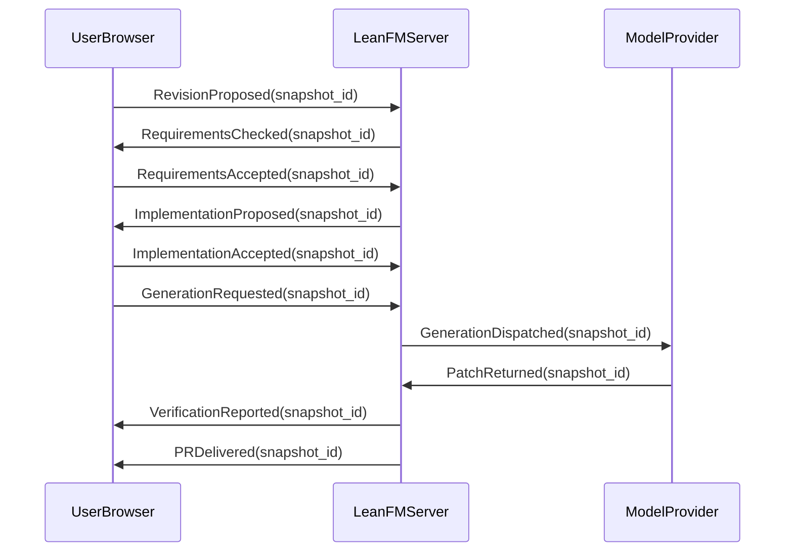
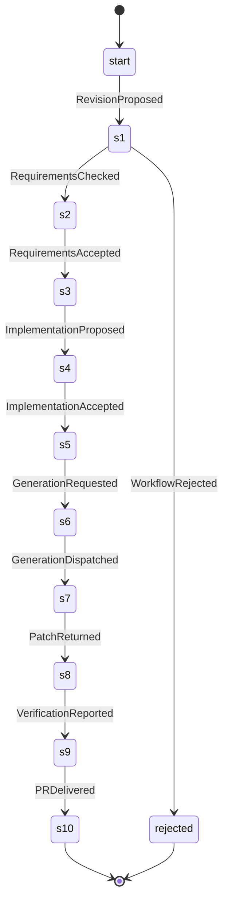
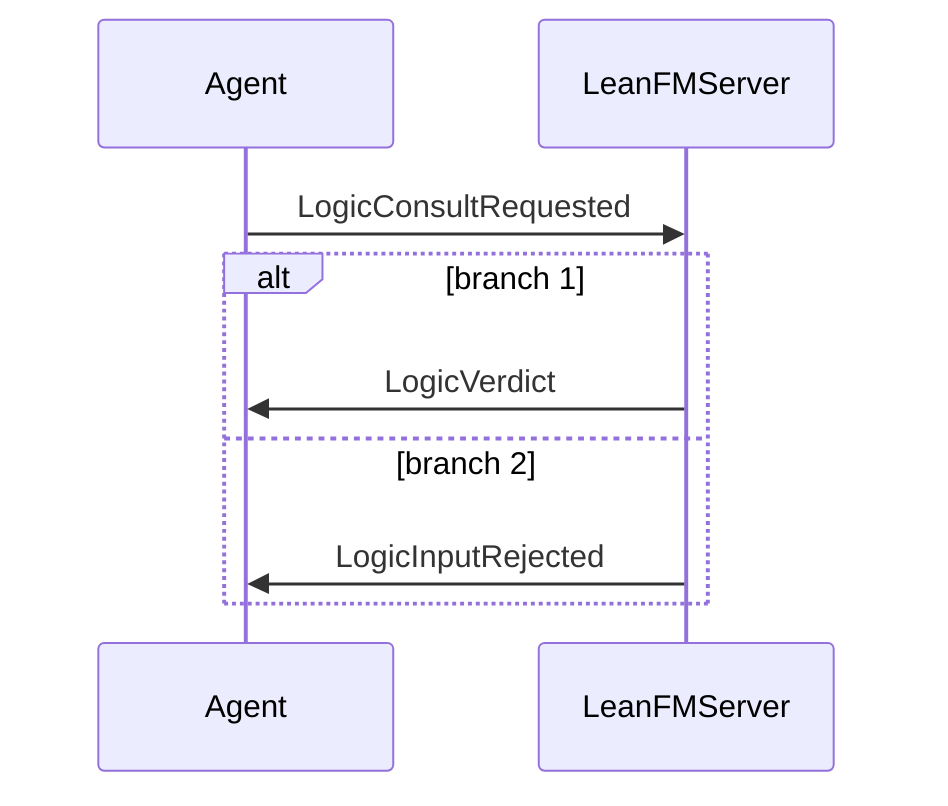

# Self-hosting requirements review

Status: proposal; neither acceptance gate is implied by this report.

Product composition: ChatUI requirements plus revision-bound requirements-to-PR workflow.
Worker example: retained separately, not the specification of the whole product.

## Component registry

- leanfm.chatui: LeanFM/ChatUI/Requirements.lean; LeanFM/ChatUI/Requirements.proto; LeanFM/ChatUI/Implementation.lean — existing product component; conformance must be audited
- leanfm.selfhost: LeanFM/LLMGenerated/SelfHosting.lean; LeanFM/LLMGenerated/SelfHosting.proto; LeanFM/LLMGenerated/Implementation.lean — proposed workflow and clauses; MCP read-only context adapter implemented; remaining mappings pending
- worker.example: LeanFM/LLMGenerated/Requirements.lean; LeanFM/LLMGenerated/Requirements.proto; LeanFM/LLMGenerated/Implementation.lean — preserved example, not whole-product implementation

## Generated interaction: successful proposed workflow

## Generated state machine

## Generated interaction: MCP logic consultation

## Proposed clauses (not semantic proofs)

- selfhost.revision [proposed]: Acceptance identifies exact book, requirements, protobuf, implementation, and repository revisions. Changes invalidate affected acceptance and derived artifacts; stale requests fail without overwriting current state.
- selfhost.gates [proposed]: Code generation requires explicit requirements acceptance and separate implementation acceptance for the current snapshot. A successful check alone is not acceptance.
- selfhost.pr [proposed]: PR delivery requires an actual patch, requirement-to-code/test mappings, reproducible check results, base revision, and remaining limitations. The PR may be delivered as a local reviewable bundle; remote publication requires explicit authority. Failed checks cannot be labeled completed.
- selfhost.checker [proposed]: Check results distinguish proved, disproved, unknown, unsupported, and resource-limit reached. Identify model revision, formula, assumptions, bounds, terminal-path convention, fairness, and witness or counterexample. Schema validation is not a semantic proof.
- selfhost.formulas [proposed]: Requirements must support typed nested CTL state formulas and separately typed path conditions. AF AG p is eventual permanent safety; AG AF p is universal recurrence. Preserve existential counterexample duals without claiming CTL covers all LTL.
- selfhost.modal [proposed]: Knowledge quantifies over legal histories with identical declared actor observations. Obligation and permission quantify over all and some nonempty named ideal policy futures. Never conflate legal, observable, ideal, and probabilistic alternatives. Belief and morality are outside this extension.
- selfhost.lazy [proposed]: Retain modality-specific indexes only while current formulas reference the corresponding actor or policy relation. Rebuild them from retained source evidence; release unreferenced indexes. Index lifetimes must not alter truth. Isolate caches by project and model revision.
- selfhost.probability [proposed]: Probabilities are optional and distinct from existence. Identify declared model probability versus observed frequency versus unknown. Specify normalization, conditioning, scheduler or min/max policy, horizon, threshold comparison, and sample boundary. Do not infer independence or treat unknown as zero.
- selfhost.history [proposed]: Immutable events carry predecessor links; derived successor indexes preserve event identity and partial order. State whether a past monitor uses causal ancestry or a declared linearization. Strictly prior facts exclude the current event.
- selfhost.coverage [proposed]: Every normative book claim is linked to an accepted requirement, an explicitly pending proposal, or a deferred/illustrative classification. Every accepted requirement maps to implementation decisions and evidence; unmapped claims prevent a claim of complete one-shot readiness.
- selfhost.handoff [proposed]: A new session starts from book/main.pdf, book/main-dark.pdf, canonical requirements/protobuf/implementation, component registry, current repository, and generated review report. Application goals also retain spec/ProjectMemory.md, spec/runtime.json, revision-bound actual-launch evidence, failure remedies and PR/base-revision context. Conversation history is not required input.
- selfhost.bounds [proposed]: Declare finite exploration and resource bounds. Exhaustion yields resource-limit or unknown, never proved. Compaction must preserve the declared observation and monitor semantics.
- selfhost.mcp.context [implemented]: A stateless MCP endpoint exposes the project book, canonical requirements, protobuf, implementation specification, and live language references through fixed resource URIs. Initialization states that the book is durable agent context comparable to maintained system-prompt material.
- selfhost.mcp.readonly [implemented]: The MCP endpoint is read-only: its tools return deterministic interrogation, generation, and validation material, cannot read arbitrary paths, cannot accept either gate, and cannot mutate project state.
- selfhost.mcp.transport [implemented]: POST /mcp accepts JSON-RPC initialization, ping, resource, prompt, and tool methods using MCP protocol version 2025-06-18. The loopback service requires deployment authentication before remote exposure.
- selfhost.mcp.logic.reference [implemented]: Resource leanfm://language/logic-reference states the JSON formula grammar, the operators and their English readings, the five verdicts, the witness/counterexample conventions, the terminal-state convention and the bounds, so an agent never guesses logic syntax.
- selfhost.mcp.logic.explain [implemented]: Tool explain_formula takes one JSON formula and returns its English reading, its negation with existential/universal duals, the requirement mode it fits (always, never, eventually or possibly), typing errors (a path condition used as a state formula and the reverse), unknown atoms, and lints: an implication whose antecedent may be unreachable is reported with the stronglyImplies alternative; AF/EF, AG/EG and AF AG/AG AF readings are distinguished.
- selfhost.mcp.logic.ctl [implemented]: Tool check_ctl takes a task, either a canonical task id or an inline draft with states, initial state and message-labelled transitions, plus one JSON CTL formula over that task's observable atoms (at state, after message, terminal). It returns one of proved, disproved, unknown, unsupported or resource-limit, the reading, the declared bounds and terminal convention, and evidence: a witness path for an existential or possibly claim that holds, a counterexample path for a universal or never claim that fails, each as states and messages.
- selfhost.mcp.logic.trace [implemented]: Tool check_trace takes event envelopes (id, prevIds, causeIds, task, src, dst, message). It reports duplicate or dangling ids, cycles, causes that do not precede their effects, src/dst that contradict a message schema, which events are concurrent, and for each task whether its events are accepted by that task's grammar or the first event that is not. It returns the interaction diagram and causal graph derived from the events, so agents design sequence diagrams by writing events rather than drawing them.
- selfhost.mcp.logic.observability [implemented]: Tool classify_requirement takes a formula or a predicate text and classifies every atom as observable (a message, a field of a message, a task state reachable from messages), derived (knowledge from the causal past, a policy permission or obligation, a where_ predicate over message fields) or implementation-only (internal state with no observable consequence). For derived atoms it names the declaration that must exist; for implementation-only atoms it says the claim belongs in Implementation.lean or must be restated through observable events, and proposes the events that would make it testable. It never reports a hidden predicate as observable.
- selfhost.mcp.logic.knows [accepted; deferred]: Tool knows takes event envelopes, an actor, an event id and declared derivation rules (pairing, projection, encryption and decryption with held keys) and returns the values the actor can derive from messages delivered to it in the causal past of that event, with the delivering event for each. Deferred to a later revision; until then the tool is listed as unsupported.
- selfhost.mcp.logic.safety [implemented]: Logic tools treat formulas, tasks and traces strictly as JSON data: never compiled, evaluated or executed as Lean, shell or any other code. Inputs are bounded (formula nodes, task states and transitions, trace events, string lengths); exceeding a bound yields resource-limit or an input error, never proved. Tools are deterministic, stateless, read no paths and cannot accept either gate.

Implementation gate: pending for workflow and checker extensions. Existing ChatUI mappings remain in LeanFM/ChatUI/Implementation.lean.
