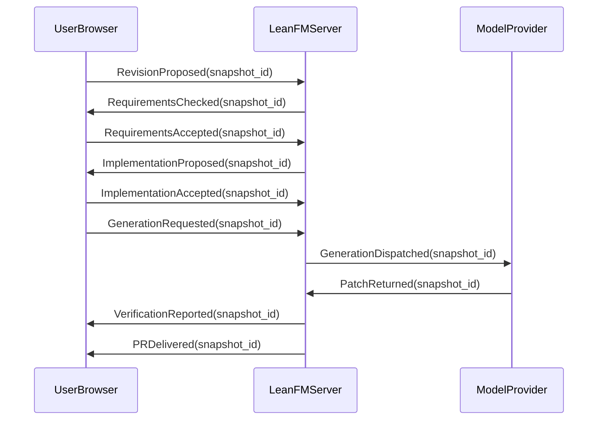
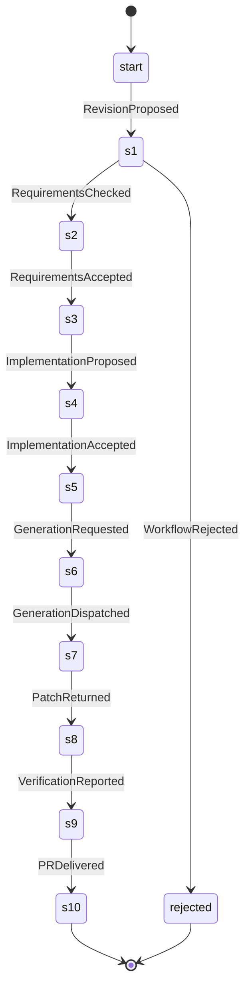

# Self-hosting requirements review

Status: proposal; neither acceptance gate is implied by this report.

Product composition: ChatUI requirements plus revision-bound requirements-to-PR workflow.
Worker example: retained separately, not the specification of the whole product.

## Component registry

- leanfm.chatui: LeanFM/ChatUI/Requirements.lean; LeanFM/ChatUI/Requirements.proto; LeanFM/ChatUI/Implementation.lean — existing product component; conformance must be audited
- leanfm.selfhost: LeanFM/LLMGenerated/SelfHosting.lean; LeanFM/LLMGenerated/SelfHosting.proto; LeanFM/LLMGenerated/Implementation.lean — proposed workflow and clauses; new implementation mappings pending
- worker.example: LeanFM/LLMGenerated/Requirements.lean; LeanFM/LLMGenerated/Requirements.proto; LeanFM/LLMGenerated/Implementation.lean — preserved example, not whole-product implementation

## Generated interaction: successful proposed workflow

## Generated state machine

## Proposed clauses (not semantic proofs)

- selfhost.revision [proposed]: Acceptance identifies exact book, requirements, protobuf, implementation, and repository revisions. Changes invalidate affected acceptance and derived artifacts; stale requests fail without overwriting current state.
- selfhost.gates [proposed]: Code generation requires explicit requirements acceptance and separate implementation acceptance for the current snapshot. A successful check alone is not acceptance.
- selfhost.pr [proposed]: PR delivery requires an actual patch, requirement-to-code/test mappings, reproducible check results, base revision, and remaining limitations. The PR may be delivered as a local reviewable bundle; remote publication requires explicit authority. Failed checks cannot be labeled completed.
- selfhost.checker [proposed]: Check results distinguish proved, disproved, unknown, unsupported, and resource-limit reached. Identify model revision, formula, assumptions, bounds, terminal-path convention, fairness, and witness or counterexample. Schema validation is not a semantic proof.
- selfhost.formulas [proposed]: Requirements must support typed nested CTL state formulas and separately typed path conditions. AF AG p is eventual permanent safety; AG AF p is universal recurrence. Preserve existential counterexample duals without claiming CTL covers all LTL.
- selfhost.modal [proposed]: Knowledge quantifies over legal histories with identical declared actor observations. Obligation and permission quantify over all and some nonempty named ideal policy futures. Never conflate legal, observable, ideal, and probabilistic alternatives. Belief and morality are outside this extension.
- selfhost.lazy [proposed]: Retain modality-specific indexes only while current formulas reference the corresponding actor or policy relation. Rebuild them from retained source evidence; release unreferenced indexes. Index lifetimes must not alter truth. Isolate caches by project and model revision.
- selfhost.probability [proposed]: Probabilities are optional and distinct from existence. Identify declared model probability versus observed frequency versus unknown. Specify normalization, conditioning, scheduler or min/max policy, horizon, threshold comparison, and sample boundary. Do not infer independence or treat unknown as zero.
- selfhost.history [proposed]: Immutable events carry predecessor links; derived successor indexes preserve event identity and partial order. State whether a past monitor uses causal ancestry or a declared linearization. Strictly prior facts exclude the current event.
- selfhost.coverage [proposed]: Every normative book claim is linked to an accepted requirement, an explicitly pending proposal, or a deferred/illustrative classification. Every accepted requirement maps to implementation decisions and evidence; unmapped claims prevent a claim of complete one-shot readiness.
- selfhost.handoff [proposed]: A new session starts from book/main.pdf, book/main-dark.pdf, canonical requirements/protobuf/implementation, component registry, current repository, and generated review report. Conversation history is not required input.
- selfhost.bounds [proposed]: Declare finite exploration and resource bounds. Exhaustion yields resource-limit or unknown, never proved. Compaction must preserve the declared observation and monitor semantics.

Implementation gate: pending for workflow and checker extensions. Existing ChatUI mappings remain in LeanFM/ChatUI/Implementation.lean.
