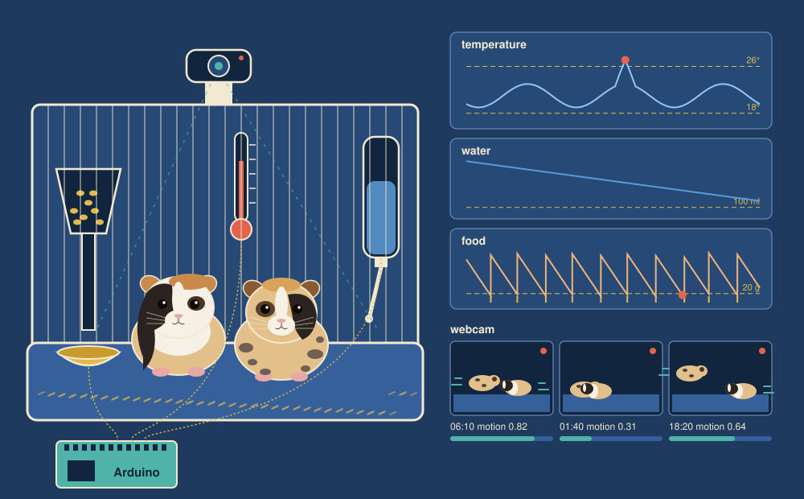

# The guinea pig cage: claims over measurements



Two guinea pigs stay home while their owners travel. An Arduino reads the water bottle, the food
bowl and the temperature every ten minutes, the food dispenser reports each time it runs, and a
webcam over the cage reports how much the guinea pigs move. This is the example of the book's
Section 5.6 ("Claims over measurements"), and the drawing is the book's cover.

## The files

- [`GuineaPigCage.leanfm`](GuineaPigCage.leanfm): the protocol, written by hand. Three devices
  report to a hub in parallel, each until it is switched off. `session_check` finds no issues.
- [`cage.log`](cage.log): three days of event lines, simulated by `SignalChapterExample.lean` (a
  tool wrote it, so do not edit it by hand). Each event carries its measurements in its payload:
  `temp`, `water` and `food` from the Arduino, `food` after a `Dispense`, `motion` from the webcam.

## What LeanFM says about it

The order of the events follows the protocol (`session_conform`, with `allowIncomplete`, since the
devices are still running): 875 events in one session.

The measurements are checked with `check_signal`, one claim at a time:

| What we require | Claim | Answer |
|---|---|---|
| The temperature stays between 18 and 26 °C | `(always (and (above temp 18) (below temp 26)))` | fails by 1.1 °C on day 2 at 14:30: afternoon sun |
| The water bottle is never below 100 ml for half an hour | `(never (throughout 1800 (below water 100)))` | holds, 71 ml to spare |
| A low bowl gets food within 10 minutes | `(always (implies (below food 20) (within 600 (on Dispense))))` | fails on day 3 at 03:10: the dispenser stuck once |
| The webcam sees them move every two hours | `(always (within 7200 (above motion 0.3)))` | fails only at the last reading: the log ends in their quietest hour, and the window after it is cut short (counted, not hidden) |

`make book` regenerates the log, the checks and the charts; `LeanFM/SessionToolsTests.lean`
fails if any answer above changes.

## Your own cage

Have each device write one line per reading in LeanFM's event-line format:

```
{"type":"leanFM","from":"Arduino","to":"Hub","id":"arduino:2","prev":["arduino:1"],"session":"cage","label":"Reading","payload":{"temp":19.5,"water":600.1,"food":50.2},"ts":"1794528600000000000"}
```

`ts` is nanoseconds since the epoch. Append the lines to `logs/devices.log` in the LeanFM project
and ask Claude to check a claim with `check_signal` and `serverLog: "devices"`: the server reads the
log itself, so it may be far larger than the 64 KiB a client may send (`lastLines` checks just the
latest readings). To try it with this example: `cp examples/guinea-pigs/cage.log logs/devices.log`.

A claim reads each field's latest value, starts once every
field it names has been read, and gives a margin: how far it is from failing, in the readings' own
units.
