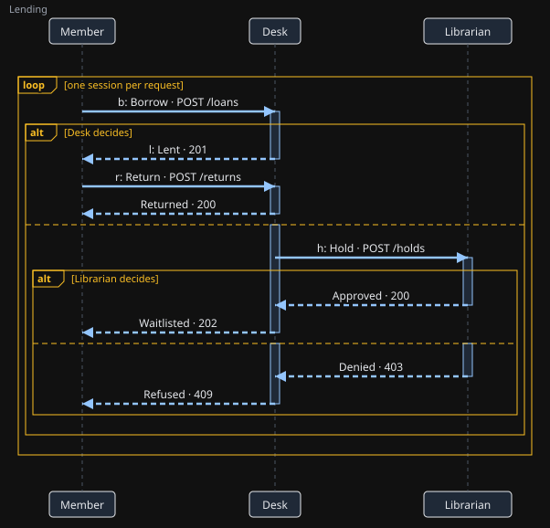

# Vibecoding from a session type: a lending service

The whole loop, small enough to read in one sitting:

1. **Protocol.** [`Lending.protocol`](Lending.protocol): members borrow and return books; when no copy
   is in, the Desk asks the Librarian to approve a hold. Each member's visit is one session, and many
   run at once. `session_check` finds no issues, and draws the diagram (generated, and kept current
   by a test):

   

2. **Typestates.** `session_check` also gives each role's API, one state per point in the conversation.
   The Desk's:

   ```
   S1.receive() : Borrow × S2                -- from Member
   S2.sendLent(m : Lent) : S3                -- to Member
   S2.sendHold(m : Hold) : S5                -- to Librarian
   S3.receive() : Return × S4                -- from Member
   S4.sendReturned(m : Returned) : End       -- to Member
   S5.receive() : Approved × S6 | Denied × S7
   S6.sendWaitlisted(m : Waitlisted) : End   -- to Member
   S7.sendRefused(m : Refused) : End         -- to Member
   ```

3. **Generated states.** `session_skeleton` turns those typestates into
   [`lending_protocol.py`](lending_protocol.py): a class per state, whose methods are exactly what
   the state allows. `DeskS2` has `send_lent` and `send_hold` and nothing else; `send_lent` fills in
   the cause (the member's Borrow) and logs the event; a state used twice raises; `receive` refuses a
   message the state does not allow, or one from another session. The file is generated, and a test
   keeps it equal to what LeanFM generates from the current protocol.

4. **Implementation.** [`lending.py`](lending.py) adds only what the protocol leaves open: the
   Desk's stock, the Librarian's limit on holds, when members arrive, and a simulated network that
   delivers messages in a seeded random order, so twenty members' sessions interleave. Per session
   it keeps the state the last method returned:

   ```python
   msg, state = state.receive(m)
   if isinstance(state, lp.DeskS2):            # a Borrow: lend, or ask for a hold
       if self.stock.get(book, 0) > 0:
           state = state.send_lent()
       else:
           state = state.send_hold({"book": book})
   ```

5. **Conformance.** `session_conform` checks the log against the protocol:

   ```sh
   cd examples/vibecode/lending
   python3 lending.py > log.json && python3 ../conform.py Lending.protocol log.json
   # conforms: Lending: 80 events in 20 sessions follow the protocol

   python3 lending.py --bug | python3 ../conform.py Lending.protocol -
   # violates: ... session 5, event e44: Lent from Desk to Member is not allowed here;
   #           the protocol allows Waitlisted from Desk to Member
   ```

   The `--bug` Desk lends a copy that came back while a hold was pending: a plausible shortcut, and
   the program runs without error. With the generated states it cannot even be written as a method
   (an approved hold's state, `DeskS6`, has no `send_lent`), so the bug goes around the typestate to
   the endpoint. The check names the event where it breaks the protocol.

`conform.py` talks to the local server (`bash scripts/desktop-setup.sh` starts it). In Claude
Desktop, attach or paste `log.json` and ask Claude to run `session_conform` against the protocol; the
result shows in the session view under "Where the run breaks the protocol".

`LeanFM/SessionToolsTests.lean` checks both logs, the generated module and the picture against the
current protocol, so `lake build` fails if they drift apart; `python3 -m unittest -v test_lending`
checks the generated states' refusals and that the logs are what `lending.py` writes. After changing
the protocol, regenerate the module (session_skeleton), then the logs:

```sh
python3 lending.py > log.json; python3 lending.py --bug > bug-log.json
```
