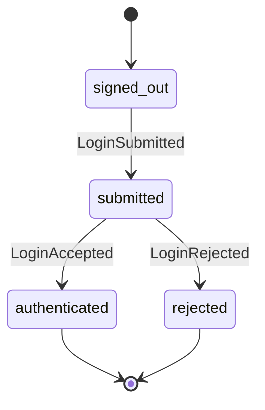
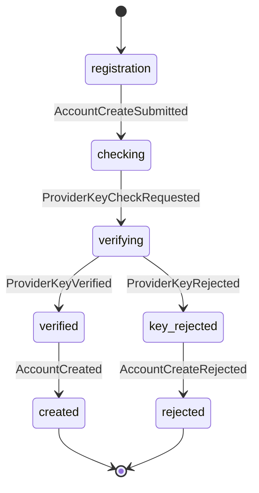
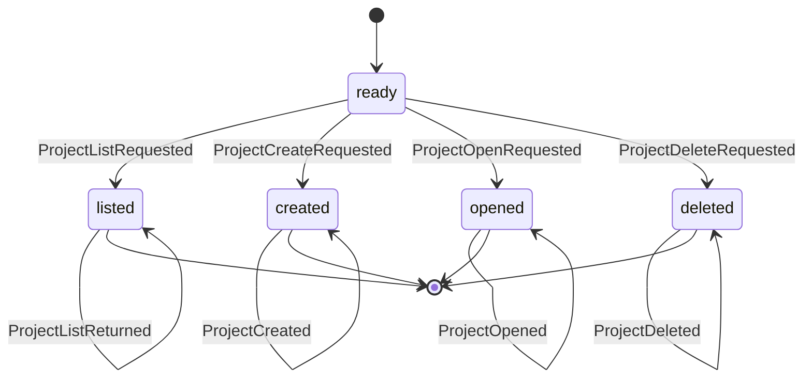
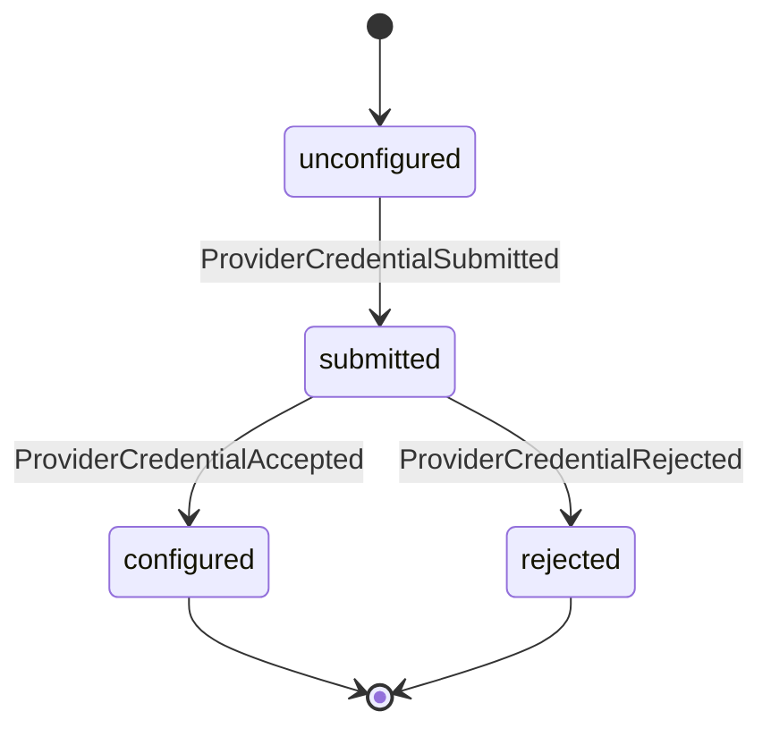
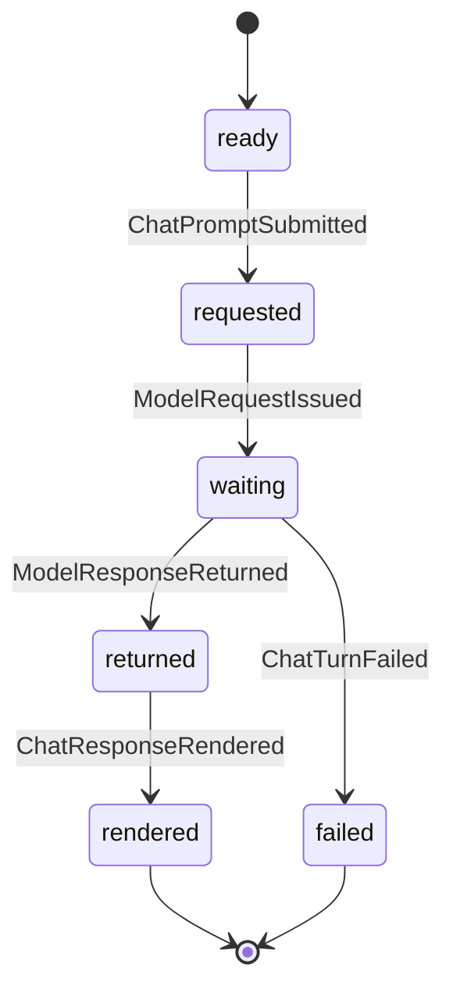
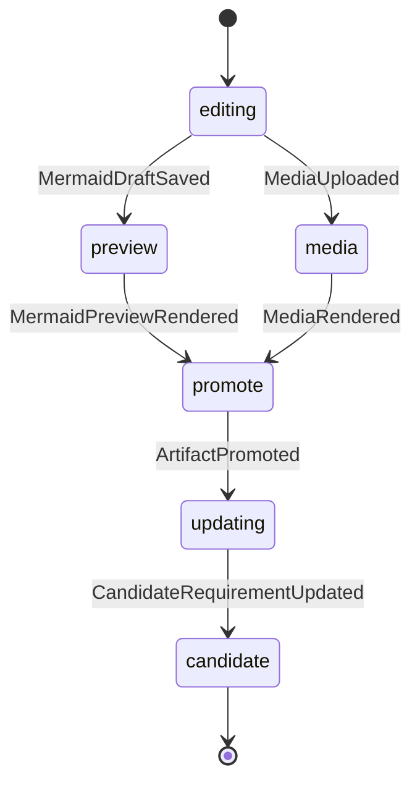
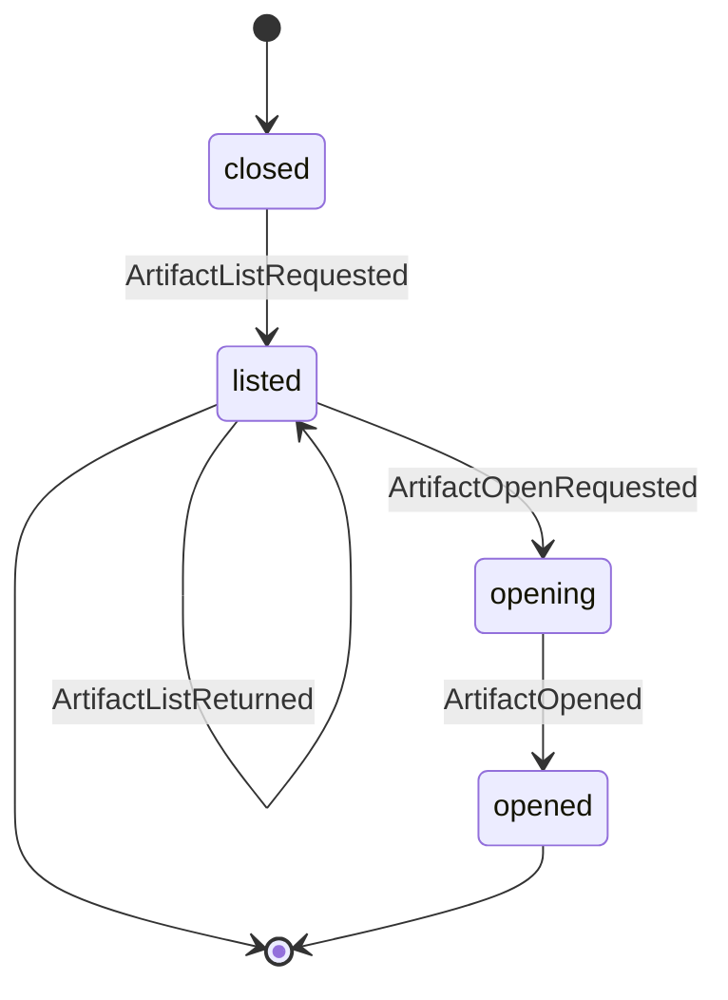
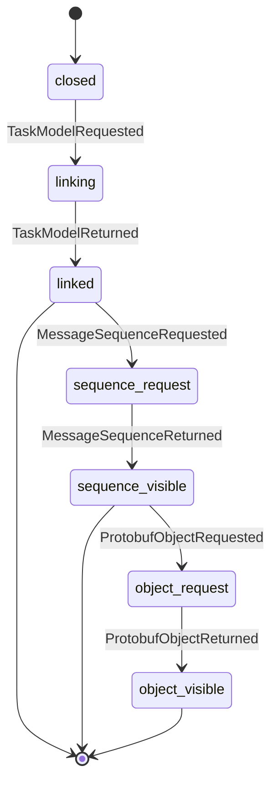
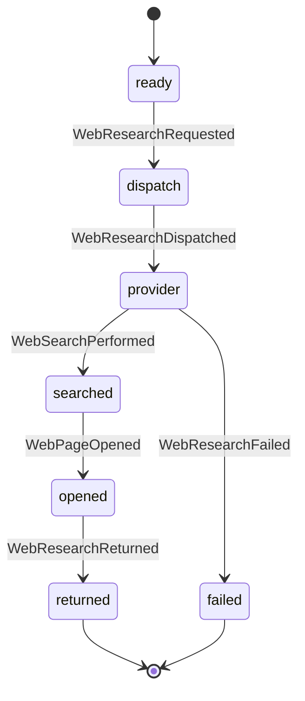
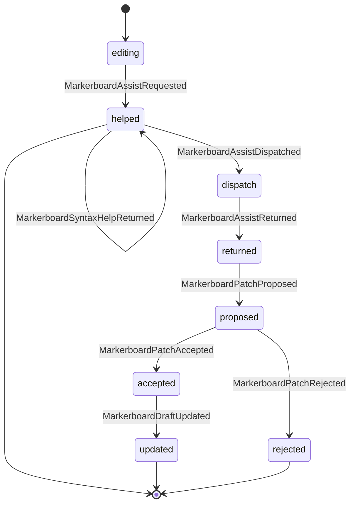

# Generated residual state machines

## authenticate_user

## create_account

## manage_projects

## configure_provider

## argue_requirements

## markerboard

## inspect_artifacts

## inspect_task_model

## research_web

## assist_markerboard

