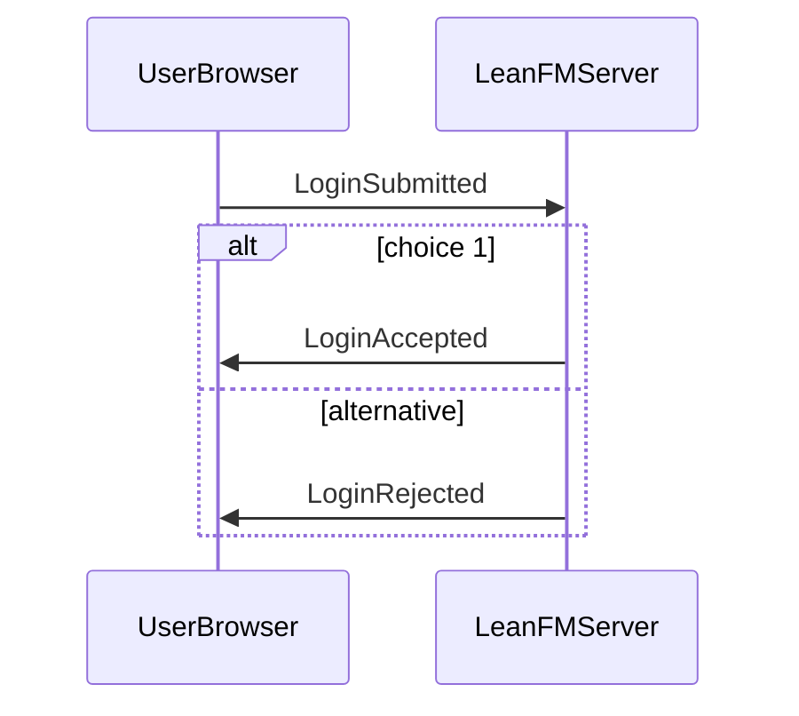
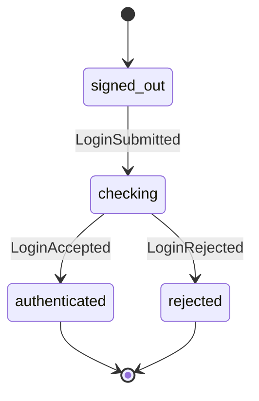
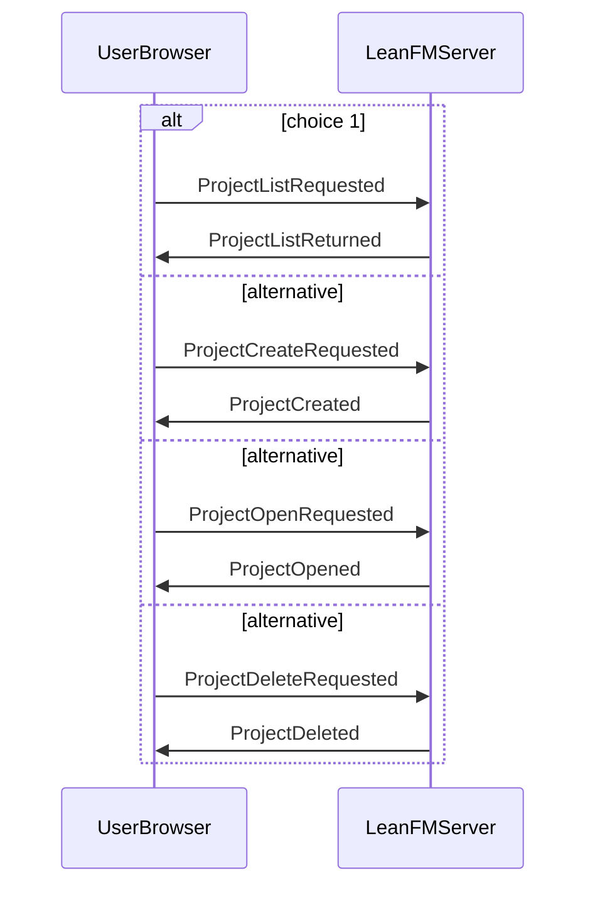
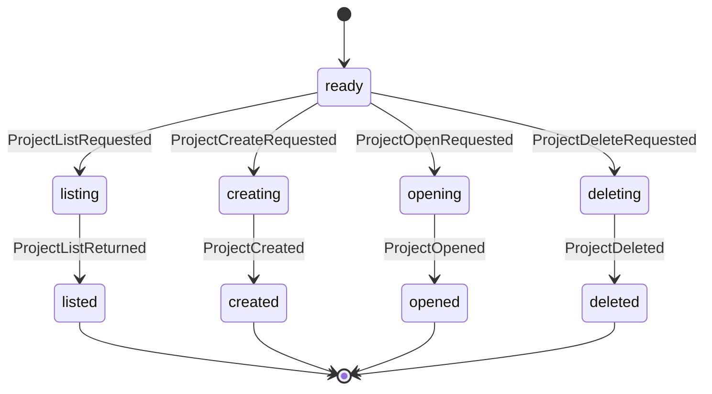
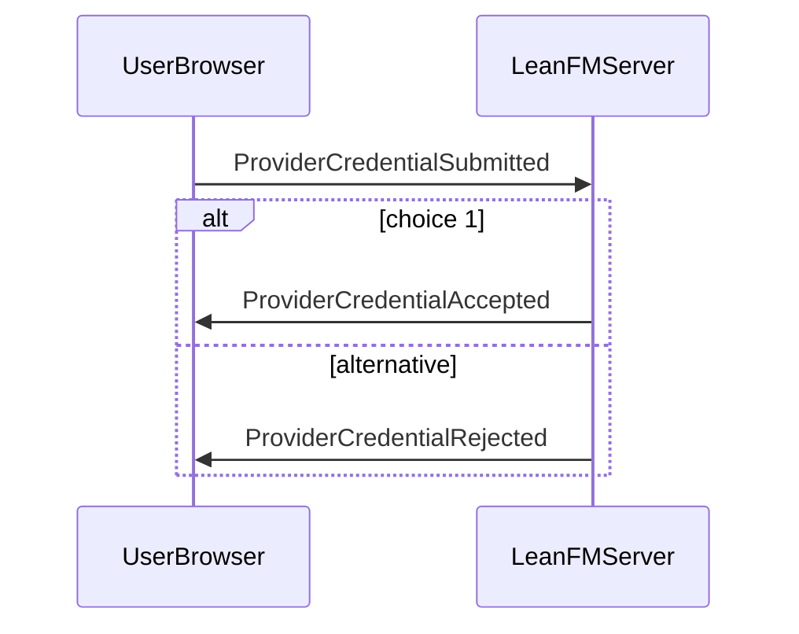
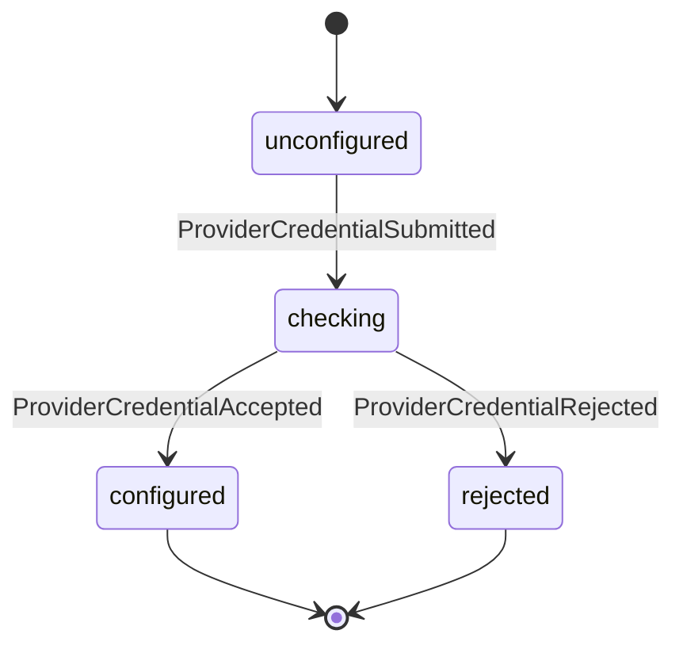
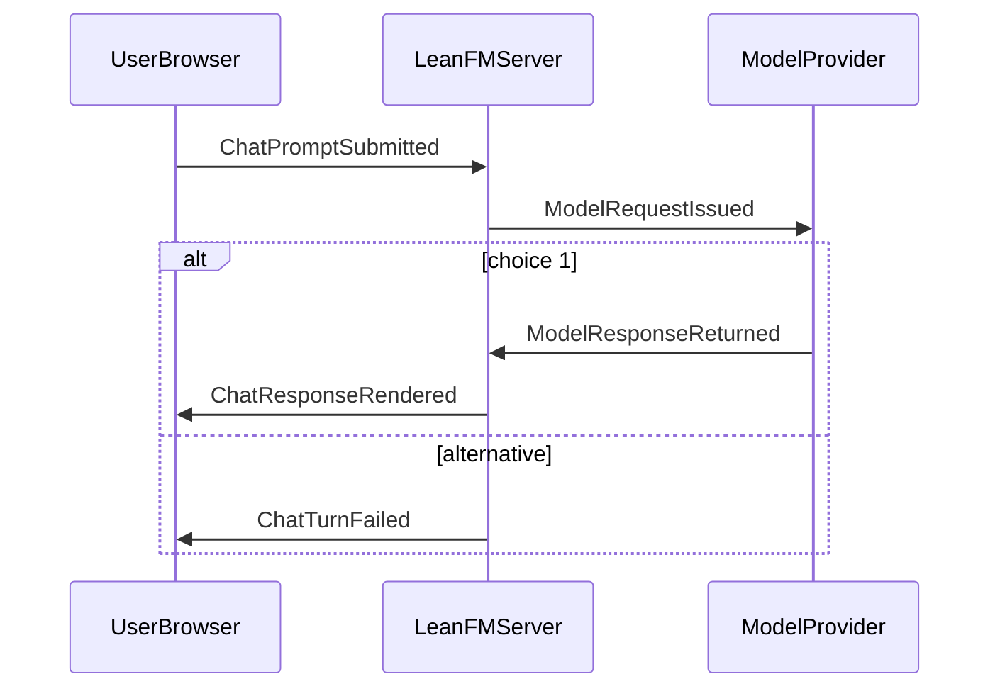
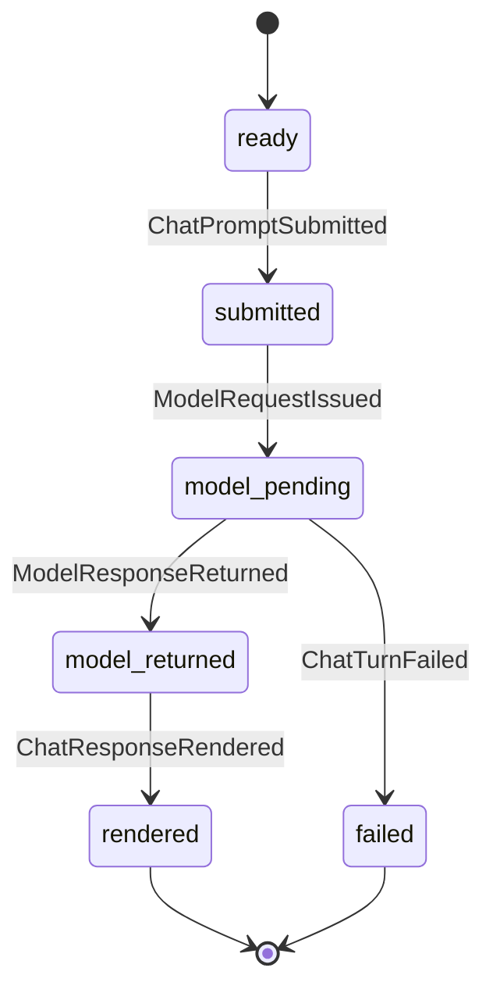

# Shared-project requirements review

Status: generated requirements review. Exact stakeholder acceptance is recorded separately in acceptance.json; this generator accepts neither gate.

Prompt: remove ./data, keep projects directly in ./projects, remove user ownership, and use login only to protect API keys.

Positive invariant: project identity and its complete shared directory are independent of credential accounts; model requests use only their initiating caller's unlocked key.

Confirmed access policy: projects open without login; login is required for LLM calls and key management. Confirmation of that policy does not accept the complete revised specification or implementation mapping.

## Observable requirements

- Shared roots are independent of credential accounts [always]: the same project_id resolves to the same projects/<project_id> for every visitor and account
- Shared projects never disclose credential-vault material [never]: a project listing file media artifact conversation model workspace tool error or trace returns a password verifier encryption key provider API key session bearer or credential ciphertext from the private vault
- No migration overwrites a project or drops an encrypted key [never]: migration replaces an existing different destination drops a source project or encrypted credential removes the old data root before verification or accepts a path or symlink escape
- No shared project borrows another caller's model credential [never]: a project turn or continuation selects a credential from project state or another visitor instead of the initiating caller's unlocked credential
- Fresh start preserves LeanFM and encrypted accounts [never]: an explicitly requested project reset deletes LeanFM source book canonical specifications version history password verifiers or encrypted provider credentials, changes credential bytes, or follows an escaping project symlink
- shared_projects_have_one_root: Every ordinary workspace project resolves to exactly projects/<project_id> below the workspace root; project identity listing opening creation and confirmed deletion never depend on username credential account login status or a data/accounts path.
- login_protects_keys_only: Confirmed access policy: the loopback workspace and its shared projects open without login; login unlocks only that caller's retained provider credentials. No login creates a project namespace or changes the shared catalog.
- shared_project_reads_and_local_edits_are_keyless: Listing and opening projects reading their books diagrams source media and shared conversation and making non-provider local project edits require no provider credential; paid chat research AI assistance and provider-backed repairs require the initiating caller's unlocked credential before any provider call or paid-turn persistence.
- shared_storage_preserves_project_identity: Migrating an existing project preserves its project_id canonical specification and acceptance revisions book source PDFs implementation source images artifacts conversation events logs and caches in one shared project root. Existing destination roots and projects with equal display names remain independent and cannot be overwritten or silently merged.
- credential_vault_is_not_a_project: Password verifiers and encrypted provider credentials remain outside every shared project root in a private application credential vault. The vault is excluded from project discovery project file reads model workspace tools media routes and version control; login unlocks only the caller's account keys and never another visitor's keys.
- migration_never_overwrites_or_loses_state: Storage migration is explicit and restartable after project writers are quiescent. Preflight all sources destinations identifiers paths symlinks and byte inventories before mutation. A collision unsupported entry or failed check leaves existing data recoverable and reports a concrete blocker. Remove the old data directory only after every recognized project and encrypted account record has a verified durable destination; never replace it with an escaping symlink.
- shared_project_writers_do_not_collide: Concurrent visitors cannot interleave destructive writes or model tool turns against one project and silently lose a conversation source revision or snapshot. Serialize conflicting work or reject it visibly before mutation and provider spending; keep stale-book revision rejection and captured model credential cancellation and accounting identities request-local.
- shared_project_paths_never_reach_credentials: Project identifiers manifests configured artifact paths source and media requests and model tool paths cannot traverse projects or follow symlinks into another project the credential vault the installation or arbitrary filesystem paths. Shared visibility never grants an arbitrary-path capability.
- legacy_user_selector_has_no_ownership_meaning: For wire compatibility the existing ProjectListRequested.user_id field may remain readable but is ignored as a project ownership or namespace selector. Project URL IDs are preserved through migration; no new account owner field is introduced.
- shared_project_mutations_reject_cross_site_requests: Making the loopback workspace independent of login cannot let an unrelated web page create delete or edit projects through the visitor's browser. Mutating requests must pass explicit local Host and same-origin or permitted command-client admission before dispatch; mismatched or cross-site origins DNS-rebinding hosts and ambiguous frames fail before project mutation or provider work.
- credential_changes_never_rebill_queued_work: A queued paid prompt captures its initiating credential identity as well as its model. Logout session expiry key replacement or account switching cannot silently send an earlier queued prompt using a different caller's key. Preserve shared project drafts while visibly holding or cancelling unstarted paid work until explicitly resubmitted under an unlocked identity; recheck active-session validity at each provider or mutating-tool boundary.
- explicit_fresh_start_erases_projects_not_credentials: On the operator's explicit fresh-start instruction, stop project writers, enumerate and erase ordinary project roots under projects and the legacy data/accounts/*/projects trees, and start with no ordinary projects. Preserve the LeanFM repository's own book canonical specifications source and version history. Relocate password verifiers and encrypted provider credentials byte-for-byte to .leanfm/accounts outside project roots; verify digests and private permissions before removing the old data directory. The reset is an explicitly authorized discard, not a lossless project migration, and cannot silently erase credentials or follow a symlink outside an enumerated project root.

## Generated task views

### Authenticate an individual user

### Use the shared workspace independently of a credential account

### Select user-funded or platform-funded model access

### Conduct one durable project-scoped requirements turn

## Output provenance

- chatui.auth.interaction
  - Prompt: Provide valid user logins.
  - Question: How does a login become an authenticated session or a visible rejection?
  - Source: authenticate_user events
  - Reducer: render the selected LoginAccepted or LoginRejected grammar branch
  - Unit and boundary: events
- chatui.auth.state
  - Prompt: Provide valid user logins.
  - Question: Which authentication states are observable?
  - Source: authenticate_user grammar
  - Reducer: render grammar residuals
  - Unit and boundary: states and transitions
- chatui.signup.interaction
  - Prompt: Users should be able to create their own account if they supply their own API key.
  - Question: Did the provider verify the prospective user's key before account creation?
  - Source: create_account events
  - Reducer: render registration, provider verification, and the selected created or rejected branch while redacting credentials
  - Unit and boundary: events
- chatui.signup.state
  - Prompt: Users should be able to create their own account if they supply their own API key.
  - Question: Which registration and provider-verification states are observable?
  - Source: create_account grammar
  - Reducer: render grammar residuals
  - Unit and boundary: states and transitions
- chatui.projects.interaction
  - Prompt: Show a list of projects and keep every project in one deletable directory.
  - Question: How does the user list, create, open, or confirm deletion of a project?
  - Source: manage_projects events
  - Reducer: render the selected project-operation branch
  - Unit and boundary: events
- chatui.projects.state
  - Prompt: Show a list of projects and keep every project in one deletable directory.
  - Question: Which project lifecycle states are observable?
  - Source: manage_projects grammar
  - Reducer: render grammar residuals for list create open and confirmed delete
  - Unit and boundary: states and transitions
- chatui.specification-conversation.interaction
  - Prompt: A fresh LeanFM session should begin by asking what problem the user is trying to solve, resolve ambiguities, and remain focused on accepted requirements and implementation.
  - Question: How does a project directory become an inquiry, clarified requirements, two accepted revisions, and authorization for implementation?
  - Source: develop_project_specification events
  - Reducer: render problem inquiry, repeated named clarification loop, book revisions, and both acceptance gates
  - Unit and boundary: events and artifact revisions
- chatui.specification-conversation.state
  - Prompt: A totally fresh prompt should need only the project directory as input.
  - Question: Which discovery or acceptance state is the project conversation in?
  - Source: develop_project_specification grammar
  - Reducer: render the residual grammar with the current named ambiguity and exact artifact revisions
  - Unit and boundary: states, ambiguities, and revisions
- chatui.conversation-checkpoint.interaction
  - Prompt: A project conversation is a working transaction that can be cleared after its current understanding is compacted into durable specifications.
  - Question: Does clearing occur only after the current book, interaction grammar, contextual where_ constraints, generated views, and checkpoint manifest validate at one captured message boundary?
  - Source: checkpoint_conversation events and project-local artifact revision manifest
  - Reducer: render request, blocker or validated commit, then the exact bounded history clear; preserve newer messages and expose blocker IDs
  - Unit and boundary: events and artifact revisions per project conversation checkpoint
- chatui.conversation-checkpoint.state
  - Prompt: A project conversation is a working transaction that can be cleared after its current understanding is compacted into durable specifications.
  - Question: Is this conversation retained, being checked, blocked with recoverable messages, committed, or cleared through a known boundary?
  - Source: checkpoint_conversation grammar and ConversationCheckpointRequested/Blocked/Committed/HistoryCleared
  - Reducer: render residual checkpoint state at the captured through_message_id; never infer deletion from a failed or missing event
  - Unit and boundary: states and message-boundary IDs
- chatui.provider.interaction
  - Prompt: Let a user bring an API key and bound use of the platform key.
  - Question: How is a provider credential accepted or visibly rejected without exposing the raw secret?
  - Source: configure_provider events
  - Reducer: render the selected credential result branch while redacting api_key
  - Unit and boundary: events
- chatui.provider.state
  - Prompt: Let a user bring an API key and bound use of the platform key.
  - Question: Which provider-credential states are observable?
  - Source: configure_provider grammar
  - Reducer: render grammar residuals
  - Unit and boundary: states and transitions
- chatui.chat.interaction
  - Prompt: Move this requirements argument from Codex into LeanFM chat, including image and diagram questions and answers.
  - Question: How does one durable multipart question reach a model and return ordered inline content parts?
  - Source: argue_requirements events and ChatContentPart values
  - Reducer: render browser server and provider lifelines with content-part kinds and the visible failure alternative
  - Unit and boundary: events and content parts
- chatui.chat.state
  - Prompt: Make LeanFM chat comfortable enough for permanent project use.
  - Question: Which state is the current chat turn in?
  - Source: argue_requirements grammar
  - Reducer: render grammar residuals
  - Unit and boundary: states and transitions
- chatui.markerboard.interaction
  - Prompt: Type simple Mermaid while markerboarding requirements.
  - Question: How does a scratch diagram or media attachment become a candidate requirement?
  - Source: markerboard events
  - Reducer: render save preview promote and candidate-update events for the selected artifact revision
  - Unit and boundary: events
- chatui.markerboard.state
  - Prompt: Type simple Mermaid while markerboarding requirements.
  - Question: Which scratch, preview, promotion, and candidate states are observable?
  - Source: markerboard grammar
  - Reducer: render grammar residuals without conflating scratch and derived evidence
  - Unit and boundary: states and transitions
- chatui.artifacts.interaction
  - Prompt: Add a tab or link showing current diagrams and generated artifacts in an organized view.
  - Question: How does the user filter, list, and open one exact artifact revision?
  - Source: inspect_artifacts events
  - Reducer: render filtered list and optional exact-revision open messages
  - Unit and boundary: events
- chatui.artifacts.state
  - Prompt: Add a tab showing the current generated artifacts.
  - Question: Can the user distinguish current accepted superseded and stale revisions without scrolling chat?
  - Source: inspect_artifacts grammar and artifact metadata
  - Reducer: render artifact-list and artifact-open residuals labeled by revision status
  - Unit and boundary: artifact revisions
- chatui.task-model.interaction
  - Prompt: Each task has its own interaction diagram linked to its own state machine and message sequence.
  - Question: How does a user traverse one task's linked views and inspect its protobuf objects?
  - Source: inspect_task_model EventEnvelope values with prior_ids and cause_id
  - Reducer: render the selected task and revision through task view message sequence and protobuf object inspection; recursively enclose cause_id descendants in nested boxes while deriving message interleavings only from prior_ids
  - Unit and boundary: events and causal nesting depth
- chatui.task-model.state
  - Prompt: There is not one shared state machine or interaction diagram.
  - Question: Which task-model inspection state is visible?
  - Source: inspect_task_model grammar
  - Reducer: render grammar residuals for one task and requirements revision
  - Unit and boundary: states and transitions
- chatui.usage.tokens
  - Prompt: Expose token usage on the page so the user can avoid a billing surprise.
  - Question: How many provider-reported tokens did this completed turn consume?
  - Source: ModelResponseReturned joined to ChatResponseRendered by request_id
  - Reducer: show input_tokens cached_input_tokens output_tokens and their sum for exactly one completed turn
  - Unit and boundary: tokens per turn
- chatui.usage.context
  - Prompt: Expose context usage on the page so the user can be warned.
  - Question: How much of the selected model's context window did this request occupy?
  - Source: ModelResponseReturned joined to the selected model metadata by request_id
  - Reducer: show input plus output tokens over context_window_tokens beside the response with a BYOK billing notice
  - Unit and boundary: tokens and percent of context window per turn
- chatui.response-time
  - Prompt: Keep the animated clock while a request runs and leave the time to respond on the response.
  - Question: How long did this exact completed chat turn take?
  - Source: ChatPromptSubmitted paired with ChatResponseRendered in one request
  - Reducer: subtract the server monotonic start from the completed response time and retain the result on that assistant message
  - Unit and boundary: milliseconds per turn
- chatui.research.interaction
  - Prompt: Follow HTTP URLs and do research through web searches.
  - Question: How does a research question become searches, opened pages, and a cited answer?
  - Source: research_web events and provider web_search_call actions
  - Reducer: render the selected successful or failed research trace with search and page-open actions
  - Unit and boundary: events and cited URLs
- chatui.research.state
  - Prompt: Follow HTTP URLs and do research through web searches.
  - Question: Which web-research residual state is visible?
  - Source: research_web grammar
  - Reducer: render grammar residuals for the selected research request
  - Unit and boundary: states and transitions
- chatui.markerboard-assist.interaction
  - Prompt: Provide AI assistance on the markerboard for syntax recall and tedious detail.
  - Question: How does local syntax help or a reviewed AI patch affect one exact markerboard revision?
  - Source: assist_markerboard events
  - Reducer: render the selected syntax-help or AI propose-and-accept/reject trace
  - Unit and boundary: events and artifact revisions
- chatui.markerboard-assist.state
  - Prompt: Provide AI assistance on the markerboard for syntax recall and tedious detail.
  - Question: Which assistance, proposal-review, and draft-update state is visible?
  - Source: assist_markerboard grammar
  - Reducer: render grammar residuals for one artifact base revision
  - Unit and boundary: states and transitions
- chatui.web-protocol.adapter
  - Prompt: Fully document the LeanFM web-server protocol in LeanFM grammar and explain protobuf-to-HTTP conversion.
  - Question: Where does an HTTP exchange enter the typed message grammar and become a journaled protobuf event?
  - Source: ChatUI task grammars, MessageSchema values, EventEnvelope cause_id values, implementation HTTP bindings, and running server routes
  - Reducer: project HTTP request decoding, typed grammar transition, EventEnvelope append, causal nested boxes for intermediate work, and terminal response projection by following cause_id back to the request
  - Unit and boundary: messages and causal nesting depth per HTTP exchange
- chatui.grammar.canvas
  - Prompt: Show the whole grammar as a canvas that can open and close productions and cascade changed parameters.
  - Question: What is the complete grammar, which details are currently expanded, and what changes when a parameter is edited?
  - Source: RequirementSpec grammars, task references, parameter definitions, dependency edges, queue contracts, codecs, proofs, and generated outputs
  - Reducer: render the complete grammar hierarchy; collapse closed nodes to typed summaries; expand selected nodes to productions and byte bindings; highlight every transitive dependent of edited parameters
  - Unit and boundary: grammar productions and dependency edges
- chatui.measurement.pairs
  - Prompt: Use event id, priorId, and calculated differences to elide detail in a principled way.
  - Question: Which explicit start/terminal pairs justify each displayed duration and byte delta?
  - Source: EventEnvelope values whose terminal prior_ids name their start event_id
  - Reducer: join terminal events to declared starts by prior_id within session and task; subtract timestamps or encoded byte counts; group by selected grammar production and parameter assignment
  - Unit and boundary: milliseconds or bytes per paired production
- shared-projects.projects.interaction
  - Prompt: Get rid of ./data; projects belong directly in ./projects and are not owned by users.
  - Question: How does a visitor list create open or confirm deletion of a shared project without selecting a credential-account namespace?
  - Source: manage_projects task and projectGrammar in this proposed RequirementSpec
  - Reducer: render every selected project-operation grammar branch against this specification; credential login is a separate task
  - Unit and boundary: messages per shared project operation within one workspace
- shared-projects.projects.state
  - Prompt: Projects are not owned by a user; login protects API-key confidentiality.
  - Question: Which shared-project lifecycle states remain independent of credential unlock?
  - Source: manage_projects task in this proposed RequirementSpec
  - Reducer: render the shared project task's entry transitions and terminal states
  - Unit and boundary: states and transitions per shared project operation
- shared-projects.keys.interaction
  - Prompt: The logon is just to keep the confidentiality of API keys.
  - Question: Which login messages unlock one caller's API keys while leaving project identity unchanged?
  - Source: authenticate_user task and authenticationGrammar in this proposed RequirementSpec
  - Reducer: render LoginSubmitted then the accepted or rejected credential-unlock branch
  - Unit and boundary: messages per credential unlock
- shared-projects.migration.inventory
  - Prompt: Get rid of ./data and preserve the existing projects and saved API keys.
  - Question: Which legacy project roots and encrypted account records require verified destinations before the old data directory can disappear?
  - Source: read-only legacy filesystem inventory plus existing projects directory manifests
  - Reducer: enumerate project roots account-record paths sizes modes and digests without decoding credential contents; check destination collisions and symlinks
  - Unit and boundary: source roots and credential records within one workspace; preflight only
- shared-projects.reset.interaction
  - Prompt: Just blast it all away; start over with a fixed LeanFM and get LeanFM itself right.
  - Question: Which ordinary project deletions make the workspace empty while preserving LeanFM and encrypted account access?
  - Source: manage_projects ProjectDeleteRequested and ProjectDeleted branches plus a quiescent root inventory
  - Reducer: render the explicit reset as the confirmed deletion branch for each enumerated ordinary project; exclude the self-hosting root and credential vault
  - Unit and boundary: confirmed ordinary project deletions within this workspace; credentials and self-hosting source excluded
